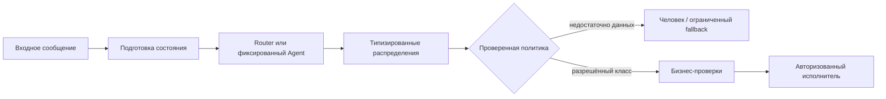
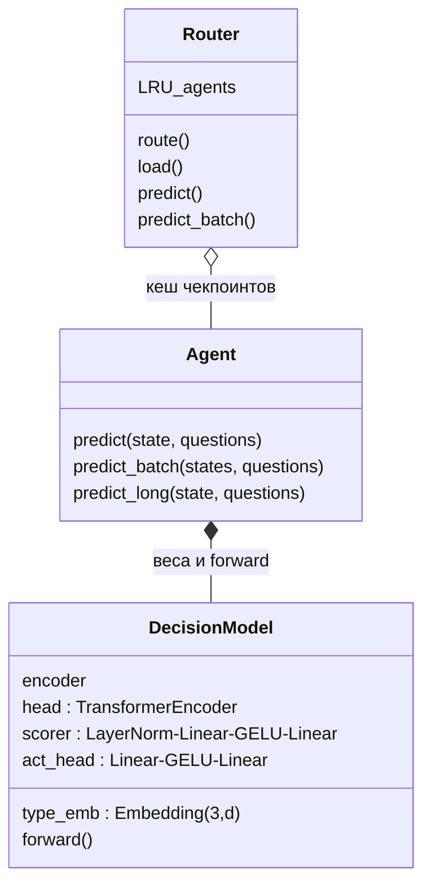
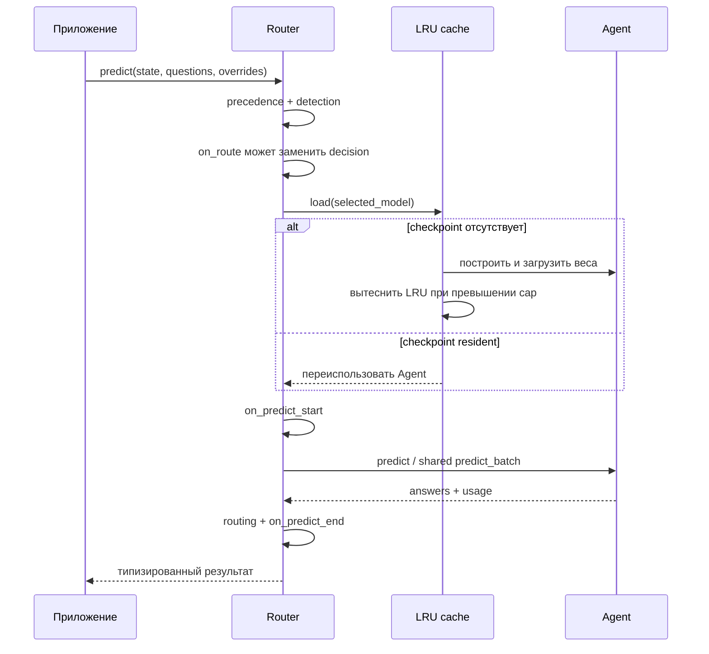
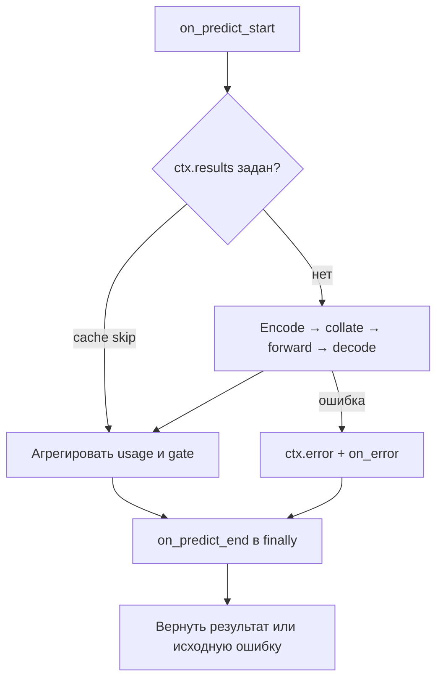

# Laya: устройство, API и официальная экосистема

Знакомство с моделью часто начинается с нескольких строк кода. Они запускаются, на экране появляются числа, но за этим ещё не приходит понимание, что именно произошло. Это руководство написано для того, чтобы пройти этот путь дальше: разобраться, что Laya читает, как выбирает ответ и почему даже уверенный результат иногда требует проверки.

Сначала мы рассмотрим обычное обращение клиента, затем постепенно перейдём к внутреннему устройству модели, формулам и работе приложения. Практическое продолжение находится в [02_PRODUCTION.md](02_PRODUCTION.md): там разобраны установка, шесть собственных сценариев, HTTP-сервис, Docker и проверка качества. Каталоги `production/` и `examples/` в этой папке содержат наш прикладной код, а ссылки на GitHub ведут к официальным исходникам Laya. Это два связанных, но разных набора примеров.

> Здесь описана Laya **0.4.21** по исходникам с Git SHA **`0565524a27bcb9821bcd7c42aaf49d925f6f8560`**. Фиксация версии нужна, чтобы читатель мог найти именно тот код, о котором идёт речь. При подготовке веса не скачивались, инференс и обучение не выполнялись. Приведённые измерения взяты из указанных официальных источников либо из работ, на которые они ссылаются. Учебный вывод и опубликованная скорость не являются обещанием такого же результата на вашей машине.

## Оглавление

1. [Что делает Laya](#1-что-делает-laya)
2. [Три чекпоинта и загрузка](#2-три-чекпоинта-и-загрузка)
3. [Устройство одного решения](#3-устройство-одного-решения)
4. [Три примитива и контракт результата](#4-три-примитива-и-контракт-результата)
5. [Математика и достоверность вероятностей](#5-математика-и-достоверность-вероятностей)
6. [Состояния, батчи и длинные документы](#6-состояния-батчи-и-длинные-документы)
7. [Router: выбор, объяснения и память](#7-router-выбор-объяснения-и-память)
8. [Схемы, Pydantic и готовые вопросы](#8-схемы-pydantic-и-готовые-вопросы)
9. [Инструменты и hooks](#9-инструменты-и-hooks)
10. [Интеграции, CLI, HTTP, MCP и порты](#10-интеграции-cli-http-mcp-и-порты)
11. [Backends, производительность и измерения](#11-backends-производительность-и-измерения)
12. [Обучение и оценка](#12-обучение-и-оценка)
13. [Безопасность, ограничения и лицензии](#13-безопасность-ограничения-и-лицензии)
14. [Исправления объяснений DeepSeek](#14-исправления-объяснений-deepseek)
15. [Карта официальных примеров 01–41](#15-карта-официальных-примеров-0141)
16. [Дополнительные источники и навигация](#16-дополнительные-источники-и-навигация)

## 1. Что делает Laya

Представим службу поддержки, которая получает сообщение: «Сумму списали дважды. Пожалуйста, верните лишний платёж». До ответа клиенту программе нужно решить несколько разных задач: выбрать отдел, заметить просьбу о возврате и оценить срочность. Для этого не обязательно сочинять письмо. Достаточно ответить на заранее заданные вопросы и показать, насколько однозначным получился каждый выбор. Именно такую работу выполняет Laya.

Чтобы понять её устройство, сначала разделим программу и **модель**. Программа задаёт порядок действий: принимает текст, готовит вход, вызывает вычисления и оформляет результат. Модель — вычислительная система с большим набором числовых параметров, которые называют **весами**. Во время **обучения** эти числа постепенно изменяют так, чтобы ответы на учебных примерах лучше соответствовали целевым ответам. При обычном использовании, или **инференсе**, веса уже не меняют: по новому входу вычисляют прогноз. Прогноз здесь означает оценку вариантов, а не предсказание будущего. Модель может оценивать уже произошедшее событие, например наличие явной просьбы в письме.

Веса не являются таблицей всех возможных обращений. Они сохраняют выученные закономерности, которые могут переноситься на незнакомый текст, а могут и не переноситься. Поэтому даже аккуратно обученная модель ошибается на двусмысленной формулировке, незнакомом языке или отсутствующем факте. Сохранённый комплект весов и настроек называют **чекпоинтом** — снимком модели, который можно загрузить и использовать повторно. Дальше мы разберём три опубликованных снимка Laya и увидим, почему они не взаимозаменяемы.

Внутри Laya работает **энкодер**: часть модели, которая превращает элементы текста в наборы чисел с учётом соседнего содержания. Такой набор чисел называют вектором; его координаты не нужно читать как готовые человеческие признаки. Важно другое: представление слова «возврат» зависит от того, говорится ли «прошу возврат» или «возврат не нужен». Laya совместно читает состояние — факты, переданные приложением, — формулировку вопроса и описания допустимых вариантов. Затем из полученных представлений вычисляет распределение: каждому варианту соответствует числовая масса, а сумма масс до округления равна единице.

Поэтому Laya называют **неавторегрессионным движком типизированных решений**. «Типизированный» означает, что заранее известен вид ответа: один вариант, уровень шкалы или ответ да/нет. «Неавторегрессионный» означает отсутствие цикла «предсказать следующий фрагмент текста, добавить его к ответу, предсказать следующий». Такой цикл характерен для генеративных больших языковых моделей, или LLM. Laya не пишет свободный ответ, не выдаёт цепочку рассуждений и не извлекает произвольную строку вроде номера счёта. Она не чатбот, даже когда входом служит история разговора.

Не является она и векторной базой. В поиске по числовым представлениям, который часто называют embedding retrieval, обычно заранее сохраняют представления документов и ищут ближайшие к запросу. Здесь вопрос, варианты и состояние участвуют в совместном вычислении. Это позволяет задавать новые конечные решения без превращения каждого из них в отдельный поисковый индекс, но не делает результат доказательством.

Ответ ограничен схемой: если разрешены только `billing`, `technical` и `other`, четвёртая выдуманная метка не появится. Однако допустимая метка тоже может быть неверной. Модель способна выбрать `billing` вместо `technical`, не заметить отрицание или дать высокую вероятность ошибочному варианту. Формальная правильность структуры и правильность смысла — разные свойства.

Отсюда практический принцип: **модель оценивает; приложение разрешает действие**. Вопрос «клиент просит возврат?» проверяет содержание обращения, а не право на возврат по договору. Для перечисления денег нужны отдельные проверки операции и полномочий. Точно так же вопрос «похоже на попытку подменить инструкции?» не заменяет разграничение доступа. Laya полезна перед человеком, более дорогой языковой моделью или программой бизнес-правил, когда между оценкой и исполнением остаётся явная граница.



На диаграмме эта граница проходит между распределениями и исполнителем. **Политика** здесь — написанные приложением правила, по которым результат принимают, отправляют человеку или отклоняют; это не ещё одна скрытая способность модели. Запасной путь, или fallback, может означать передачу человеку либо более ограниченный способ обработки. Даже высокое `answer_confidence` не заменяет проверку прав, баланса, идемпотентности — защиты от повторного исполнения одной операции — и допустимости действия. В наших сценариях внешние действия вообще не выполняются. С этой границей в виду можно выбирать, какую именно модель загружать.

## 2. Три чекпоинта и загрузка

Универсального «файла Laya для всего» нет. Англоязычное обращение, многоязычный поток и специализированная обработка счетов требуют разных исходных моделей и обучения. Официальная [таблица моделей](https://github.com/NandhaKishorM/laya/blob/0565524a27bcb9821bcd7c42aaf49d925f6f8560/README.md) и реестр `laya/router.py` различают три чекпоинта. Router — компонент, который выбирает один из них по правилам; сам по себе он не добавляет выбранной модели новых знаний.

| Логическое имя Router | Публикация на Hub | Основа; размер | Обычный бюджет всей последовательности | Назначение |
|---|---|---|---|---|
| `english` | `convaiinnovations/laya` | ModernBERT-large; 421M | 512 | Общие англоязычные решения |
| `multilingual` | `convaiinnovations/laya-multilingual` | mmBERT-base; 322M | 1024; поддерживается расширение до 8192 | 100+ языков; это охват модели, не гарантированная одинаковая точность |
| `typed-decisions` | `convaiinnovations/laya-typed-decisions` | ModernBERT-large; 421M | 1024 | Специализация на четырёх typed-decisions workflows |

Число 421M означает примерно 421 миллион параметров, а 322M — примерно 322 миллиона. Это характеристика размера, не оценка качества конкретной задачи. **Бюджет последовательности** задаёт, сколько элементов входа модель получает за один проход. Эти элементы называют токенами: один токен может соответствовать слову, части слова или знаку, поэтому 1024 токена не равны 1024 словам. В общий бюджет входят и состояние, и вопрос, и варианты ответа.

Размеры и окна в таблице — свойства официальных публикаций, а не замер этой машины. `head_max_len` задаёт ориентир для части входа с вопросом и вариантами: у multilingual он обычно 256, у English — 192. Реальное место для состояния зависит от того, сколько места заняла построенная вопросная часть. В §6 мы разберём обрезку подробно. Пока важно не обещать чтение полного документа по одному числу `max_len`. Typed-decisions также не становится многоязычной специализацией только потому, что Router направил в неё немецкий или русский текст.

Публикации хранятся на Hub — сервисе распространения моделей Hugging Face. Кроме отдельных репозиториев есть **bundle**, то есть комплект в одном репозитории: корень `convaiinnovations/laya` содержит English, подкаталоги `multilingual` и `typed-decisions` — другие модели. В этой версии `Router.DEFAULT_MODELS` использует такой комплект, а `STANDALONE_MODELS` содержит отдельные публикации. Их ревизии, то есть идентификаторы сохранённых состояний репозитория, различаются. Нельзя подставить ревизию bundle к отдельной публикации и считать, что выбран тот же набор файлов.

Для перечисленных ниже версий отдельных моделей при подготовке проверялись файлы настроек JSON, но не сами веса. JSON — текстовый формат записи словарей, списков, строк и чисел; в таких файлах удобно хранить конфигурацию. Числа температуры управляют тем, как оценки модели превращаются в вероятности. Их смысл мы разберём в §5, а пока важно заметить последнее правило таблицы: специальная настройка для группы вопросов может перекрывать общую настройку типа.

| Версия файлов модели | max/head | Температуры по типам | На что обратить внимание |
|---|---|---|---|
| English `7b928d828b7b0e022f929d9bd2e44165aa270148` | 512/192 | `[1.636903, 1.251430, 1.9833995]` | У группы `noul:2` температура `1.9833995`; её настройка имеет приоритет |
| Multilingual `1720e3e3357cfe1e281542e223f8273b0890ca34` | 1024/256 | `[1, 1, 1]` | Таблица групп пуста; это не подтверждение калибровки на ваших данных |
| Typed `e929ae5cf69bc34259cd2f95c9e91145b818b1f0` | 1024/256 | `[1.014802, 1.037426, 1.057513]` | Сохранились настройки групп исходной модели: `noul:2=1.9833995`, `choice:3-5=1.7601519`; поэтому считать T(noul)=1.057513 неверно |

Проверяемые источники: [English config](https://huggingface.co/convaiinnovations/laya/resolve/7b928d828b7b0e022f929d9bd2e44165aa270148/rl_agent_config.json), [multilingual config](https://huggingface.co/convaiinnovations/laya-multilingual/resolve/1720e3e3357cfe1e281542e223f8273b0890ca34/rl_agent_config.json), [typed config](https://huggingface.co/convaiinnovations/laya-typed-decisions/resolve/e929ae5cf69bc34259cd2f95c9e91145b818b1f0/rl_agent_config.json). Эти SHA относятся к файлам моделей, не к Git SHA исходного кода. Bucket — группа вопросов, например все бинарные `noul` или `choice` с 3–5 вариантами; precedence означает приоритет настройки такой группы. Inherited override — настройка, оставшаяся от исходной модели после дообучения. Именно поэтому у typed нельзя просто прочитать третье число массива и объявить его действующей температурой noul. Числа таблицы не являются результатами калибровки на нашем трафике.

Есть и второе независимое измерение версии: библиотеки, которые исполняют модель. README описывает новый стек Transformers 5 / Torch 2.14, тогда как [pyproject.toml](https://github.com/NandhaKishorM/laya/blob/0565524a27bcb9821bcd7c42aaf49d925f6f8560/pyproject.toml) декларирует нижние границы `torch>=2.0.0`, `transformers>=4.48.0`. Torch выполняет числовые вычисления, Transformers предоставляет архитектуру энкодера. Возможность установить пакет не доказывает работоспособность каждой новой функции на любой версии выше минимальной. Специальные маски и экспорт имеют отдельные ограничения. Для рабочего сервиса нужен согласованный закреплённый набор зависимостей, а не смесь команд из разных поколений README.

### 2.1. Прямой Agent

Прямой `Agent` удобен, если модель уже выбрана приложением. Его API — программный интерфейс, то есть названия вызовов и правила передаваемых данных, — позволяет загрузить чекпоинт и задать словарь вопросов. В примере ниже ключ `refund_requested` станет идентификатором ответа. Английский текст критериев описывает две стороны решения, а не командует выполнить возврат.


```python
import laya

# Hub: загрузит артефакты, если их ещё нет в кеше.
agent = laya.load("convaiinnovations/laya", device="cpu")
# Альтернативы, не требующие смены predict API:
# agent = laya.load("convaiinnovations/laya", subfolder="multilingual")
# agent = laya.load("convaiinnovations/laya-multilingual")
# agent = laya.load("/srv/models/laya-multilingual", device="cpu")

questions = {
    "refund_requested": {
        "type": "noul",
        "instructions": "Does the customer explicitly request a refund?",
        "criteria": {
            "false": "No explicit request for money to be returned.",
            "true": "The customer explicitly asks for money to be returned.",
        },
    }
}
# Выполнять только там, где разрешена реальная загрузка и инференс:
# result = agent.predict({"body": "Please refund the duplicate charge."}, questions)
```

Это пример использования API, а не выполненная здесь запись запуска. `laya.load()` возвращает Agent; `Router()` создаёт объект выбора с ленивой загрузкой, при которой веса загружаются лишь тогда, когда потребовалась модель. `device` задаёт устройство вычислений. В этих исходниках при `device=None` порядок автоматического выбора — **CUDA → MPS → XPU → CPU**, если соответствующий backend доступен. Backend означает способ исполнения вычислений: CUDA используется с подходящими NVIDIA GPU, MPS — с поддерживаемыми устройствами Apple, XPU — с поддерживаемыми ускорителями Intel; CPU означает центральный процессор. XPU можно указать и явно. Уточняйте фактически выбранное устройство, а не только пожелание в настройках: старые тексты upstream, то есть исходного проекта, местами перечисляют лишь CUDA/MPS/CPU.

### 2.2. Что нужно для offline

Загрузка по локальному пути полезна, когда сервер не должен обращаться в сеть. Однако локальный чекпоинт — не один `model.safetensors` с весами. Нужны также `rl_agent_config.json`, каталог `encoder/` с конфигурацией базовой сети и `tokenizer/` с файлами токенизатора. **Токенизатор** — программа с заданным словарём и правилами, которая переводит текст в номера токенов. Иные правила изменят вход модели даже при тех же весах, поэтому переносить нужно полный каталог. Абсолютный путь или явно локальный `./...` не должен превращаться в поиск репозитория на Hub; если локального каталога нет, возникает `FileNotFoundError`.

Для изолированной среды заранее, **на разрешённой машине**, скачивают проверенную ревизию, переносят файлы и сверяют SHA256 — контрольную сумму, зависящую от содержимого файла. `HF_HUB_OFFLINE=1` запрещает сетевой запасной путь Hub, но не создаёт недостающие файлы. Кеш — сохранённые для повторного использования данные — тоже нужно переносить целиком. Одних символических ссылок недостаточно: они лишь указывают на реальные blob-файлы, которых на новой машине может не быть. Явный каталог и manifest, то есть перечень файлов, версий и контрольных сумм, обычно легче воспроизвести.

`revision=` закрепляет версию Hub; `LAYA_REVISION=reviewed` выбирает проверенные SHA из `laya/revisions.py`. Без такого закрепления обычная загрузка может получить обновление. Выбор ревизии и проверка digest решают разные задачи: первый выбирает снимок, вторая сверяет доставленные байты до загрузки. Наш runtime — код подготовки и запуска моделей — дополнительно использует `models.lock.json`; локальные overrides, то есть явные замены настроек, описаны в [02_PRODUCTION.md](02_PRODUCTION.md).

### 2.3. Не переносите `_common` в приложение

При чтении официальных упражнений легко принять вспомогательную функцию за публичный интерфейс библиотеки. Скрипты 02–41 импортируют `examples/_common.py`, но его `load` принимает **логические имена** `english`, `multilingual`, `typed-decisions`, а не произвольный путь. Он ищет чекпоинт в `models/` относительно собственного файла, затем выбирает bundle Hub и subfolder. Это другой контракт, чем у `laya.load(path)`.

Команда `python /path/to/laya/examples/02_hello_world_decision.py` работает из другого рабочего каталога потому, что Python добавляет каталог скрипта в `sys.path`, список путей поиска модулей, а helper вычисляет ROOT по `__file__`, расположению своего файла. Он также ставит ROOT впереди путей, чтобы `laya/email.py` не подменил стандартный `email`. Одно копирование `from _common import load` в notebook — интерактивный документ с исполняемыми ячейками — эту структуру не создаёт. В приложении используйте публичный API; наши примеры обращаются к собственному `production.runtime`. Теперь, когда происхождение загружаемых файлов понятно, посмотрим, что происходит внутри одного вызова.

## 3. Устройство одного решения

Пользователь видит один словарь вопросов, но модель не получает его как таблицу со специальной логикой Python. Сначала библиотека строит текстовую последовательность для каждого вопроса. Источник истины для этого пути — [common.py](https://github.com/NandhaKishorM/laya/blob/0565524a27bcb9821bcd7c42aaf49d925f6f8560/laya/common.py), особенно `build_head`, `build_sequence`, `DecisionModel.forward`; превращение числовых выходов в публичный ответ описано в [agent.py](https://github.com/NandhaKishorM/laya/blob/0565524a27bcb9821bcd7c42aaf49d925f6f8560/laya/agent.py).

### 3.1. Последовательность и маски

Пусть мы одновременно спрашиваем отдел и наличие просьбы о возврате. Для **каждого вопроса** строится отдельная строка следующего вида. Служебный `[CLS]` отмечает общее представление последовательности, `[SEP]` разделяет части, а `<type>` сообщает тип решения.

```text
[CLS] <type> question: <instructions> [SEP]
[MASK] <option 0> [MASK] <option 1> ... [SEP]
<serialized state> [SEP]
```

`[MASK]` здесь отмечает позицию варианта. Это не просьба заполнить пропущенное слово, хотя название унаследовано от моделей с такой учебной задачей. После чтения входа у каждого токена есть скрытый вектор — внутреннее числовое представление. Из вектора на позиции `[MASK]` вычисляют одно число для соответствующего варианта. Это число называют **логитом**: оно ещё не вероятность и само по себе может быть отрицательным или больше единицы. Вставленные пользователем mask-токены заменяются пробелами, чтобы текст не добавлял ложных технических позиций.

Состояние-строка используется как есть; словарь или список сериализуется, то есть превращается в текст JSON, с `ensure_ascii=False`, без обязательного превращения русских букв в escape-последовательности. `choice` превращает пары в строки вида `label: description`, `score` — в `level i: description`, а `noul` всегда сохраняет порядок `[false, true]`. Структурированные критерии также становятся JSON, а не специфической печатной записью Python. Ключи и порядок полей поэтому являются частью прочитанного текста, а не невидимыми метаданными.

Слово **маска** означает правило, которое разрешает одни позиции или связи и выключает другие. В реализации несколько таких правил, и путать их нельзя. `attention_mask` отделяет настоящие токены от padding — пустого дополнения, которым короткие строки выравнивают до длины длинной. Энкодер читает контекст в обе стороны; это bidirectional attention, не causal mask генератора, скрывающая будущие токены.

Другие маски решают более узкие задачи. `marker_pos` хранит позиции вариантов, а `marker_mask` выключает фиктивные варианты при совместной обработке вопросов с разным количеством ответов K. `src_key_padding_mask` скрывает пустое дополнение от добавленного преобразующего слоя. Специальные option masks разграничивают внимание между вариантами в обученном **parallel layout** (§3.4); они не включены автоматически у всех опубликованных весов. Таким образом, токен `[MASK]` и маска внимания имеют разные роли: первый помечает место, вторая ограничивает вычислительные связи.

### 3.2. Encoder, transformer head, MLP и action



Диаграмма показывает состав объектов, а не полный перечень методов. Вход проходит несколько последовательных этапов. Сначала базовая сеть, или backbone, ModernBERT/mmBERT создаёт `last_hidden_state`: по одному вектору размерности `d` на токен. Размерность — количество координат вектора. Далее к каждому вектору добавляется embedding типа вопроса: обученное числовое представление одного из трёх типов.

Если `head_layers > 0`, результат обрабатывают дополнительные `TransformerEncoderLayer`. Transformer — устройство сети, в котором токены обмениваются информацией через внимание, а затем каждый вектор отдельно проходит нелинейное преобразование. Здесь **вся последовательность**, а не только маркеры, проходит такую обработку. У слоя `norm_first=True`: нормализация масштабов выполняется перед основными преобразованиями. Внутренний блок FFN преобразует координаты вектора с промежуточной шириной `4d`; число каналов внимания, attention heads, равно `max(1, d // 64)`. Несколько каналов позволяют вычислять разные связи параллельно; это не отдельные ответы пользователю.

Здесь слово head употребляется в двух смыслах. Attention head — один канал вычисления связей **внутри** слоя, а дополнительная Laya head — целый блок слоёв **после** базового энкодера. FFN, feed-forward network, обрабатывает каждый токен отдельно: сначала расширяет его набор координат, затем сужает обратно, не смешивая соседние токены напрямую. Внимание отвечает за обмен между позициями, FFN — за преобразование содержимого каждой позиции. Их нельзя считать двумя названиями одной операции.

Затем `marker_pos` выбирает векторы вариантов. Один общий scorer — блок вычисления оценки — применяет `LayerNorm(d) → Linear(d,d) → GELU → Linear(d,1)` и выдаёт логит каждого варианта. `Linear` означает обученное линейное преобразование чисел, `GELU` — нелинейную функцию, позволяющую сети описывать не только линейные зависимости, а `LayerNorm` выравнивает масштаб координат. Такой небольшой набор слоёв называют MLP, многослойной полносвязной сетью. Фиктивным вариантам назначают очень отрицательные логиты, чтобы они не получали значимой вероятности.

«Полносвязная» означает, что у такого линейного слоя каждый выход может зависеть от всех входных координат. Нелинейное преобразование меняет числа не по одному постоянному коэффициенту: его отклик зависит от самих значений. Если бы между линейными слоями не было нелинейности, их цепочка свелась бы к одному линейному преобразованию. Это и объясняет, зачем MLP содержит GELU, а не только несколько умножений на обученные матрицы.

Есть и отдельная вспомогательная ветвь `act_head`. Она получает вектор CLS и четыре признака: наибольшую вероятность, разрыв между первой и второй, нормированную энтропию — меру разброса, которую мы вычислим в §5, — и `K/255`. Softmax для этих признаков превращает логиты в распределение; `detached` означает, что при обучении обратное изменение весов не проходит через эту копию признаков к исходным логитам. MLP со скрытой шириной 256 выдаёт action logits.

Поэтому объяснение «три независимые головы: классификатор, регрессор и бинарный sigmoid» **не соответствует коду**. Здесь общая оценка вариантов, представление типа и разные правила чтения одного распределения. Регрессия обычно означает прогноз числовой величины, но `score` устроен как распределение по уровням, а не отдельный линейный регрессор. Sigmoid — функция преобразования одного числа в диапазон 0…1; отдельная такая noul-голова не обязательна. Действительно отдельна вспомогательная action head. Её `action.act_probability` не равна уверенности лучшего варианта и не разрешает пользовательскую операцию. Количество action-выходов связано с `act_costs` в config; переносимость и качество этой ветви нужно проверять отдельно.

### 3.3. Что означает один forward

**Forward** — один прямой проход входных чисел через сеть без изменения весов. `predict(state, Q)` обычно собирает Q строк в **батч**, то есть пачку, которую устройство обрабатывает совместно. Но состояние присутствует в каждой строке и проходит энкодер Q раз внутри батча. Если вопросов три, повторяется не только их короткая часть: документ участвует в трёх полных последовательностях.

Токенизацию общего state можно переиспользовать, а вопросные токены кешируются в рамках вызова. Однако готовые скрытые представления документа не становятся общим единожды вычисленным контекстом. Один запуск GPU kernels — низкоуровневых вычислительных процедур на графическом процессоре — и одно чтение документа сетью не одно и то же. При разбиении по `batch_size` или бюджету токенов будет несколько forward passes. Это различие определяет и смысл `usage`, и реальную стоимость множества вопросов.

### 3.4. Порядок вариантов и parallel options

Порядок вариантов кажется косметикой, пока не вспоминаешь, что модель читает последовательность. Опубликованные чекпоинты по умолчанию обучены на **sequential layout**, последовательном расположении. Номер позиции и взаимодействие с соседними вариантами могут влиять на оценку. `option_order` меняет показанный порядок, а `unpermute_probs` возвращает вероятности к исходным индексам. Иначе перестановка могла бы случайно прикрепить старую вероятность к новой метке.

Для другого режима в коде есть `option_layout: "parallel"`. В нём варианты используют общие относительные позиции. Option mask запрещает прямое внимание к токенам другого варианта, но оставляет общую часть и свой вариант. Local attention, внимание в ограниченном окне, вычисляет соседство по position ids, номерам позиций, а не по физическому месту в склеенной строке. Дополнительная head не имеет собственного позиционного кодирования. Вместе это предназначено для перестановочной эквивариантности: при перестановке вариантов их логиты должны переставляться вместе с ними, а не менять смысл.

Однако формат — часть обучения весов, а не бесплатный переключатель ускорения. Включить parallel у старого sequential чекпоинта и объявить корректность нельзя. Поддержка отдельных масок для разных типов слоёв ModernBERT зависит и от API Transformers. Для существующей модели полезны проверки перестановок и `OptionStabilityHook`, но несколько прогонов стоят дороже одного. Стабильная ошибка остаётся ошибкой: устойчивость порядка не доказывает правильность ответа.

### 3.5. Внутреннее устройство backbone и размер вычислений

Теперь можно отделить базовый энкодер от добавленных слоёв Laya. Проверенные конфигурации [English encoder](https://huggingface.co/convaiinnovations/laya/resolve/7b928d828b7b0e022f929d9bd2e44165aa270148/encoder/config.json) и [multilingual encoder](https://huggingface.co/convaiinnovations/laya-multilingual/resolve/1720e3e3357cfe1e281542e223f8273b0890ca34/encoder/config.json) содержат `model_type=modernbert`. У mmBERT совместимая архитектура, но другое многоязычное обучение и токенизатор. Мультиязычность поэтому не возникает из незаметного перевода запроса перед обработкой.

| Параметр backbone | English ModernBERT-large | Multilingual mmBERT-base |
|---|---|---|
| Encoder layers | 28 | 22 |
| Hidden size d | 1024 | 768 |
| Attention heads encoder | 16 | 12 |
| FFN intermediate size из config | 2624 | 1152 |
| Tokenizer vocabulary | 50368 | 256000 |
| Local attention window | 128 | 128 |
| Full-attention cadence | Каждые 3 слоя, начиная с первого | Каждые 3 слоя, начиная с первого |
| Backbone max positions | 8192 | 8192 |

Таблица описывает **энкодер**, не добавленную Transformer head Laya: у последней ширина FFN равна `4d`. Например, при `d=1024` это 4096, а не указанное для базовой сети 2624. Поле `architectures=ModernBertForMaskedLM` в config отражает происхождение базовой модели. Задача MaskedLM при обучении связана с восстановлением скрытых токенов, но Laya берёт внутренние представления энкодера, а не запускает такой декодер как свободный генератор. Аналогично, техническая возможность backbone хранить позиции до 8192 не отменяет рабочего `max_len=512/1024` чекпоинта и не доказывает качество English на расширенном входе.

Слои чередуют глобальное и локальное двустороннее внимание. Локальный слой напрямую связывает близкие токены, глобальный позволяет обмен между удалёнными участками. Концептуальная стоимость полного внимания имеет член $O(L^2d)$, локального — $O(Lwd)$, а линейные преобразования и FFN добавляют $O(Ld^2)$. Здесь `L` — число токенов, `w` — ширина окна, `d` — размерность вектора. Запись `O(...)` показывает характер роста, а не точное время в миллисекундах. Если для иллюстрации удвоить `L` при неизменном `d`, квадратичный член увеличится в четыре раза, линейный — в два. Поэтому нельзя ни объявить все вычисления строго квадратичными, ни считать длинный контекст бесплатным. Дополнительная head тоже расходует память и время. При `B` состояниях и `Q` вопросах обрабатывается примерно `BQ` строк с учётом выравнивания: для расчёта, 8 состояний × 3 вопроса дают 24 строки.

Порядок слов нужно сообщить сети отдельно от их содержания. В актуальных configs это делают в том числе `rope_parameters` для `full_attention`/`sliding_attention`. **RoPE**, rotary position embeddings, — способ ввести положение через вращение пар координат. Для пары $(x_{2j},x_{2j+1})$ применяется матрица $R(\theta_{m,j})$, где $\theta_{m,j}=m\,\omega_j$. Здесь `x` — исходный вектор, `j` выбирает пару координат, `m` — позиция токена, `ω_j` — частота вращения для этой пары, а `R` — обычное двумерное вращение на угол `θ`. Например, только для понимания геометрии: пара `(1, 0)` при угле 90° превратится в `(0, 1)`. Это не значения частот реального чекпоинта.

Вращают query/key, числовые представления для вычисления связей внимания. Их скалярное произведение — сумма произведений соответствующих координат — после вращения зависит от относительного смещения позиций. Поэтому сеть получает информацию о расстоянии, не читая число позиции как слово. Это объяснение механизма, не рекомендация вручную менять частоты обученной модели. Разные версии Transformers читают positional config по-разному; опорное окружение комплекта использует Transformers 5.0.0, соответствующий `transformers_version` этих encoder configs. Одного соблюдения нижнего порога зависимости недостаточно для одинаковой интерпретации нового config. Теперь у нас есть путь от текста к логитам; осталось понять, как из него получаются три вида ответа.


## 4. Три примитива и контракт результата

Три **примитива** — это три базовые формы решения, из которых приложение собирает свою схему. Отдел обработки удобно выбрать через `choice`, срочность по упорядоченной рубрике — через `score`, а наличие явной просьбы — через `noul`. Они отличаются смыслом ответа, а не необходимостью загружать три независимые сети.

### 4.1. Choice

Когда действие должно попасть ровно в одну очередь, нужен взаимоисключающий выбор. Вопрос ниже разрешает только три метки и объясняет, что каждая означает.

```python
q = {"department": {
    "type": "choice",
    "instructions": "Which department should handle the request?",
    "criteria": {
        "billing": "Invoices, duplicate charges and refunds.",
        "technical": "Bugs, outages and login failures.",
        "other": "Requests outside the named departments.",
    },
}}
```

Ключи словаря задают допустимые ответы, значения — их смысл. Имена не обладают скрытой магией: энкодер читает и `billing`, и описание. Если написать только `payment errors`, техническая ошибка оформления платежа пересечётся с финансовой проблемой. Лучше заранее решить, кто обрабатывает такие случаи, и отразить границу в описаниях. Почти одинаковые критерии не позволяют честно ожидать однозначного выбора.

Ответ содержит `type`, выбранную `choice`, словарь `probabilities` по всем меткам, две оценки уверенности `confidence` и `answer_confidence`, а также `action`. Победитель определяется через **argmax**: берётся индекс или метка с наибольшей вероятностью. Это дискретный выбор из входного словаря, не генерация новой метки. Если письмо одновременно содержит просьбу о возврате и угрозу уйти к конкуренту, независимые признаки нельзя выразить одним таким выбором: нужны отдельные noul-вопросы.

### 4.2. Score

Иногда отдел уже выбран, но очередь нужно упорядочить по срочности. Тогда полезна рубрика — явно описанная шкала уровней. Для `score` поле `criteria` представляет собой **упорядоченный список** от меньшего уровня к большему. Уровни нумеруются с нуля. Поэтому три описания дают диапазон 0…2, а не 1…3; в `legend` и `probabilities` ключи записаны строками `"0"`, `"1"`, `"2"`.

Поле `score` возвращает математическое ожидание, то есть средний индекс с весами-вероятностями. Оно может быть дробным и само не является вероятностью. Для иллюстрации, распределение `[0, 1, 0]` даёт среднее 1.0, но `[0.5, 0, 0.5]` даёт то же число: первая ситуация однозначно указывает середину, вторая колеблется между крайностями. По одному среднему эти случаи не различить, поэтому показывайте распределение.

Наиболее вероятный уровень называют модой, или modal class. `round(score)` не обязан с ней совпадать; когда нужен ровно один класс, выбирают argmax вероятностей. Среднее полезно для расчётов лишь тогда, когда расстояния между уровнями имеют смысл для задачи. Деление на `K-1`, где `K` — количество уровней, переводит шкалу в 0…1, но не превращает срочность и тяжесть нарушения в одинаковые величины.

### 4.3. Noul

Для вопроса «есть ли явная просьба вернуть деньги?» стороны естественно обозначить как «нет» и «да». `noul` возвращает **P(true)** — оценку вероятности положительной стороны. Порядок всегда `[false, true]`. Необязательные `criteria` описывают каждую сторону; `labels` могут изменить показываемые названия, но не этот порядок.

Полезно описать обе стороны симметрично: «явно просит возврат» и «явной просьбы нет», а не внушать положительный ответ длинным перечнем поводов. При этом отсутствие просьбы в прочитанном фрагменте ещё не доказывает её отсутствия в обрезанном письме. В noul-ответе нет отдельного публичного словаря `probabilities`: бинарное распределение восстанавливается как `[1-noul, noul]`, приблизительно из-за округления. Например, условное `noul=0.2` означает массы 0.8 для false и 0.2 для true.

Порог 0.5 лишь выбирает более вероятную сторону при симметричной цене ошибок. Если ошибочно разрешённый возврат дороже передачи обычного письма человеку, правило решения должно быть другим. Это правило принадлежит приложению; модель не назначает безопасный порог для денег или безопасности.

### 4.4. Общий payload и usage

**Payload** — весь объект передаваемых данных, а `usage` — сведения об обработанном входе. Обычный результат представляет собой dict с `model`, `answers`, `usage`; Router добавляет `routing`. Идентификаторы вопросов становятся ключами `answers`, поэтому стабильные IDs связывают запрос и результат. Прежде чем читать только победителя, полезно проверить `usage`: модель могла выбрать уверенно, но по неполному состоянию.

| Поле | Что означает |
|---|---|
| `input_tokens` | Сумма входных токенов строк данного результата: state повторяется для каждого вопроса. Это не размер одного контекста |
| `output_tokens` | **0**: нет генерации токенов. Это не отсутствие числовых выходов и не нулевая стоимость вычислений |
| `state_tokens` | Размер полного сериализованного state в токенах |
| `state_tokens_dropped` | Худший, то есть максимальный, объём отброшенного state среди вопросов |
| `truncated` | Было ли отброшено состояние хотя бы для одного вопроса |
| `truncated_questions` | IDs затронутых вопросов |
| `options` | Появляется при схлопывании разных вариантов в один и тот же token span; содержит total/distinct/tokens_per_option |

Если для условного состояния длиной 100 токенов задаются три вопроса, в `input_tokens` состояние учитывается трижды плюс отдельные вопросные части. `state_tokens` при этом описывает полный state один раз. `output_tokens=0` сообщает не отсутствие ответа, а отсутствие порождённого текста: числовые выходы всё равно потребовали вычислений.

Вероятности публикуются с округлением до четырёх знаков. Их сумма может слегка отличаться от единицы, а 0.0000 не обязательно является математическим нулём. Из такого объекта нельзя восстановить точные логиты или требовать побитового совпадения заново посчитанной энтропии. Строгий режим Jev HTTP намеренно удаляет часть дополнительных полей (§10); клиент должен знать, какой именно контракт получает. Теперь можно разобрать числовой смысл этих полей, не смешивая формат ответа с достоверностью решения.

## 5. Математика и достоверность вероятностей

Математика нужна здесь не для самостоятельного написания нейросети. Она помогает ответить на практические вопросы: почему два поля уверенности различаются, что именно меняет калибровка и какой порог имеет смысл проверять. Все ручные числа в этой главе служат расчёту, а не изображают результаты запуска модели.

В формулах дальше встречаются две обратные операции. Экспонента `exp(x)` означает возведение числа `e≈2.71828` в степень `x`; натуральный логарифм `ln y`, также записанный `log y`, спрашивает, в какую степень нужно возвести `e`, чтобы получить `y`. Поэтому `exp(0)=1`, `ln(1)=0`, а `exp(ln 3)=3`. Квадратный корень `√a` — неотрицательное число, квадрат которого равен `a`. Этого достаточно, чтобы следить за приведёнными расчётами, не изучая отдельно математический анализ.

### 5.1. Attention

Внимание позволяет одному токену собрать информацию из других. Например, представление варианта «возврат запрошен» должно учитывать не только слово «refund», но и отрицание рядом с ним. Для одного канала внимания концептуальная формула выглядит так:

$$\operatorname{Attention}(Q,K,V)=\operatorname{softmax}\left(\frac{QK^\top}{\sqrt{d_k}}+M\right)V.$$

`Q` — матрица query, числовых запросов от позиций; `K` — матрица key, числовых признаков, по которым ищется связь; `V` — матрица value, содержимого, которое будет смешано. Все три получают обученными преобразованиями исходных векторов. Здесь `K` означает матрицу ключей, а не количество вариантов из соседних разделов. Верхний знак `⊤` означает транспонирование, обмен строк и столбцов. Произведение `QKᵀ` даёт оценки связей каждой позиции с другими; `d_k` — число координат ключа одного канала. Деление на его квадратный корень сдерживает рост масштаба оценок.

`M` равна нулю для разрешённой связи и минус бесконечности для запрещённой. После сложения **softmax** превращает оценки каждой строки в неотрицательные доли с суммой один: берёт экспоненты и делит каждую на их общую сумму. Умножение на `V` создаёт взвешенную смесь содержимого. Для ручного примера пусть после деления и маски две оценки равны `0` и `ln 3`. Их экспоненты равны 1 и 3, веса — 0.25 и 0.75. Если соответствующие одномерные значения `V` равны 2 и 6, результат равен `0.25×2 + 0.75×6 = 5`. При запрещённой второй связи её вес станет нулём, и останется 2.

Эта формула объясняет смысл, но не требует хранить все промежуточные матрицы в памяти. SDPA, scaled dot-product attention, — библиотечная реализация такого масштабированного внимания; локальные окна и fused kernels, объединяющие несколько операций в одну процедуру, могут вычислять результат иначе. Двустороннее внимание позволяет вопросам, вариантам и состоянию влиять друг на друга. Токен `[MASK]` из формата входа не является матрицей `M`.

### 5.2. Logits и temperature softmax

После внимания общий scorer уже выдал по числу на вариант. Чтобы сравнивать их как распределение, нужна ещё одна нормировка softmax. Пусть вопрос имеет `K` вариантов, `z_i` — логит варианта с индексом `i`, а `T` — выбранная положительная температура:

$$p_i=\frac{\exp((z_i-z_{\max})/T)}{\sum_{j=0}^{K-1}\exp((z_j-z_{\max})/T)}.$$

`p_i` — итоговая вероятность, `z_max` — наибольший логит, `exp` — экспонента, а сумма в знаменателе проходит по всем индексам `j` от 0 до `K−1`. Вычитание максимума не меняет отношений экспонент, зато предотвращает переполнение при больших числах. Для расчёта возьмём два логита `0` и `ln 3`. При `T=1` получаются вероятности 0.25 и 0.75. При `T=2` отношение весов уже `1:√3`, поэтому вероятности примерно 0.366 и 0.634: победитель тот же, распределение менее острое.

Так действует temperature scaling, масштабирование температурой. При `T>1` распределение обычно мягче, при `0<T<1` — острее; положительное общее `T` сохраняет argmax в точной арифметике. Оно может улучшить соответствие вероятностей наблюдаемым частотам, но **не обучает выбирать правильный класс**. У `score` среднее способно измениться и без смены моды, потому что изменяются веса остальных уровней.

Фактическая температура выбирается по приоритету. Сначала ищется `temperature_by_options[temp_bucket(qtype,K)]`, иначе берётся `temperature[QTYPES[type]]`, где choice=0, score=1, noul=2. При распознанном переданном `lang` и настроенном `lang_temperatures` применяется языковая замена. Рабочее значение ограничивается диапазоном **[0.5, 5.0]**; такое ограничение называют clamp. Некорректные значения обрабатываются защитно, а `*_raw` сохраняет значения до ограничения. Поэтому число, записанное в config, не обязательно равно применённому. Особенно важно это для унаследованных buckets typed-чекпоинта из §2.

### 5.3. Что именно называется confidence

Когда в ответе рядом стоят `confidence` и `answer_confidence`, хочется прочитать оба поля как «вероятность правильного ответа». Но первое у choice/score описывает форму всего распределения. Для этого используется энтропия — мера того, насколько масса распределена между вариантами:

$$H(p)=-\sum_{i=0}^{K-1}p_i\log p_i.$$

`H` — энтропия, `p_i` — вероятность варианта, `K` — число вариантов, а `log` — натуральный логарифм. Суммируются вклады всех вариантов; при нулевой массе вклад по пределу принимают за ноль. Чем равномернее распределение, тем больше `H`. Для двух равных вероятностей 0.5 и 0.5 получаем `−2×0.5×ln(0.5)=ln 2≈0.6931`. Для `[0.9,0.1]` получается примерно 0.3251. У `choice`/`score` это превращается в:

$$\texttt{confidence}=1-\frac{H(p)}{\log K},\qquad
\texttt{answer\_confidence}_{raw}=\max_i p_i.$$

Деление на `log K`, максимально возможную энтропию для `K` вариантов, даёт нормировку. У равномерного бинарного выбора `confidence=1−ln2/ln2=0`, хотя один из вариантов всё равно будет выбран. У `[0.9,0.1]` она равна примерно `1−0.3251/0.6931=0.531`. А `answer_confidence_raw` — просто наибольшая масса, здесь 0.9. Суффикс `raw` означает значение до возможной дополнительной коррекции. Для `K=1` вырожденный случай обрабатывается отдельно, без деления на нулевой `log 1`.

У `noul` действует другое определение. Пусть `p=P(true)`, тогда:

$$\texttt{confidence}=\max(p,1-p),\qquad
\texttt{answer\_confidence}_{raw}=\max(p,1-p).$$

`max` выбирает большую из масс положительной и отрицательной сторон. Поэтому при `noul=0.1342` модель скорее выбирает «нет», и уверенность равна `1−0.1342=0.8658`; при 0.9718 скорее выбирает «да», и уверенность равна 0.9718. Это арифметика определения, а не случайное совпадение с энтропией. Бинарный choice с массой 0.9 имеет энтропийную confidence около 0.531, а noul с той же массой — 0.9. Один и тот же cutoff, то есть порог, нельзя переносить между этими полями по совпадению названия.

`answer_confidence` может дополнительно преобразовываться через `binning_map`: таблицу коррекции для диапазонов исходной уверенности. После этого она не обязана буквально совпадать с максимумом опубликованных вероятностей. При языковом temperature override текущий декодер пропускает общий binning map; и без него округление даёт малые расхождения. Для score `max(p)` относится к **модальному уровню**, а не к правильности дробного среднего. Никакое из определений само не доказывает достоверность модели на ваших обращениях.

### 5.4. Score и потери решения

Когда результат нужно превратить в действие, среднего или наиболее вероятного класса иногда недостаточно. Сначала запишем, откуда берётся само среднее:

$$s=\sum_{i=0}^{K-1}i\,p_i.$$

`s` — возвращаемый score, `i` — нулевой индекс уровня, `p_i` — его вероятность, `K` — количество уровней. Знак суммы означает: умножить каждый индекс на его массу и сложить. Для условного распределения `[0.40,0.35,0.25]` по трём уровням `s=0×0.40+1×0.35+2×0.25=0.85`. Округление даст 1, хотя наиболее вероятен уровень 0 с массой 0.40. Это конкретная причина не подменять моду округлённым средним.

Если уровням соответствуют реальные величины `v_i`, приложение может отдельно вычислить `sum(v_i*p_i)`: здесь `v_i` — стоимость или другая величина уровня, а не его номер. Например, для значений `[0,10,100]` и тех же вероятностей ожидание равно `0+3.5+25=28.5`, не 0.85. Laya не узнаёт эту бизнес-шкалу автоматически.

Ещё общий случай — матрица потерь `L(a,i)`, где `a` означает выбранное действие, `i` — истинный исход, а значение таблицы — цену их сочетания. Выбирают действие с наименьшим `sum_i L(a,i)p_i`. Для иллюстрации: если пропуск опасного случая стоит 100, ложная тревога — 1, а вероятность опасности 0.1, бездействие имеет ожидаемую потерю `100×0.1=10`, тревога — `1×0.9=0.9`. Более вероятный безопасный класс не делает бездействие лучшим. Это теория принятия решений, **не дополнительный скрытый API Laya** и не готовая политика безопасности.

### 5.5. RLCD и proper scoring rules

Чтобы сеть училась выдавать полезное распределение, ей задают не только «правильно/неправильно», но и числовое правило награды. **RLCD** — название официального подхода к обучению решений с подкреплением и калибровкой. Здесь подкрепление означает изменение весов по оценке качества выбранных прогнозов, а не общение с пользователем во время работы. В качестве цели используются распределения teacher/gold: teacher означает модель-учителя, подготовившую целевые оценки, gold — принятые эталонные данные. Они могут задавать массу нескольким вариантам вместо одной жёсткой метки. В [proper_reward](https://github.com/NandhaKishorM/laya/blob/0565524a27bcb9821bcd7c42aaf49d925f6f8560/laya/common.py) для предсказанного `q` и целевого `t` концептуально записано:

$$R(q,t)=\sum_i t_i\log q_i
+\alpha\frac{\sum_i t_iq_i}{\sqrt{\sum_iq_i^2}}
-\mathbf{1}_{score}\,\beta\frac{\sum_i(F_q(i)-F_t(i))^2}{K-1}.$$

`R` — награда, которую стремятся увеличить; `q_i` — масса, заявленная моделью, `t_i` — целевая масса на варианте `i`. Первая сумма — log score: целевые массы взвешивают логарифмы заявленных. Второе слагаемое называется spherical score: согласование `t` и `q` делится на длину вектора `q`, вычисленную как квадратный корень суммы квадратов. `α` задаёт вес этой части. `F_q(i)` и `F_t(i)` — накопленные массы от нулевого уровня до `i` включительно; последняя сумма сравнивает их по квадратам разностей. Это ranked probability score, RPS, оценка с учётом порядка уровней. `β` задаёт её вес, `K−1` нормирует по числу промежутков, а индикатор `1_score` включает штраф только для score. В функции по умолчанию `α=0.5`, `β=1.0`; notebook-рецепт задаёт spherical weight 0.75. Это разные настройки, не одно универсальное число модели.

Разберём расчёт без запуска сети. Для noul возьмём `t=[0,1]`, `q=[0.25,0.75]`, `α=0.5`. Log score равен `ln(0.75)≈−0.2877`; длина `q` равна `√(0.25²+0.75²)≈0.7906`; spherical-вклад равен `0.5×0.75/√0.625≈0.4743`. Индикатор score равен нулю, поэтому общая награда при расчёте без промежуточного округления около 0.1867. Число само по себе не является вероятностью: сравнивать нужно награды разных прогнозов при одном правиле. Для понимания последнего штрафа возьмём три уровня с `t=[0,1,0]` и `q=[0.5,0,0.5]`. Накопленные массы равны `[0,1,1]` и `[0.5,0.5,1]`; сумма квадратов различий равна 0.5, после деления на `K−1=2` штраф составляет 0.25 при `β=1`.

Log score не поощряет обнуление правдоподобного исхода, spherical score учитывает согласование распределений, а RPS различает близкую и далёкую ошибку на упорядоченной шкале. **Proper scoring rule**, правильное правило оценки вероятностей, устроено так, что в идеализированной задаче ожидаемая награда не улучшается от нечестного сообщения распределения. Strictly proper означает, что истинное распределение — единственный оптимальный ответ при соответствующих условиях. Это свойство математического правила, **не сертификат калибровки конечной сети**. В коде есть нижнее ограничение `logq` (`log_floor=-9.21`), численные минимумы и конечная процедура обучения. Теорему об идеальной формуле нельзя безоговорочно переносить на ограниченную численную цель.

Тренировочная RLCD-loss, то есть функция ошибки, сочетает GRPO-подобную часть и soft cross-entropy `−sum_i t_i log q_i`. **GRPO**, групповая относительная оптимизация политики, сравнивает несколько пробных решений одного примера и усиливает более удачные относительно группы. Policy gradient — способ изменить веса по связи вероятности пробного решения с его наградой. Здесь пробы создаются добавлением шума к логитам, а не генерацией текстовых рассуждений. В notebook на пример берут четыре пробы, уровень шума постепенно снижают 0.4→0.1.

Soft cross-entropy — отрицательная первая сумма: она напрямую приближает распределение модели к мягкой, не обязательно однозначной цели и входит с полным весом. Для предыдущих `t=[0,1]` и `q=[0.25,0.75]` она равна 0.2877. Это не текстовый RLHF — обучение по человеческим предпочтениям к сгенерированным ответам — и не обновление модели при `predict`. `td_lambda_targets` поддерживает целевые оценки для последовательностей нескольких шагов, но обычный инференс не изменяет веса и не хранит скрытую историю разговора между запросами.

### 5.6. Калибровка и измерение

Предположим, на сотне независимых размеченных обращений модель часто показывает уверенность около 0.8. Если среди таких ответов верны примерно 80%, это свидетельство **калибровки** на данной группе. Оно не позволяет заранее выделить, какие именно двадцать ответов ошибочны. Калибровка — соответствие чисел наблюдаемым частотам на определённом распределении входов. Источники прямо предупреждают о чрезмерной уверенности поставляемых чекпоинтов; multilingual не поставляется с подобранными, fitted, температурами. Clamp сдерживает крайние значения, но сам не подбирает их по данным.

Поэтому данные разделяют по назначению. На train обучают веса; на отдельном calibration split, калибровочной части, подбирают температуру; на validation, проверочной части, выбирают порог с учётом стоимости ошибок и **coverage**, доли автоматически принятых решений. Нетронутый final test используют для итоговой оценки. Затем полезен shadow production: система обрабатывает настоящий поток параллельно, не исполняя её рекомендации автоматически. Если подбирать и температуру, и порог на итоговом тесте, он перестаёт быть независимым.

Переносимость проверяют для каждого языка, числа вариантов `K`, типа решения, предметной области, токенизатора, формата входа и backend. Официальные инструменты — `fit_temperatures`, `fit_one_temperature`, `fit_temperature_map`, `fit_binning_map`, `fit_abstention_thresholds`; `Agent.load_calibration` загружает сохранённые настройки. **Abstention** означает отказ от автоматического решения, обычно передачу человеку. Если в группе мало примеров `N`, параметры могут остаться неподобранными. Отсутствующий threshold иногда означает отсутствие такого отказа, а не безопасную консервативность.

Для точных положительных вероятностей дополнительная температура вычисляется как `p'_i ∝ p_i^(1/T)`. Знак `∝` означает пропорциональность: сначала каждую `p_i` возводят в степень `1/T`, затем делят на сумму новых значений. Для `[0.25,0.75]` при `T=2` квадратные корни дают примерно `[0.5,0.8660]`, а нормировка — `[0.3660,0.6340]`. Но публичный ответ уже округлён до четырёх знаков и может содержать нули; исходная температура может быть неизвестна, а binning map меняет отдельное поле уверенности. Поэтому подбор по этим числам — отдельная приблизительная последующая обработка с записанным происхождением данных, не восстановление исходных логитов.

**Platt scaling** — другой способ бинарной калибровки, обычно `sigmoid(a*logit(p)+b)`. Здесь `logit(p)=ln(p/(1−p))` переводит вероятность в логарифм отношения сторон, `a` меняет наклон, `b` добавляет сдвиг, а `sigmoid(x)=1/(1+exp(−x))` возвращает число в 0…1. Для расчёта при `p=0.8`, `a=1`, `b=0` получается обратно 0.8; при `b=−ln4` результат уже 0.5. Температура без свободного сдвига — ограниченный случай, поэтому произвольное возведение вероятностей в степень нельзя называть Platt calibration. Это объяснение методов, а не обещание соответствующего keyword в `predict`.

Качество нужно смотреть несколькими метриками — числовыми способами сравнения с эталоном. **Accuracy** — доля верных наиболее вероятных меток: 8 верных из 10 дают 0.8. Soft accuracy вместо единицы за совпадение учитывает целевую массу teacher на выбранном варианте. Однако одинаковая accuracy может скрывать разную честность вероятностей.

**Brier** измеряет квадраты отклонений вероятностей. Multiclass Brier вычисляют как `mean(sum_i (p_i−t_i)^2)`: `mean` означает среднее по примерам. Для `p=[0.25,0.75]`, `t=[0,1]` вклад равен `0.25²+(−0.25)²=0.125`. Бинарный top-1 Brier — `mean((max(p)−correct)^2)`, где `correct` равно 1 при верном победителе и 0 иначе; здесь вклад 0.0625. В `laya-evals` поле `brier` описано вторым способом, в training evaluation `brier` означает первый, `brier_top1` — второй. Проверяйте формулу, а не только имя.

**ECE**, ожидаемая ошибка калибровки, группирует ответы по диапазонам уверенности и складывает `n_b/N × abs(accuracy_b−confidence_b)`. `b` — группа, `n_b` — число её примеров, `N` — общее число; `abs` берёт модуль разности фактической точности и средней уверенности. Если группа из 20 ответов среди 100 имеет уверенность 0.9, но точность 0.7, её вклад равен `20/100×0.2=0.04`. Итог зависит от границ групп и размера выборки, поэтому малое среднее не исключает плохую узкую область.

**NLL**, отрицательное логарифмическое правдоподобие, штрафует малую вероятность истинного класса: при массе 0.75 вклад `−ln0.75≈0.2877`, при 0.01 — около 4.6052. **MAE**, средняя абсолютная ошибка, для score усредняет `abs(s−target)`: прогноз 0.85 вместо уровня 2 даёт 1.15. **KL** сравнивает распределения через средний логарифм отношения масс, а **TV** — через половину суммы абсолютных различий. Например, для `[0.5,0.5]` и `[0.25,0.75]` TV равна `(0.25+0.25)/2=0.25`, KL первого относительно второго — `0.5 ln2 + 0.5 ln(2/3)≈0.1438`. Направление KL важно, а нулевые массы требуют аккуратной численной обработки.

Наконец, **risk–coverage** связывает ошибку среди принятых решений с их долей. Если из условных 100 обращений автоматически приняты 40 и два из них ошибочны, coverage равна 40%, risk — `2/40=5%`. Отказ по остальным 60 не делает систему «точной на 98%»: это другая постановка. Хорошая общая accuracy также не доказывает безопасность уверенного хвоста.

`min_confidence` — явно включаемая проверка на `answer_confidence`, не на энтропийную confidence. Она сообщает низкую уверенность, но не отменяет сама по себе сторонний вызов, уже выполненный приложением. Храните исходный ответ вместе с решением политики и причиной передачи человеку. Даже флаг, которым пользователь объявляет политику валидированной, является его заявлением, а не проведённым испытанием. Пока политика не проверена, наш прикладной путь остаётся review. Следующая глава покажет ещё один источник ошибок, который одними вероятностями не исправить: неполный или неправильно сформированный вход.

## 6. Состояния, батчи и длинные документы

Для модели существует только переданный вход, а не настоящая карточка клиента где-то в базе. Если нужного факта нет в state или он исчез при обрезке, сеть не может надёжно восполнить его знанием вашего процесса. Поэтому подготовка состояния — часть качества решения, а не техническая упаковка перед «главной» работой.

### 6.1. Что подать как state

Можно передать строку, dict или список conversation turns — последовательных реплик с указанием роли и содержания. История разговора при этом является входными данными; между вызовами скрытая память не сохраняется. Приложение само решает, какую историю приложить. Один и тот же факт в письме, JSON и коротком описании может дать разные распределения: подписи ключей, порядок записей и старые цитаты тоже читаются как текст.

Например, в переписке «в прошлом месяце просил возврат, сейчас хочу только исправить адрес» старый quoted reply, процитированный ответ, может исказить вопрос о текущем намерении. `email_state` и `clean_email_body` помогают удалять подписи и цитаты, но очистка способна убрать важный факт. Сравнивайте качество до и после неё, а не считайте преобразование нейтральным.

Отдельная опасность возникает при объединении нескольких клиентов в один большой JSON. Вопросы с именами `row_1`, `row_2` всё равно видят **все** записи: имена не создают изолированные области данных. Для независимого результата на строку передавайте отдельные states в `predict_batch`. Иначе наличие просьбы у соседнего клиента может повлиять на ответ текущему.

### 6.2. Questions batch versus states batch

Есть два разных повода собрать пачку. Первый — задать много вопросов одному обращению: `agent.predict(state, questions)` строит несколько вопросных строк. Второй — применить одинаковую схему к множеству обращений: `agent.predict_batch(states, questions, batch_size=8, sort_by_length=True)` разворачивает пары state×question, ограничивает размер вычислительной пачки и возвращает по результату на state в исходном порядке.

У Router вход устроен иначе: `router.predict_batch(requests)` принимает список словарей, каждый со своим `state`, `questions` и настройками выбора модели и бюджета. Он сначала группирует запросы по чекпоинту, затем по совместимым схемам и бюджетам токенов. Совместимость учитывает **порядок** вариантов. После вычислений восстанавливается первоначальный порядок запросов, поэтому сортировка не должна привязывать результат к чужому обращению.

```python
# API-форма, не выполненный здесь запуск:
# results = agent.predict_batch(states, questions,
#                               batch_size=8, sort_by_length=True)
# routed = router.predict_batch([
#     {"state": state_en, "questions": questions, "lang": "en"},
#     {"state": state_ru, "questions": questions, "lang": "ru"},
# ])
```

Официальный старый пример 19 показывает «states loop», последовательные вызовы для списка состояний. Это понятная учебная форма, **не ограничение нынешнего API**. Настоящий `predict_batch` полезен для throughput — числа обработанных решений за единицу времени. Сортировка по длине уменьшает padding: короткие обращения меньше времени проводят в пачке с очень длинными. Но около границы выбора возможны численные отличия, поэтому ускорение сравнивают вместе с результатами.

Поток JSONL, где каждая строка является отдельным JSON-объектом, обрабатывают ограниченными частями, или chunks. Нельзя загрузить бесконечный поток целиком и назвать это потоковой обработкой. Наш `examples/05_batch.py` использует такие части и сохраняет IDs. Прикладной контракт также различает частичный результат и завершённый: прерванный вывод нельзя объявлять полным. Ограниченный размер пачки не означает постоянную память всего задания, если для обнаружения повторных IDs сохраняется множество всех идентификаторов: оно растёт как O(N), по числу записей.

В этом прикладном скрипте выход открывается через `open("x")`: создаётся **новый** файл, а существующий не перезаписывается. До загрузки модели пишется `record_type="run_start"` со `status="partial"`, затем записи `prediction`, и только после успешного конца — `run_end` со `status="complete"` и числом записей. При обработанной ошибке остаётся `run_end` со `status="partial"`; при жёстком обрыве финального маркера может не быть вообще. Поэтому потребитель подтверждает полноту по завершающей записи, а не по существованию непустого файла. Это протокол нашего `examples/05_batch.py`, не скрытое свойство любого вызова Laya.

### 6.3. Truncation и option budget

Когда полный вход не помещается, возникает **truncation**, обрезка. `max_len` относится ко всей последовательности. `head_max_len` — ориентир, по которому сокращают вопрос и описания вариантов, **не жёсткий предел фактически построенной head**. Для каждого варианта сначала оставляют не более 48 текстовых токенов, затем распределяют общий бюджет с минимальным размером блока. При большом количестве вариантов сумма таких минимумов может выйти за ориентир.

Особенно опасны одинаковые начала длинных описаний. Различия могут находиться после обрезанной части, и два варианта превратятся в один token span — одинаковый фрагмент токенов. Все маркеры останутся на месте, исключения не возникнет, но модель уже не читает исходное различие. Для этого существует `usage.options`.

Фактическое место состояния равно `max(0, max_len − len(actual_head) − 1)`. Здесь `len(actual_head)` — длина уже построенной вопросной части, единица резервирует завершающий разделитель, а `max` не позволяет отрицательную длину. Для расчёта при `max_len=512` и реальной head длиной 200 остаётся `512−200−1=311` токенов, даже если настройка `head_max_len` равна 192. Подстановка постоянного `max_len-head_max_len` даст неправильный ответ. Если исчезли маркеры целых вариантов, Agent может выбросить `ValueError`; если исчезли лишь различия описаний, отсутствие ошибки ничего не гарантирует.

Обычные строка и dict сохраняют начало состояния. Список реплик обрезается слева, чтобы оставить конец, последние turns; граница проходит по сериализованным токенам и не обязана совпадать с целым сообщением. Поэтому `usage.truncated=true` должно влиять на политику. В наших примерах оно требует review, передачи на рассмотрение, даже при высокой уверенности. Сначала надо знать, что прочитано, и лишь затем оценивать ответ.

### 6.4. Увеличить окно или сканировать

Первый способ сохранить больше фактов — увеличить окно. Multilingual поддерживает до 8192 токенов, но это увеличивает вычисления и не гарантирует одинакового качества на всех позициях. В официальном исследовании меняли положение полезного фрагмента в 20 обращениях поддержки среди 7000 токенов наполнителя при `max_len=8192`. Accuracy составляла 0.85 в начале, 0.40 в конце и 0.50 в середине; постоянный выбор самого частого класса давал 0.45. Это небольшой синтетический протокол авторов, не наша оценка и не универсальная закономерность. Он показывает более узкое, но важное различие: «поместилось» ещё не значит «одинаково хорошо использовано».

Второй способ — сканирование. `predict_long(state, questions, window=..., stride=..., aggregate="auto", batch_size=...)` один раз токенизирует состояние и строит перекрывающиеся окна. `window` задаёт размер участка, `stride` — шаг начала следующего. Фактический размер ограничен минимальным `state_room` среди всех вопросов. По умолчанию шаг равен половине эффективного окна; шаг больше окна запрещён, иначе между участками остались бы непрочитанные дыры. Для иллюстрации, окна длиной 400 с шагом 200 читают позиции 0–399, затем 200–599: перекрытие помогает не разорвать связанный фрагмент на границе.

После отдельных решений нужна **агрегация**, правило получения общего ответа. В текущем `auto` для noul берут максимум P(true): это смысл «хотя бы где-то есть положительный признак». Для choice и score выбирают ответ наиболее уверенного окна, а не среднее по множеству нейтральных участков. Если состояние целиком помещается, используется обычный single-state путь без искусственного разбиения.

`answer.window` указывает index, `token_start`, `token_end` и count решающего окна. Это происхождение ответа, или provenance: можно узнать, какой участок участвовал в выборе. Но если hook, пользовательская функция вмешательства (§9), переписал содержимое окна, старые смещения уже нельзя показывать как доказательство прочитанного текста. Реализация снимает такую attribution, привязку к исходному участку. При `ctx.skip` без инференса `usage.windows=0`.

Самый уверенный участок не обязательно правильно описывает весь документ. Максимум повышается с числом окон даже на шуме, поэтому его confidence **не является калиброванной вероятностью истинности по всему документу**. Нельзя автоматически применять такой ответ к «все разделы соответствуют политике», подсчёту событий, разрешению противоречий или объединению двух фактов из удалённых окон. Проверять нужно полный документный процесс вместе с числом окон и правилом агрегации, а не только качество коротких фрагментов. Далее мы отделим ещё один выбор — выбор самого чекпоинта — от смыслового решения внутри него.

## 7. Router: выбор, объяснения и память

Когда в одной очереди встречаются английские, русские и специализированные обращения, удобнее вынести выбор модели в Router. Он действует по правилам, а не спрашивает нейросеть «какую нейросеть вызвать». [Routing guide](https://github.com/NandhaKishorM/laya/blob/0565524a27bcb9821bcd7c42aaf49d925f6f8560/docs/routing.md) задаёт следующий порядок приоритета. Workflow здесь означает известную схему связанных решений одной рабочей задачи; callable — передаваемую приложением вызываемую функцию:

1. Явный `model=`.
2. Явный `task=`.
3. Точное совпадение question-ID set известного workflow, **только если** `auto_task_detection=True`.
4. Распознанный `lang=`.
5. Per-call `lang_guess=` либо настроенный callable/код.
6. Встроенный анализ письма/языка; при неопределённости `default`, с 0.4.0 это `multilingual`.

Срабатывает первое подходящее правило: `model="english"` сильнее `lang="ru"`. Это удобно для воспроизводимого сравнения, но опасно при случайно закреплённой модели. `task` задаёт известную задачу, `lang` — явный язык, `lang_guess` — подсказку или способ его оценить. Ошибочное имя модели вызывает `ValueError`, а не незаметный переход к другой. При этом оператор может заранее зарегистрировать собственное имя через `Router(models={"my-finetune": "/srv/model"})`: неизвестное встроенному списку имя не запрещено само по себе, важна регистрация.



На диаграмме сначала выбирается модель, затем загружаются веса и лишь после этого запускается прогноз. `route` и `route_batch` останавливаются на выборе: сами по себе они не запускают сеть и не скачивают веса. Однако `Router(preload=...)` мог загрузить их ещё при создании объекта, а функции оператора могут выполнять собственные действия. Поэтому «этот route не делает инференс» не равно «весь процесс гарантированно ничего не загружает».

Встроенный детектор языка — набор эвристик на обычном Python, то есть правил по наблюдаемым признакам, не отдельная обученная модель. Он смотрит состав письменностей, долю нелатинских букв, диакритические знаки и словарные признаки языков с латиницей, а также отдельные сегменты и строковые значения вложенного state. Короткая команда, транслитерация, текст заглавными буквами и смесь языков дают мало надёжных оснований. Для латинского текста короче четырёх слов возможна причина `insufficient_words`. Выбор multilingual по умолчанию здесь означает осторожный общий путь, а не уверенное распознавание языка. Если язык достоверно известен приложению, лучше передать его явно.

`explain=True` добавляет diagnostic с `stage`, `reason`, `source`. Это объяснение **маршрута**, не рассуждение модели о клиенте. `whole_state`, `segment`, `value` показывают, на какой ветви принято окончательное решение, но не полный журнал всех шагов и не вероятность языка. `source` с `leaf_index`, path и line указывает строковое значение, путь и строку, повлиявшие на выбор, а не подтверждает правильность классификации. Начальный `script_profile` может описывать раннюю выборку текста, даже если позднее поле изменило итог. При явных model/task/lang детектор обычно пропускается, и `detection=None` ожидаемо.

### LRU и resident memory

Загрузка весов с диска на устройство намного отличается от повторного вызова уже готовой модели. Находящиеся в памяти модели называют **resident**, готовую к повторному использованию — hot, а загрузку заново — cold load. По умолчанию Router лениво держит до двух моделей, `max_loaded=2`. English и multilingual могут оставаться готовыми; для одновременного удержания ещё и typed-decisions нужны память и `max_loaded=3`. При cap=1 чередование двух моделей заставляет постоянно выгружать и загружать их.

**LRU**, least recently used, означает вытеснение того, чем дольше всего не пользовались. Это кеш **весов**, не ответов на одинаковые письма. `preload()` загружает запрошенное заранее и увеличивает вместимость под эти модели, перенося стоимость на запуск процесса. `attach(name, agent)` присоединяет уже созданный Agent без второго комплекта весов, а `unload()` удаляет загруженные агенты.

Освобождение ссылок и device cache не обещает немедленного уменьшения RSS, объёма физической памяти процесса: allocator, механизм выдачи памяти, может удерживать страницы для следующих операций. Поэтому не создавайте Router на каждый HTTP-запрос. Группировка неоднородного batch по модели уменьшает постоянное вытеснение, но не добавляет GPU RAM и не отменяет цену третьего чекпоинта. Выбрав способ удержания моделей, можно переходить к более удобной форме описания вопросов.

## 8. Схемы, Pydantic и готовые вопросы

Словарь questions удобен для исследования, но приложению часто нужен объект с полями `department` и `needs_human`. Структурный слой позволяет описать эти поля один раз. Он не расширяет способности модели: каждое поддерживаемое поле всё равно должно сводиться к конечному решению.

### 8.1. JSON Schema — только конечные решения

**JSON Schema** — описание допустимого устройства данных: типов полей, ограничений и перечней значений. `agent.decide(state, schema=...)` и `router.decide(...)` компилируют такую схему, то есть переводят поля в вопросы, а затем проецируют числовой ответ в значение нужного типа. Поддерживается верхний object с плоскими properties — один объект с полями без вложенных объектов:

| Поле схемы | Примитив | Проекция |
|---|---|---|
| enum / const | choice | Исходный тип значения enum сохраняется |
| boolean | noul | `noul >= 0.5` |
| integer или number с целыми minimum/maximum | score | **Модальный уровень**, возвращаемый как integer, не округлённое expected score |
| Optional с одной non-null веткой | underlying type | Null-ветка не создаёт nullable модельное решение |
| локальный `$ref` | соответствующая конечная схема | Разрешается через `$defs`/definitions |

`enum` перечисляет допустимые значения, `const` оставляет одно; boolean означает true/false. Целые minimum/maximum задают конечный ряд уровней. `description` становится формулировкой вопроса, а `title` не читается. Исходный тип enum сохраняется: `enum: [1,2,3]` может вернуть число 2, а не строку `"2"`. Ограниченный number не превращается в прогноз произвольного вещественного числа: здесь выбирается модальный уровень, а не округлённый expected score.

Optional или nullable обычно означает, что формат допускает отсутствие значения либо `null`. Но в этом компиляторе единственная non-null ветка берётся как основная схема, а null-ветка не добавляет отдельный ответ «не знаю». `$ref` ссылается на локальное определение из `$defs`/definitions. Свободные строки, массивы, вложенные объекты, рекурсивные ссылки и неоднозначные unions — объединения нескольких возможных схем — не поддерживаются.

У schema compiler есть собственные пределы: 32 поля, 32 варианта, 10 уровней score. Это ограничения удобного структурного слоя, не универсальные пределы raw Agent или HTTP. `SchemaError` сообщает путь проблемного поля. Для Python ту же схему можно записать через **Pydantic**, библиотеку описания и проверки типов данных. В примере `Literal` задаёт конечные значения строки, а `Field(description=...)` — смысл вопроса:

```python
from typing import Literal
from pydantic import BaseModel, Field

class TicketDecision(BaseModel):
    department: Literal["billing", "technical", "other"] = Field(
        description="Which department should handle the request?")
    needs_human: bool = Field(description="Does the request require human review?")

# decision = router.decide(state, schema=TicketDecision, return_details=True)
```

Дополнение `laya[structured]` устанавливает поддержку Pydantic. Без `return_details` возвращаются только значения или экземпляр модели данных; с ним `DecisionResult` сохраняет values, обе confidence, probabilities, исходные answers, usage и routing. Для разбора ошибки второй вариант полезнее: можно отличить неудачный выбор от обрезанного входа. Нужно передать ровно одно из `schema` и `questions`, чтобы не было двух конкурирующих описаний решения.

`decide_batch` планирует схему один раз и использует настоящий batch, не скрытый последовательный цикл. На Router закреплённые настройки маршрута копируются в каждый request, а общие настройки batch и hooks передаются отдельно. Структура облегчает код приложения, но не отменяет необходимости сохранять числовой результат для аудита и проверять политику действий.

### 8.2. Presets

**Preset** — готовый набор вопросов для частого случая. Официальные `email_questions`, `triage_questions`, `guard_questions`, `moderation_questions`, `router_questions` возвращают **обычные словари**, а не загружают ещё пять моделей. Это стартовая рубрика, которую всё равно нужно сопоставить со своей задачей.

Для почты `email_questions` спрашивает категорию, признаки spam/phishing — нежелательного сообщения или попытки выманить данные, — срочность и ожидание ответа. Очистка письма и его классификация остаются разными этапами. Support triage, первичная сортировка обращений, даёт intent, is_urgent, frustration, refund_requested, churn_risk: намерение, срочность, раздражение, просьбу о возврате и риск ухода клиента. Последние два не означают ни права на выплату, ни достоверного будущего ухода.

Guard ищет jailbreak — попытку заставить систему нарушить её ограничения, prompt injection — попытку подменить инструкции через входной текст, — и тяжесть вреда. Особенно важны ограничения для indirect injection, когда вредные инструкции спрятаны во вложенном документе (§13). Moderation оценивает отдельные признаки токсичности, преследования, угроз и других категорий. Её severity — уровень тяжести, не вероятность события.

Model router preset оценивает сложность и риск для дальнейшего выбора между небольшой и наиболее мощной, frontier, языковой моделью. Это **политика приложения**, не `laya.Router`, выбирающий English или multilingual. Два употребления слова router полезно держать раздельно: одно выбирает исполнительную LLM, другое — чекпоинт самой Laya.

Автоматическое распознавание typed-decisions workflow устроено уже: оно сопоставляет точные множества IDs четырёх семейств — agent trace observability, наблюдение за шагами агента; customer service, обслуживание клиентов; invoice processing, обработка счетов; security incidents, инциденты безопасности. Это не общее распознавание смысла задачи. Совпадение имён не доказывает совпадения ваших критериев и эталонов с обучающими. Не включайте auto-task для чужой схемы без оценки. В official example 38 специалист получает и немецкий state, но сам пример отмечает необходимость перевода или человека перед англоязычным specialist stage.

### 8.3. Большие пространства вариантов

Когда вариантов десятки или сотни, длинные описания конкурируют за место с документом. `shortlist_choice` и `predict_shortlist` сначала отбирают короткий список кандидатов, затем Laya сравнивает только их. Первый отбор часто называют retrieval, поиском кандидатов. Если он исключил правильный вариант, последующее идеальное решение уже не поможет.

`predict_tournament` действует как турнир: делит варианты на небольшие группы и проводит несколько раундов с выбыванием. Это уменьшает размер одного сравнения, но ошибка раннего раунда необратима. Ни короткий список, ни турнир не вычисляют полноценный global softmax по исходным `K`. Вероятность победителя финала условна относительно оставшихся соперников, а не всего каталога.

Evals отдельно учитывает происхождение ошибок shortlist и tournament. Проверяйте candidate recall — долю случаев, где правильный вариант вообще попал в кандидаты, — ошибки среди выживших вариантов, способ группировки и перестановки. Только final accuracy скрывает, на каком этапе потерян ответ. Та же логика понадобится при выборе инструмента: сначала надо понять, что именно разрешено выбирать, а не приписывать выбору способность выполнить всю задачу.

## 9. Инструменты и hooks

### 9.1. Выбор инструмента — не генерация аргументов

Предположим, у приложения есть поиск по базе знаний, просмотр статуса заказа и передача оператору. Это конечный набор, поэтому выбор функции можно выразить через choice. `laya.integrations.tools.LayaToolSelector` строит такой вопрос из названий и описаний tools — доступных программных инструментов. Он принимает Python functions, объекты LangChain/CrewAI, metadata LlamaIndex, OpenAI function specs, dictionaries и строки `name: description`. Metadata и specs здесь означают описание инструмента и его интерфейса, а не обязательно исполняемый код. Поддерживаются `select`, `aselect`, локальные Agent/Router и удалённый `base_url`, адрес сервера.

`select` выбирает инструмент, а `aselect` предоставляет асинхронную форму, позволяющую приложению не блокировать ожидание ответа. `ToolRouteDecision` хранит tool_name/index, распределение, confidence и признаки запасного пути или прямого ответа. `allow_direct_answer=True` добавляет вариант «инструмент не нужен», но **не генерирует сам ответ**. `confidence_threshold` вместе с fallback_tool либо `LayaLowConfidenceError` задаёт отказ от неуверенного выбора. Числовой порог имеет практический смысл только после проверки на подходящих данных.

Вызов `call(prompt, **arguments)` не только выбирает, но и исполняет инструмент **с аргументами, уже переданными приложением**. Он не извлекает автоматически корректный SQL — язык запросов к базе — или реквизиты платежа из произвольной фразы. Поэтому разрешение вызвать `query_database(sql)` требует своей проверки запроса и доступа, независимо от confidence маршрутизатора. Функции с константными демонстрационными ответами в документации tools показывают соединение компонентов, а не реальный поиск или расчёт. Прежде чем подключать исполнение, полезно освоить точки наблюдения вокруг самого прогноза.

### 9.2. Lifecycle hooks

**Hook** — функция приложения, которую библиотека вызывает в определённый момент. Lifecycle означает жизненный цикл вызова: выбор модели, загрузку, прогноз, завершение или ошибку. Через такие точки можно вести аудит, удалять личные данные и возвращать сохранённый ответ, не переписывая внутренности Agent. Официальные [hooks docs](https://github.com/NandhaKishorM/laya/blob/0565524a27bcb9821bcd7c42aaf49d925f6f8560/docs/hooks/index.md) описывают `PredictContext` и события `on_route`, `on_load`, `on_evict`, `on_predict_start`, `on_predict_end`, `on_error`. Контекст несёт states, questions, results, model, usage, `run_id` для связи записей одного запуска, `elapsed_ms` для времени, error, agent/router и бюджеты токенов.



Диаграмма показывает важное отличие пропуска вычислений от пропуска завершения. `ctx.skip(results)` подменяет **весь вызов** готовыми результатами; для batch нужен результат на каждое state. End hooks всё равно выполняются, поэтому аудит и итоговая обработка не исчезают при попадании в кеш. `predict()` оборачивает `predict_batch([state], ...)`, и Agent hooks обычно видят список даже для одного состояния. Пустая пачка возвращает `results=[]` и нулевые tokens. Это корректный пустой результат, не неудача с `results=None`.

Start hook может изменить state, questions и budget до токенизации. Если вопросы разделяются несколькими неоднородными запросами, назначайте новый dict `ctx.questions`, а не меняйте общий объект на месте: иначе соседняя группа может получить чужую правку. Router hooks охватывают выбор и вызов; собственные hooks присоединённого Agent тоже выполняются, но список Router не пересылается туда как один и тот же список. В `Router.predict_batch` начала checkpoint-групп вызываются до общей обработки, завершения — в обратном порядке. Это важно для tracing, связывания событий одного запроса, и `contextvars`, механизма Python для хранения контекста выполнения.

По умолчанию `hooks_raise=True`: ошибка аудита способна остановить запрос. При `False` появляется `RuntimeWarning`, предупреждение, и выполнение продолжается, но уже изменённые данные не возвращаются к прежнему состоянию. Решение зависит от задачи: потеря обязательного аудита и потеря необязательного счётчика не всегда равноценны. На пути ошибки `on_error` и end hooks не должны скрывать первоначальное исключение.

`hooks_timeout` ограничивает время ожидания, **не завершает Python thread**, отдельный поток выполнения. Зависшая функция может продолжить работу после отказа от ожидания, поэтому сетевому socket/HTTP-вызову внутри нужен собственный срок ожидания. AsyncHook выносит побочные действия за пределы времени основного ответа, но не гарантирует доставку сам по себе: размер очереди, потерянные записи и ошибки обработчика всё равно требуют правил эксплуатации.

Дополнительные официальные примеры показывают разные последствия вмешательства. `examples/hooks/audit.py` записывает каждую согласованную пару state/result. Это удобно для разбора ошибки, но полный state может содержать **PII**, персональные сведения, позволяющие связать запись с человеком; нужны ограничения хранения и доступа. `redact.py` рекурсивно заменяет email и телефон до инференса. Использованные regex, регулярные выражения для поиска текстовых шаблонов, — демонстрация, а не исчерпывающая **DLP**, система предотвращения утечки данных.

`cache.py` включает порядок criteria, модель и бюджеты в ключ и пропускает вычисления лишь тогда, когда **весь** batch найден в кеше. `otel.py` показывает счётчики и гистограмму, группирующую измеренные значения по диапазонам, с необязательным OpenTelemetry — стандартным средством передачи наблюдений о работе сервиса. Один call не равен числу state×question решений, поэтому метрику нужно называть по тому, что она действительно считает.

Для рабочего кеша мало одного текста. Ключ должен включать ревизию чекпоинта, токенизатор и формат входа, **порядок** вариантов, файл калибровки, бюджеты, язык и поведение policy/gate. В example 40 `sort_keys=True` упрощает вводный hash — числовой отпечаток входа, — но при sequential layout способен склеить разные порядки criteria. Возвращённые объекты лучше копировать, чтобы правка результата одним потребителем не изменила сохранённое для всех. Router `elapsed_ms` в predict hooks не включает route и cold load. **Latency**, время от начала до ответа, для всего запроса измеряется снаружи. Это особенно существенно, когда локальный вызов превращается в сетевой сервис.

## 10. Интеграции, CLI, HTTP, MCP и порты

Один и тот же движок можно вызвать из Python, терминала, другого процесса или по сети. Меняется способ доставки данных и набор доступных настроек, но не появляется новый класс разумных ответов. Полезно двигаться от самого близкого к приложению слоя — адаптера — к удалённому сервису, а затем к реализациям на других языках.

### 10.1. Framework adapters

**Framework**, программный каркас, задаёт, как приложение соединяет шаги обработки и инструменты. Адаптер переводит его входы и выходы в API Laya. В таблице Runnable и nodes означают исполняемые шаги графа, conditional edges — условные переходы между ними, screen — предварительную проверку, dispatch — передачу выбранному исполнителю.

| Слой | Компоненты | Что реально добавляет |
|---|---|---|
| LangChain / LangGraph | `LayaRouter`, `LayaGuardrail`, `LayaTriage`, `LayaEvaluator`, `LayaDecision` | Runnable/nodes, conditional edges, schema projection, input adaptation, hooks и batching |
| CrewAI | `LayaCrewRouter`, `LayaTaskGuard` | Выбор агента, назначение task.agent, pre-execution screen |
| Agno | `LayaAgnoRouter`, `LayaAgnoGuardrail` | Выбор Agent/Team и screen сообщений |
| LlamaIndex | `LayaSingleSelector`, `LayaMultiSelector`, `LayaQueryRouter` | Выбор query engine/tool, составной выбор, dispatch |
| Общие tools | `LayaToolSelector` | Выбор callable/spec из конечного набора |

Это адаптеры одного decision engine, не пять дополнительных моделей. Если приложение уже построено на LangGraph, удобно вставить решение в узел и выбирать дальнейшую ветку; если на CrewAI — назначить исполнителя задаче. Но составной `MultiSelector` без собственного протокола не превращает один взаимоисключающий choice в многометочную вероятностную модель. Большой roster, список доступных исполнителей, сталкивается с тем же бюджетом вопросной части, что и любой длинный choice.

Remote mode, работа через удалённый сервер, позволяет не устанавливать PyTorch в клиентское приложение. Это уменьшает клиентские зависимости, но требует отдельно закрепить совместимые версии framework и правила обработки исключений. Официальные quickstarts `langchain_quickstart.py`, `crewai_quickstart.py`, `agno_quickstart.py`, `llamaindex_quickstart.py`, `tool_selection_quickstart.py` показывают локальное и удалённое соединение. В CrewAI/Agno/LlamaIndex/tool quickstarts есть также mock/demo agents, учебные заменители с константными ответами: они демонстрируют только соединение. Ветка с настоящими весами требует дополнительных зависимостей и может скачать чекпоинт, поэтому её нельзя считать лёгкой проверкой без модели.

### 10.2. CLI

**CLI**, command-line interface, — интерфейс командной строки: вместо Python-вызова пользователь запускает программу в терминале. `laya` поддерживает режим только выбора маршрута, `--predict`, `--questions`, `--preset`, batch и interactive, диалоговый ввод. Route-only с `--explain --json` позволяет изучать выбор без весов. Но `--explain` не сочетается с predict/preset/questions: оно объясняет маршрутизацию, а не причины прогноза сети. Ошибка должна попадать в stderr, поток ошибок, и отражаться в exit status, коде завершения, чтобы вызывающий скрипт не принял пустой вывод за успех.

Другие команды решают другие задачи. `laya-evals` проверяет формат datasets, наборов примеров, запускает оценку и сравнивает отчёты с baseline, исходным ориентиром, и gates, условиями приёмки. `laya-train` обучает веса. Проверка формата может обходиться без модели, а настоящее evaluate/train требует её. Поэтому название «пример команды» не делает её безопасной для машины, где скачивание весов или вычисления на GPU запрещены.

### 10.3. Два разных HTTP примера

**HTTP** — протокол сетевого обмена запросами и ответами. Путь вроде `/predict` называют endpoint, адресуемой операцией сервиса; совпадение порта ещё не означает совпадение API. В официальном репозитории `examples/server.py` предоставляет локальную графическую площадку, GUI, и `/predict`, обычно по адресу `http://127.0.0.1:8000`. На Windows `start.bat 8080` меняет порт. Это учебная площадка, не основной контракт развёртывания.

`laya-serve` из `laya[serve]` — другой сервис: FastAPI описывает обработчики, ASGI задаёт способ их запуска сервером. По умолчанию он слушает `0.0.0.0:8000`, то есть все доступные сетевые интерфейсы, а не только локальный. Основные пути — `/health`, `/v1/route`, `/v1/systemone`, `/v1/systemone/batch`; `create_app(router)` позволяет передать собственный Router. Наша API в [examples/06_api.py](examples/06_api.py) отдельно описана в 02_PRODUCTION. Её endpoint нельзя автоматически считать копией официального формата Jev wire API, то есть полей, передаваемых по сети.

`POST /v1/route` возвращает снимок выбора **развёрнутого** Router без инференса. Нужны state и questions, причём questions могут быть пустыми; `explain=true` добавляет ограниченную диагностику. Это не полный валидатор будущего prediction-запроса. По умолчанию возвращаются model/repo/reason, а не весь detection с дословным mixed_segment. Однако reason и path всё равно могут содержать сведения, заданные вызывающей стороной, поэтому ответ не обязательно обезличен. `examples/http_route.py` использует TestClient внутри одного процесса без весов и показывает различие defaults клиента и серверного Router. Локальная проверка MCP-маршрута также не доказывает маршрут удалённого развёртывания.

`POST /v1/systemone` принимает state, questions и необязательные настройки маршрута, токенов и порога. `/batch` принимает states с общей схемой. Сервер не должен скачивать чужую модель по произвольному пути или имени репозитория из запроса: разрешены имена, зарегистрированные оператором через `LAYA_EXTRA_MODELS`. Для строгих Jev-клиентов `LAYA_JEV_STRICT=1` удаляет routing, action, answer_confidence, noul confidence и расширенный usage. Вместе с ними исчезают поля обрезки, поэтому совместимость формата нужно оплачивать отдельным контролем полноты входа, а не игнорированием этого риска.

### 10.4. Эксплуатационные настройки HTTP

У сервиса есть разные бюджеты: сколько моделей держать, сколько запросов допустить и сколько токенов обрабатывать за проход. Официальные defaults `laya-serve` — `LAYA_PRELOAD=1`, `LAYA_MAX_LOADED=2`, `LAYA_MAX_CONCURRENT=16`, `LAYA_MAX_TOKEN_BUDGET=8192`, `LAYA_MAX_BATCH_TOKENS=131072`, `LAYA_BODY_READ_TIMEOUT=10`. **Compose HTTP override может задавать другой preload default (0)**. Compose — средство запуска согласованного набора контейнеров; его дополнительные файлы переопределяют базовые настройки. Поэтому значения разных entrypoints, способов входа в программу, нельзя склеивать в один вечный набор defaults.

`LAYA_API_KEY` включает Bearer auth: клиент предъявляет секрет в заголовке запроса. Это статический ключ, не система индивидуальных ролей пользователей. При его настройке отключаются `/docs`, `/redoc`, `/openapi.json`. Проверка жизнеспособности `/health` остаётся доступной, но без правильного bearer возвращает лишь `{"status":"ok"}`. С доступом видны ревизии загруженных моделей, фактические устройства и счётчики перехода на CPU. HTTP 200 здесь означает живой процесс, не готовность нужного чекпоинта и не качество его ответов.

Concurrency admission — число допущенных запросов — не равно числу одновременных GPU forward. Вычисления вынесены на worker, рабочий исполнитель, а event loop, цикл обслуживания событий, может отвечать на health. Допущенный запрос ещё может ждать. Превышение допуска даёт 503, недопустимые параметры — 422, превышение времени чтения тела — 408. Неожиданная ошибка не должна раскрывать клиенту внутренний traceback, стек вызовов. `LAYA_MAX_BATCH_TOKENS` делит обработку на проходы, а не задаёт длину одного state. `LAYA_IDLE_UNLOAD_SECONDS` выгружает простаивающие модели ценой следующей загрузки. Отмена запроса не гарантирует остановки уже запущенного вычислительного кода.

Перед внешней публикацией нужен reverse proxy, промежуточный сервер перед приложением. При `LAYA_ROOT_PATH=/laya` публичный префикс удаляется прокси перед передачей во внутренние `/v1/...`. TLS шифрует соединение, сетевые ACL ограничивают доступ по правилам сети, rate limits сдерживают частоту запросов; доступ к логам тоже настраивается отдельно. Не публикуйте незащищённый `0.0.0.0:8000` в интернет только потому, что локально ответил health. При этом правила нашего `examples/06_api.py` — фиксированный сервером чекпоинт, один вычислительный слот и 429 при занятости — не надо приписывать официальному `laya-serve` с его 503 и Router. Проверка полного запуска сервиса с настоящими весами здесь не проводилась.

### 10.5. MCP и SDK

**MCP**, Model Context Protocol, — протокол, через который приложение-помощник обнаруживает и вызывает доступные операции. Встроенный `laya-mcp-server` после установки `laya[mcp]` работает как **stdio server**: читает стандартный ввод и пишет в стандартный вывод. Отдельный TCP-порт для такого обмена не нужен. Полный список tools приведён в [cli-mcp.md](https://github.com/NandhaKishorM/laya/blob/0565524a27bcb9821bcd7c42aaf49d925f6f8560/docs/cli-mcp.md).

В локальном режиме каждый MCP-процесс может загрузить собственные веса. `LAYA_BASE_URL=http://127.0.0.1:8000` направляет prediction в общий HTTP-сервис и позволяет не дублировать модели у каждого клиента. Но routing tools могут остаться локальными с другой конфигурацией. Когда нужен снимок именно серверного выбора, используйте HTTP `/v1/route`. Набор MCP tools — не универсальный текстовый чат, а несколько разных конечных операций:

| Tool | Назначение и ограничение |
|---|---|
| `laya_status` | Устройства, loaded/preload/readiness и версии; не доказательство качества |
| `laya_route`, `laya_route_batch` | Выбор без forward; optional explain, batch сохраняет порядок |
| `laya_predict`, `laya_predict_batch` | Типизированные ответы, routing, latency/device; batch группирует совместимые requests |
| `laya_shortlist` | Embedding shortlist, default k=20; исключённый gold уже не восстановится |
| `laya_tournament` | Elimination, default group_size=16; только in-process, final confidence условна на finalists |
| `laya_preset` | Пять схем; canonical router-предустановка здесь называется `model_router`, `router` — alias |
| `laya_decide` | Ограниченная JSON Schema из §8, не генерация произвольного JSON |
| `laya_predict_long` | Scan + window attribution; на этой MCP поверхности нет `min_confidence` и overrides max/head |

На этой поверхности state должен быть непустым JSON object, хотя core Agent принимает также string и list. Core означает основной Python-движок; транспортный слой вправе сужать его входы. Точно так же у `laya_predict_long` через MCP нет `min_confidence` и overrides max/head, хотя соседний локальный API может предоставлять их. В shortlist cosine scores — меры близости числовых представлений по углу между ними — относятся к отбору кандидатов, не к вероятности правильного решения. Если множество вариантов меняется, исходный полный `option_order` отбрасывается с metadata, сведениями об этом преобразовании, а не накладывается на новые позиции.

**SDK**, набор средств для разработки клиента, упрощает вызов удалённого API. `sdk/python` — лёгкий синхронный HTTP-клиент без зависимостей инференса. `sdk/typescript` предоставляет типы, проверку входов, native fetch для запросов, presets, ошибки и отмену. Имена в стиле camelCase отображаются в сетевые snake_case: `langGuess`→`lang_guess`, `maxLen`→`max_len`. Это **не** `laya-ts`, самостоятельная реализация локального инференса. Такое различие важно для зависимостей, памяти и места, где фактически находятся веса.

### 10.6. Порты и контейнеры

Слово **порт** здесь означает перенос реализации на другой язык, а не сетевой номер вроде 8000. В репозитории есть Rust, TypeScript, .NET, Java, Go и C++; их `README.md`/`MODELS.md` описывают разные стадии готовности. Для выполнения сети вне PyTorch часто используют **ONNX**, формат представления вычислительного графа, и ONNX Runtime, программу его исполнения. Экспорт сети при этом становится отдельным набором модельных файлов.

**C++ пока не реализует ONNX inference**: наличие опции `LAYA_ONNX` не делает выполнение работающим. TypeScript использует раздельные, split, `encoder.onnx` и `head.onnx` через onnxruntime-node либо браузерный путь WebGPU→WASM: сначала доступный графический интерфейс браузера, затем переносимое исполнение WebAssembly. Rust (`laya-onnx`, пакет crate с независимой версией), .NET и Java поддерживают fused, объединённый, и split, раздельный, ONNX. В Rust доступ к сессии сериализуется внутренним Mutex — блокировкой, допускающей одного владельца защищённого участка.

Go отделяет API на чистом Go от вложенного cgo ONNX-модуля, который связывает Go с нативной библиотекой. Без cgo `Open` возвращает `ErrNoCGO`, а не фиктивный ответ. Совпадение названия пакета не гарантирует parity, полного соответствия Python hooks, калибровки, длинных окон и Router. ONNX exports и tokenizer assets имеют собственные версии; сравнивайте числовые результаты и возврат вероятностей к исходному порядку вариантов. Даже описания портов могут отставать: .NET README ещё утверждает отсутствие long API в laya-ts, тогда как текущий TS README уже описывает `predictLong`.

**Контейнер** поставляет приложение вместе с выбранными библиотеками в изолированном окружении, но не подменяет драйверы и возможности реального устройства. Docker base `compose.yaml` рассчитан на CPU; `compose.cuda.yaml` добавляет NVIDIA; `compose.spark.yaml` — ARM64 CUDA/DGX Spark; `compose.http.yaml` — длительно работающий сервис; `compose.modelscope.yaml` — подготовку зеркальных ModelScope assets. AMD64 и ARM64 — разные архитектуры процессоров, и степень проверенности каждой платформы различается.

`docs/docker-platforms.md` для Spark отмечает только сборку и загрузку библиотеки, тогда как более широкий `BENCHMARKS.md` уже содержит отдельные измерения NVIDIA GB10/DGX Spark CUDA. Измерение в одном окружении не подтверждает другой container image. Нужны точная конфигурация и происхождение результата. Linux ARM64 container на Apple Silicon не получает доступ к MPS системы-хоста: для него нужен native Python, запущенный непосредственно в поддерживаемой системе.

Секреты можно передавать файлами (`HF_TOKEN_FILE`, `LAYA_API_KEY_FILE`), не встраивая их в образ. Cache volume, подключённое постоянное хранилище, должно совпадать с `HF_HOME`; `HF_HUB_OFFLINE=1` полезен только после настоящего prefetch, предварительного скачивания полного комплекта. ModelScope mirror — иной источник файлов. Закрепляйте его revision и digests отдельно: имя ветки зеркала нельзя выдавать за Hub SHA. После доставки модели остаётся выбрать способ вычислений и честно измерить его цену.

## 11. Backends, производительность и измерения

При одинаковых весах модель можно исполнять разными вычислительными путями. Базовый — PyTorch encoder с SDPA. **Компиляция** заранее подбирает и объединяет операции для конкретных форм входа; форма, или shape, включает размеры пачки и последовательности. `compile=True` включает `torch.compile` и соответствующий путь внимания ModernBERT. Но если длины постоянно меняются, повторная подготовка новых форм может стоить дороже eager, обычного немедленного исполнения операций.

`compile_warmup=False` позволяет управлять моментом подготовки, а `agent.warmup(shapes=...)` прогревает известные размеры. Warm-up, прогрев, означает предварительные вызовы для подготовки вычислительных ресурсов. Его выполняют до обслуживания пользователей и учитывают в стоимости запуска, а не скрывают в первом ответе. **SLA** — обещанный уровень обслуживания, например предел времени ответа; время загрузки и подготовки не исчезает из опыта пользователя только потому, что в таблице показан прогретый forward.

`fast=True` или `agent.accelerate()` выбирает ускоренный путь TileLang; при конфликте fast имеет приоритет над compile. TileLang позволяет описывать специальные низкоуровневые процедуры для устройства. Процедуры CUDA не становятся автоматически реализациями для MPS или CPU. В документации отдельно есть CPU `target="c"` как опорные или запасные реализации и ограничения fragment/bf16. Fragment обозначает представление фрагмента вычислений в таком низкоуровневом коде; успешная маленькая проба одной процедуры не доказывает ускорение целого Agent на CPU.

**AOTInductor** подготавливает скомпилированный файл заранее, вне процесса обслуживания, под определённое окружение и семейство форм. Это иной способ доставки вычислений, не универсальный переносимый чекпоинт. Явно включаемые CUDA graphs сохраняют последовательность GPU-операций для повторного запуска, требуют подходящих стабильных форм и дополнительно расходуют память. Возможность такого ускорения сначала сопоставляют с реальным потоком длин, а не выбирают по одному привлекательному названию.

ONNX-экспорт через `scripts/export_onnx.py` и `ONNXAgent` даёт альтернативный runtime. Подготовка текста и калибровка должны соответствовать PyTorch, иначе сравниваются не только способы вычислений, но и разные входные задачи. TensorRT, средство оптимизации на NVIDIA, встречается через ONNX Runtime в исследовательском измерении вместимости. Из этого не следует существование встроенного `laya.load(backend="tensorrt")`: такой API здесь не обещается.

**Precision** в вычислениях означает точность представления чисел, не одноимённую метрику классификации. `dtype` — числовой тип. fp32 хранит числа в 32 битах, fp16 и bf16 — в 16, с разным распределением битов между диапазоном и точностью. `LAYA_CUDA_AMP` выбирает bf16/fp16/fp32; AMP означает автоматическое использование смешанной точности, autocast — выбор типа для операций. При CUDA capability <8, то есть более старом классе возможностей GPU, half-режим использует fp16. CPU обычно работает в fp32, а `LAYA_CPU_AMP=bf16` требует подходящего железа. Политика MPS autocast зависит от размера batch.

Меньший тип может экономить память и время, но слегка менять логиты. Рядом с ничьей это способно сменить argmax, а рядом с порогом — решение gate. Поэтому «детерминировано» означает повторяемость при закреплённой среде, а не обещание побитового равенства CPU, CUDA, MPS, ONNX и fast. Выбор backend должен включать проверку решений и порогов, не только секундомер.

### Что действительно опубликовано

Прежде чем сравнивать опубликованные числа, отделим три разных вопроса: сколько длится один вызов, сколько задач проходит за большой интервал и насколько совпадают ответы разных вычислительных путей. Официальный README сообщает время одного вопроса на T4: multilingual **32.8 ms**, English **39.5 ms**. Это измерения проекта на указанном ускорителе, не обещание для CPU и не наш результат.

Исследование length batching, группировки по длине, сообщает **1775.71 s → 825.09 s (2.15×)** для 10000 синтетических английских обращений. Условия: Ryzen 9 5950X, 64 GiB, Windows 11, CPU fp32, 16 Torch threads. Авторы указывают ноль изменений choice/action и максимальную числовую разницу 0.0001. Это сравнение пропускной способности и совпадения вычислений, **не проверка правильности меток**. Деление времён `1775.71/825.09≈2.15` показывает относительное ускорение этого задания, не универсальный коэффициент любого CPU.

Таблица fast-backends на 288 вопросах сообщает для choice совпадение 47/48 в bf16 и 48/48 в fp16 при отличающихся максимальных числовых отклонениях. Поэтому заголовок «same answers» нельзя читать как отсутствие исключений. Совпадение с базовым путём также не делает оба ответа правильными.

Для содержательного сравнения записывают ревизию модели, версию кода, устройство, число потоков, dtype, batch, количество вариантов K, длины и число вопросов, прогрев, холодную загрузку, токенизацию и HTTP overhead — время сетевой обвязки сверх самого вычисления. Полезны p50/p95/p99, перцентили: p95 — время, не превышенное у 95% измеренных запросов. Вместе показывают ошибки, отказы и throughput. «33 ms» из заголовка не является end-to-end p99 реального сервиса. На этой машине опубликованные измерения не повторялись. Если качество после правильной подготовки входа остаётся недостаточным, следующая развилка — собственная оценка и, при необходимости, дообучение.

## 12. Обучение и оценка

До этого речь шла об использовании готовых весов. Обучение меняет сами веса и требует другой дисциплины данных: иначе сеть успешно выучит не правило задачи, а случайную подсказку в наборе. Эта глава объясняет официальные пути, но не предлагает запускать их на неподготовленной машине.

### 12.1. Когда дообучать

Начните с формулировки задачи и рубрики: должны быть понятны границы каждого варианта, а значимые факты должны попадать в прочитанное окно. **Zero-shot** означает использование готовой модели на новой задаче без специального дообучения на её примерах. Если после исправления описаний этого недостаточно, собирают размеченные state/questions/gold и рассматривают **fine-tuning**, дальнейшее обучение уже готовых весов.

Дообучение не создаёт факта, отсутствующего во входе, и не исправляет **label leakage**, утечку правильного ответа в признаки или между частями данных. Например, если все срочные tickets пришли из одного файла с характерным заголовком, сеть может выучить заголовок вместо срочности. Мягкие распределения teacher полезны для неоднозначных случаев, но ошибки учителя также превращаются в обучающий сигнал.

`laya-train` принимает CSV, табличный текстовый формат, и JSONL; dry-run проверяет формат без настоящего обучения. В Python доступны `TrainConfig`, `finetune`, `train_model`, `calibration_records`. `loss="rlcd"` сочетает RLCD и soft CE, `loss="soft-ce"` оставляет мягкую перекрёстную энтропию. `freeze_encoder` замораживает энкодер, то есть не изменяет его веса, экономя ресурсы, но не гарантируя качество полного дообучения. `shuffle_options` переставляет choice вместе с целевыми массами, снижая зависимость от порядка; это не доказанная инвариантность sequential архитектуры.

**Эффективный batch** равен `micro_batch × ranks × grad_accum`. `micro_batch` — число примеров одного малого прохода на устройстве, `ranks` — число участников распределённого обучения, `grad_accum` — число накоплений градиента до изменения весов. Градиент показывает направление изменения функции ошибки по весам. Например, `8×2×4=64`: обновление использует вклад 64 примеров, хотя одновременно на одном участнике может обрабатываться лишь восемь. Optimizer update — один шаг изменения весов по накопленным градиентам. Epoch — проход по учебному набору; одинаковое число epochs при разных batch не означает одинаковое число обновлений и бюджет.

Разделяйте train/calibration/test по реальным сущностям: один ticket или страница не должен попасть в разные части в другой текстовой оболочке. Отложенный независимо от обучения набор называют held-out, или holdout. Текущий training report отмечает overlap, пересечение примеров, и `is_held_out`. Метрики части, по которой подбиралась калибровка, нельзя выдавать за независимый test, даже если отчёт технически успешно сформировался.

### 12.2. Два официальных notebook-пути

Официальный **Kaggle 2×T4 notebook** показывает распределённое обучение на двух GPU. Он готовит `LocalLLaMA/typed-decisions`, запускает DDP через `torchrun --nproc_per_node=2` и использует общие `laya.train`/`laya.calibrate`. DDP, distributed data parallel, означает, что участники читают разные порции данных и согласуют изменения весов. Калибровочную часть отделяют **до sharding**, раздачи частей участникам, чтобы она не превратилась в случайно пересекающийся учебный набор. Далее предусмотрены test и необязательная публикация на Hub.

В рецепте 1200 training cases дают 6000 решений, а 400 test cases — 2000: один случай содержит несколько вопросов. Семейства задач — agent trace observability, customer service, invoice processing, security incidents. Параметры рецепта: 4 epochs, effective batch 64, encoder LR 2.5e-5/head LR 1e-4, AdamW/cosine, gradient clipping 1.0, fp16, checkpointing, max_len 1024/head 256. **LR**, learning rate, задаёт масштаб шага изменения весов; AdamW — алгоритм обновления с ограничением роста весов; cosine — плавное изменение скорости обучения по косинусному графику. Gradient clipping ограничивает величину градиента для устойчивости, а gradient checkpointing экономит память промежуточных вычислений ценой их повторного расчёта. Это конкретный рецепт авторов, не гарантированно лучший набор для ваших данных.

**MPS Python script** — другой путь: один процесс MPS/CPU, не DDP на Apple GPU. Он использует кеш подготовленных строк JSONL с метаданными, вызывает общий `finetune` и экспортирует модель. При этом отдельно меняет config: model_name, max_tokens_per_batch, запасные температуры для отсутствующих calibration items и удаление inherited `temperature_by_options`. Эти wrappers, обёртки общего обучения, действительно ведут себя по-разному. Поэтому сравнивают итоговый экспортированный config, а не предполагают одинаковый результат по сходству названий.

В docs/finetune сохранилось историческое ограничение fitter `[0.1,10]`, но текущий runtime применяет `[0.5,5]`, а notebook уже вызывает общий `fit_temperature_map`. Fitter — процедура подбора температуры по данным. Если текст и код расходятся, записывайте реально применённое значение. Унаследованная bucket map имеет приоритет над per-type T и может незаметно перекрыть заново подобранную общую температуру.

Официальные ablations — эксперименты, где изменяют или убирают одну часть метода, — показывают, что soft CE на отдельном split может быть конкурентнее RLCD. Универсального превосходства не следует обещать. Если модель почти всегда выдаёт одно исходное распределение, говорят о collapse к prior, схлопывании к частотам до чтения конкретного примера. Несколько seeds, начальных состояний генератора случайных чисел, помогают отличить устойчивую проблему от одного неудачного обучения.

Positive control с явным label tag, нарочно добавленной меткой правильного ответа, допустим **только как диагностика** способности обучить лёгкий сигнал. Если даже её сеть не усваивает, стоит исследовать путь данных и обновления. Если усваивает, это ещё не доказывает решаемость настоящей задачи. Такой контроль нельзя включать в итоговую оценку и затем сообщать его accuracy как качество работы с обычными обращениями.

### 12.3. Browser-agent specialization

`docs/finetune_browser_agent.md` описывает contributed case, кейс внешнего участника, связанный с `cklxx/laya-browser`. Это не четвёртый стандартный чекпоинт Laya. В нём готовая typed-decisions без специального обучения не научилась автоматически выбирать DOM element. **DOM** — структурное представление веб-страницы; element — конкретная кнопка, ссылка или другое доступное действие. Простого переименования задачи оказалось недостаточно.

Решающим стал формат: кандидатов-элементы перенесли из обрезаемого state в options. В state остались goal, title, URL, history и ограниченный page text — цель, заголовок, адрес, история и текст страницы; head budget увеличили до 768. Учебный набор объединяет реальные страницы, reverse-generated goals — цели, составленные по уже известному действию, — реальные DONE landing states, состояния после достижения цели, mid-task negatives, незавершённые состояния, Mind2Web и DAgger corrections. DAgger означает добавление исправленных действий на состояниях, до которых дошла сама обучаемая система: это помогает не учить только идеальные траектории.

Методологический урок важнее отдельной цифры. Если у DONE всегда есть history, а у других вариантов её нет, сеть может выучить «есть история → готово». Если цели DONE написаны шаблонно, она может узнавать шаблон. Разделяйте websites/pages, сайты и страницы, между обучением и оценкой, а не только случайно перемешивайте строки.

Авторы кейса сообщают live success 62% для 322M на 16 задачах ×3 runs и latency 17–23 ms на **RTX 4070 Ti SUPER**. Это их результаты, не обещание браузерной автономии Laya. Внешний executor, выполняющий клики, DOM reader, извлекающий страницу, и качество teacher могут ограничивать систему сильнее самого выбора. Поэтому оценивать нужно завершение настоящей задачи, а не только отдельное совпадение кнопки.

### 12.4. Evals и research

`laya-evals` помогает сохранить связь между данными, настройками и выводами. Он работает с построчными наборами state/questions/gold, записывает run identity — идентификаторы условий запуска, — строит slices, отдельные подгруппы, сравнивает baseline и выдаёт отчёты, читаемые программой. Сначала проверяют формат без модели, затем запускают дорогую оценку. Пороговая политика и её coverage задаются отдельно: ответ модели и решение принять его автоматически — разные объекты оценки.

Подгруппы по языкам, workflow, числу вариантов, длине и источнику атаки важнее одной красивой средней. В малой подгруппе результат неустойчив, а пустая вообще не даёт свидетельств. Поэтому gate — условие прохождения проверки — не должен создавать видимость качества там, где почти нет наблюдений.

`examples/evals/teacher_agreement.py` использует первые 32 строки опубликованного parquet, формата хранения таблиц, проверяет SHA256 и сравнивает student, обучаемую модель, с **двумя сохранёнными teacher observations**. Живого teacher API здесь нет. Неизменяемая ревизия учителя отсутствует в manifest публикации и честно записана `null`, то есть неизвестна. Agreement означает согласие моделей, не accuracy относительно независимого эталона и не верхний предел качества. Они могут согласиться в ошибке либо разойтись на неоднозначном вопросе.

В `research/` находятся MASSIVE/XNLI/English/typed sweeps — серии оценок по наборам и настройкам, — application suites, группы прикладных задач, измерения задержки и вместимости, группировка по длине, длинный контекст и чувствительность к позиции. Названия MASSIVE и XNLI обозначают конкретные наборы задач, а не гарантию охвата любого языка. Исторические китайские диагностики сообщества не заменяют текущую оценку русскоязычного потока.

Часть output paths исключена через gitignore из хранения в Git, часть отобранных результатов опубликована. Не ссылайтесь на отсутствующий локальный JSON как на доступный читателю источник. README research прямо отмечает, что старый multilingual sweep не воспроизводится текущим runtime, и использует обновлённый запуск. Выбирать самую красивую цифру из несовместимых историй нельзя. Та же осторожность требуется при чтении заявлений о безопасности.

## 13. Безопасность, ограничения и лицензии

### 13.1. Что запрещено заключать из схемы

Представим, что среди разрешённых ответов есть только «безопасно» и «заблокировать», а текст содержит неизвестную схеме угрозу. Модель всё равно должна распределить массу между этими вариантами. Ограниченная структура не добавляет недостающую категорию и не делает высокую top-1 probability доказательством. Неполный набор вариантов, внушающий вопрос, противоречивое или обрезанное состояние остаются источниками неверных решений. `other/unknown` нужно описать содержательно; уверенность не исправляет его отсутствие.

Prompt guard и moderation имеют **advisory**-роль: дают дополнительный сигнал, а не окончательное разрешение доверять входу. Официальный [guardrail-limitations.md](https://github.com/NandhaKishorM/laya/blob/0565524a27bcb9821bcd7c42aaf49d925f6f8560/docs/guardrail-limitations.md) атрибутирует issue #781: 53 синтетических размеченных случая, Laya 0.3.21/0.3.22, CPU, закреплённый чекпоинт. Для полного screening rule, правила проверки, сообщаются recall 0.76 и FPR 0.29. **Recall**, полнота, — доля найденных атак среди всех размеченных атак; **FPR**, доля ложных срабатываний, — доля безопасных случаев, ошибочно отмеченных как опасные. Это внешние наблюдения, опубликованные проектом, не наш benchmark и не оценка новой версии.

Для понимания метрик: если в условном наборе 100 атак найдены 76, recall равна 0.76; если среди отдельно взятых 100 безопасных сообщений заблокированы 29, FPR равна 0.29. Эти числа иллюстрируют определения, а не состав тех 53 случаев. **Precision**, точность положительных срабатываний, делит число настоящих атак на все отмеченные атаки; она зависит ещё и от того, как часто атаки встречаются в потоке. Поэтому одинаковая полнота не гарантирует одинакового количества бесполезных тревог на реальном трафике.

В опубликованной диагностике инструкции, замаскированные под документ, проходили с низкими оценками, а безобидный урок безопасности с цитатами атак мог блокироваться. Простое снижение порога не устраняет такую инверсию и увеличивает false positives, ложные тревоги. `harm_severity=0.82` на шкале 0…3 не означает 82% опасности. Для порога по распределению можно суммировать массы верхних уровней: условные `[0.2,0.3,0.4,0.1]` дают `P(level≥2)=0.5`, а среднее равно `0.3+0.8+0.3=1.4`. Это разные величины и разные правила. Низкий score нельзя переводить в «доказано безопасно».

### 13.2. Границы доверия

Граница доверия отделяет данные, которые разрешено читать, от инструкций и полномочий, которые разрешено исполнять. State и вложенные документы находятся на стороне недоверенных данных. Instructions и criteria должны задаваться приложением, если пользователь не уполномочен менять политику. Фраза «игнорируй правила» внутри письма не должна становиться правилом системы только потому, что модель её прочитала.

Та же граница действует при загрузке. HTTP caller не должен задавать произвольный filesystem checkpoint path, hooks или model repositories. Реестр оператора ограничивает допустимую поставку. Веса, tokenizer и config берут из проверенного источника, закрепляют revision и сверяют digests. Safetensors уменьшает риск, связанный с pickle — форматом Python, способным выполнять код при небезопасной загрузке, — но не доказывает безопасность библиотек и всей подготовки входа.

Наблюдаемость тоже не бесплатна для приватности. Логи state, routing reasons, diagnostic paths и OTel attributes, свойства записей OpenTelemetry, могут раскрыть личные сведения. Сокращайте сохраняемый payload, ограничивайте круг читателей и сроки хранения. Передача на более крупную модель также может расширить круг получателей данных; она не отменяет ошибочность и не выдаёт полномочия. Просьба перевести, удалить или оплатить требует отдельной авторизации, а не более высокого confidence.

Безопасное внедрение начинается с shadow-режима, затем сравнения с baseline, проверки risk–coverage policy и ограниченного rollout, постепенного включения реальных решений. После запуска следят за **drift**, изменением состава или свойств входного потока: новый язык, продукт или шаблон атак может сделать старую оценку нерелевантной. Смена чекпоинта, формата, калибровки или backend также требует повторной оценки политики. Пока такой оценки нет, рекомендация остаётся review, а не автоматическим действием.

### 13.3. Лицензирование

Право использовать код и надёжность его решения — независимые вопросы. Исходный репозиторий распространяется по **Apache-2.0**: нужно сохранять notices, уведомления об авторстве и лицензии, и соблюдать требования распространения и изменений. Лицензия не предоставляет гарантий качества. Она также не автоматически распространяется на все веса и данные, которые может загрузить приложение.

Поэтому отдельно читают model cards, карточки каждой закреплённой модели с происхождением и условиями использования, лицензии backbone, токенизатора, учебных данных и внешних contributions. Сгенерированные teacher labels тоже имеют происхождение, которое нельзя заменить лицензией Python-кода. Например, teacher-agreement example отдельно указывает MIT dataset localgate и происхождение MMLU-Pro, а браузерный workflow использует другие datasets и Hub artifacts. Для коммерческого решения нужен manifest компонентов с их условиями, а не одна строка «всё Apache». После этих границ удобно собрать в одном месте наиболее опасные ошибки из исходного обсуждения.

## 14. Исправления объяснений DeepSeek

В обсуждении DeepSeek несколько правдоподобных объяснений расходились с реализацией. Полезно не просто запомнить поправки, а увидеть общий источник: название поля или знакомый шаблон нейросети подменял чтение конкретного кода. Так, слово confidence соблазняет применить одну формулу ко всем типам, а выражение «один проход» — вообразить одно общее чтение документа. В предыдущих главах мы развели эти понятия; таблица ниже служит памяткой, а не заменой объяснения.

| Неточная формулировка | Как понимать поведение программы |
|---|---|
| «Для noul confidence — нормированная энтропия» | В `_decode_answers` используется `max(p_true, 1-p_true)`. Энтропийная формула относится к `choice` и `score` |
| «0.1342 и 0.8658 случайно дополняют друг друга» | Для P(true)<0.5 это следует из определения уверенности. При P(true)>0.5 confidence совпадает с noul |
| «Для порога подойдёт любое поле confidence» | `answer_confidence` даёт согласованный способ читать выбранный ответ, однако пороги нужно проверять на независимых данных. Дополнительное преобразование `binning_map` тоже нужно учитывать |
| «Нет свободного текста — нет галлюцинаций и ошибок» | Модель не придумает новую метку или свободный JSON-текст, но может выбрать неверную метку, ошибиться в оценке или пропустить угрозу |
| «Output tokens — число вопросов или меток» | `usage.output_tokens=0`: числовые ответы есть, но последовательность выходных текстовых токенов не генерируется |
| «Состояние вычислено один раз для всех вопросов» | Токенизацию можно переиспользовать, но энкодер читает отдельную последовательность для каждого вопроса |
| «Несколько состояний можно обрабатывать только циклом» | Agent и Router поддерживают `predict_batch`. Цикл в примере 19 — учебный способ сравнения, а не предел библиотеки |
| «`_common.load('/path')` загружает локальную модель» | Учебный `_common.load` ждёт логическое имя. Публичная функция `laya.load('/absolute/path')` принимает путь. Сам helper находится в официальных examples, а не обязан присутствовать в вашем приложении |
| «У predict есть `return_logits=True`» | Такой публичный аргумент здесь не подтверждён. Внутренние `_option_logits` и записи для калибровки не означают, что его можно передать в predict |
| «Температура над вероятностями — это автоматически Platt scaling» | `p^(1/T)` — дополнительное температурное преобразование при определённых предпосылках. Метод Platt обычно подбирает и наклон, и сдвиг в пространстве логитов |
| «Три типа — три независимые MLP-головы» | Варианты оценивает общий scorer с учётом типа вопроса и дополнительного трансформерного слоя. Отдельной является вспомогательная action head |
| «Score можно округлить и получить класс» | Среднее и мода могут различаться. Обычный API возвращает ожидание, а структурный слой выбирает модальный уровень |
| «8192 токена гарантируют понимание длинного документа» | Увеличенное окно не гарантирует одинакового качества для фактов в разных позициях. У `predict_long` остаются ограничения объединения ответов окон |
| «Опубликованная калибровка всегда применяется именно так, как записана» | Проверяйте приоритет групп, исходные и применённые температуры, ограничения диапазона, языковые настройки и унаследованные таблицы |

В чате также встречалось значение **ECE=0.214**. Его не следует запоминать как постоянное свойство Laya: ошибка калибровки относится к конкретной версии весов, набору данных, способу группировки и определению уверенности. В этом комплекте такой результат не измерялся. Чтобы использовать чужую цифру для принятия решения, сначала нужно установить условия опыта и проверить, что они подходят вашей задаче. Само число из переписки этого не доказывает.

По той же причине слова «качество близко к случайному» нельзя переносить с одного набора задач на всю модель. Выбор отдела, распознавание просьбы о возврате и специализированная обработка счетов проверяются на разных данных. Слабый результат на одном наборе — повод изучить его условия и проверить свою задачу, а не основание считать любое применение бесполезным. И наоборот, хороший результат после дообучения на одном наборе не обещает такого же улучшения на другом.

Особенно опасно соединить несколько таких ошибок в одну цепочку. Если принять noul за энтропийную уверенность, затем выбрать привычный порог, не заметить обрезку и разрешить действие по метке, формально корректный JSON окажется основанием для неверной операции. Правильная цепочка обратная: проверить вход и модель, прочитать определённую для этого типа величину, применить проверенную политику и только затем отдельные бизнес-проверки.

Наконец, приблизительные вероятности из чата и tutorial print statements — строк печати учебного скрипта — не являются нашими результатами запуска. В приложенном production-коде сохраняются исходный output и policy reasons; числовые thresholds демонстрационные до явного подтверждения политики, причём само подтверждение не заменяет валидацию. Следующая карта предлагает упражнения, с помощью которых можно разобрать эти различия по исходникам, не принимая показанный авторами вывод за обещание.

## 15. Карта официальных примеров 01–41

Эту главу удобно использовать как практику чтения кода. Сначала найдите в каждом скрипте state, вопросы и способ загрузки; затем объясните, какое решение действительно разрешает интерфейс и где автор добавил собственную политику. Для такого разбора веса не нужны. Реальные запуски оставьте разрешённому окружению: официальные scripts обычно обращаются к настоящему чекпоинту, могут скачать веса, а `run_all.sh` не является безобидной проверкой документации.

Все 41 ссылки закреплены на одном неизменяемом SHA. Ниже сохранены точные filenames, предмет каждого примера и ограничения. Упражнения не требуют получить «правильные числа из tutorial»: их цель — научиться читать контракт и замечать, когда удобная демонстрация ещё не является готовым рабочим решением.

#### Первое решение и три формы ответа

**01. [01_first_call_minimal.py](https://github.com/NandhaKishorM/laya/blob/0565524a27bcb9821bcd7c42aaf49d925f6f8560/examples/01_first_call_minimal.py).** Здесь нет `_common`: видны проверки окружения, локальный `models/laya` и один noul-вопрос о просьбе вернуть деньги. Начните с него, если хотите понять минимальный переносимый API, а не структуру учебного каталога. При чтении отделите наличие исходного checkout от наличия весов: первое не создаёт второе. Упражнение — показать, где выбирается уже существующий локальный путь или Hub, и объяснить, почему положительный noul ещё не разрешает возврат.

**02. [02_hello_world_decision.py](https://github.com/NandhaKishorM/laya/blob/0565524a27bcb9821bcd7c42aaf49d925f6f8560/examples/02_hello_world_decision.py).** Вариант с `_common.load('english')` короче и удобнее внутри официальных examples: он задаёт один вопрос и показывает расход токенов. Сопоставьте его с первым файлом и найдите, какую работу спрятал helper. Фраза docstring «nothing to hallucinate» говорит об ограниченном формате, но не гарантирует правильность смысла. Упражнение — описать ошибочный, однако полностью допустимый по схеме ответ.

**03. [03_reading_the_result.py](https://github.com/NandhaKishorM/laya/blob/0565524a27bcb9821bcd7c42aaf49d925f6f8560/examples/03_reading_the_result.py).** Этот пример учит не останавливаться на выбранной метке: он рассматривает поля choice/score/noul, action, обе confidence и usage. Используйте его как основу контракта потребителя результата. Упражнение — объяснить каждое число без слов «общая уверенность» и отдельно обосновать, почему `input_tokens` суммирует строки пачки, а `output_tokens=0` не означает отсутствия вычисленного ответа.

**04. [04_choice_question.py](https://github.com/NandhaKishorM/laya/blob/0565524a27bcb9821bcd7c42aaf49d925f6f8560/examples/04_choice_question.py).** Двойное списание и недоступность сервиса отправляются в конечный набор отделов. Это closed-set routing — выбор внутри заранее закрытого списка, а не поиск любого отдела компании. Найдите в результате всё распределение и сопоставьте его максимум с энтропийной confidence. Упражнение — сформулировать пограничное обращение о сбое оплаты и показать, почему граница между финансовым и техническим отделом должна быть задана критериями.

**05. [05_choice_criteria_design.py](https://github.com/NandhaKishorM/laya/blob/0565524a27bcb9821bcd7c42aaf49d925f6f8560/examples/05_choice_criteria_design.py).** Одни метки описываются расплывчато, конкретно и заведомо похоже друг на друга. Это разбор дизайна вопроса и схемы, не сравнение трёх моделей. Прочитайте варианты как инструкцию сотруднику: сможет ли он различить payment и system descriptions? Упражнение — объяснить, какой конфликт устраняет конкретизация, а какой требует изменения самой бизнес-границы. Переименование метки без уточнения содержания может не решить проблему.

**06. [06_score_question.py](https://github.com/NandhaKishorM/laya/blob/0565524a27bcb9821bcd7c42aaf49d925f6f8560/examples/06_score_question.py).** Срочность представлена ожидаемым нулевым индексом, legend и вероятностями. Такой ответ полезен для ранжирования, но не является готовой категорией «низкая/средняя/высокая». Упражнение — по условному распределению вручную вычислить среднее и моду, затем показать их различие на примере из §5.4. Не считайте дробный score вероятностью и не добавляйте к нему единицу без явного изменения отображаемой шкалы.

**07. [07_score_levels.py](https://github.com/NandhaKishorM/laya/blob/0565524a27bcb9821bcd7c42aaf49d925f6f8560/examples/07_score_levels.py).** Одна задача рассматривается на шкалах из 3, 5 и 7 уровней. Granularity, подробность разбиения, меняет форму рубрики и диапазон среднего. Но дополнительные bins, интервалы или уровни, сами не создают способность надёжно различать соседние состояния. Упражнение — описать наблюдаемое различие между двумя соседними уровнями вашей шкалы. Если его невозможно объяснить разметчику, большее число уровней может лишь добавить видимость точности.

**08. [08_noul_question.py](https://github.com/NandhaKishorM/laya/blob/0565524a27bcb9821bcd7c42aaf49d925f6f8560/examples/08_noul_question.py).** В центре — P(true) и собственные пороги yes/no. Пример показывает разделение вероятности и бинарной политики. Слово calibrated в docstring нельзя принимать за проверенную калибровку на ваших данных. Упражнение — для условного `p=0.3` восстановить обе стороны и confidence, а затем объяснить, почему порог обнаружения просьбы и порог разрешения выплаты не являются одной задачей.

**09. [09_noul_criteria_wording.py](https://github.com/NandhaKishorM/laya/blob/0565524a27bcb9821bcd7c42aaf49d925f6f8560/examples/09_noul_criteria_wording.py).** Скрипт сопоставляет отсутствие criteria, симметричное описание и внушающие формулировки на положительном и отрицательном state. Он нужен, чтобы увидеть критерии как часть входа модели, а не декоративную документацию. Упражнение — переписать обе стороны так, чтобы отрицательная не означала «неважный случай», а положительная не содержала требование обязательно найти признак. Само изменение ответа при смене формулировки ещё не измеряет качество.

**10. [10_mixed_primitives_one_pass.py](https://github.com/NandhaKishorM/laya/blob/0565524a27bcb9821bcd7c42aaf49d925f6f8560/examples/10_mixed_primitives_one_pass.py).** В одном вызове собраны три типа решений. Это полезная сборка вопросов в пачку, а не три независимых механизма генерации. Упражнение — нарисовать по отдельной входной строке на каждый вопрос и проследить общий scorer из §3.2. Формулировку «different heads» читайте через фактическую архитектуру: различаются тип и правило чтения распределения, а state всё равно повторяется в строках.

#### Состояние, полнота входа и стоимость вызова

**11. [11_json_state.py](https://github.com/NandhaKishorM/laya/blob/0565524a27bcb9821bcd7c42aaf49d925f6f8560/examples/11_json_state.py).** Вложенный dict автоматически сериализуется. Так удобно передать карточку обращения вместе с полями, но это не исполнитель запросов к реляционной базе, где связи и ограничения задаются точной логикой таблиц. Упражнение — выписать текст, который получится после сериализации, и найти в нём нужный факт. Если склеить несколько клиентов, все они останутся видимыми одному вопросу.

**12. [12_state_wording_matters.py](https://github.com/NandhaKishorM/laya/blob/0565524a27bcb9821bcd7c42aaf49d925f6f8560/examples/12_state_wording_matters.py).** Одна жалоба подаётся как ticket, email и JSON. Формат может менять вероятности и иногда победителя, даже когда человеку факты кажутся одинаковыми. Упражнение — отметить не только сохранённые факты, но и добавленные подписи, порядок и контекст. Затем объяснить, почему смена шаблона входа требует повторной оценки, а не только проверки того, что JSON успешно разбирается.

**13. [13_email_state_and_cleaning.py](https://github.com/NandhaKishorM/laya/blob/0565524a27bcb9821bcd7c42aaf49d925f6f8560/examples/13_email_state_and_cleaning.py).** Разбираются `email_state`, процитированные ответы и подписи, `clean=False`, `clean_email_body`. Практическая задача — убрать старую переписку, не уничтожив доказательство текущего намерения. Упражнение — найти, какие части письма исчезают при очистке, и придумать случай, где нужная дата или просьба оказалась именно там. Очистку оценивают вместе с классификацией, а не объявляют безусловным улучшением.

**14. [14_conversation_turns.py](https://github.com/NandhaKishorM/laya/blob/0565524a27bcb9821bcd7c42aaf49d925f6f8560/examples/14_conversation_turns.py).** Состоянием становится список реплик role/content. Так можно задавать вопросы о разговоре, но это не превращает Agent в собеседника с памятью. Упражнение — определить, какие реплики нужно передать второму вызову, если он должен учитывать первый. Ответ должен ссылаться на данные state, а не на предположение, что модель «помнит», что вы только что ей показывали.

**15. [15_truncation_basics.py](https://github.com/NandhaKishorM/laya/blob/0565524a27bcb9821bcd7c42aaf49d925f6f8560/examples/15_truncation_basics.py).** Полезный факт помещается в начало или конец длинного документа, затем рассматривается usage. Это упражнение на контроль реально прочитанного текста. Упражнение — вычислить место для state по **фактической** head, а не постоянному вычитанию настройки `head_max_len`, и связать направление обрезки с типом state. Высокая вероятность по оставшемуся началу не подтверждает содержание отброшенного конца.

**16. [16_many_questions_one_pass.py](https://github.com/NandhaKishorM/laya/blob/0565524a27bcb9821bcd7c42aaf49d925f6f8560/examples/16_many_questions_one_pass.py).** В одном `predict` задаются 13 независимых вопросов. Это демонстрация пропускной способности по вопросам: меньше отдельных вызовов обвязки, но не одно вычисление документа для всех. Упражнение — посчитать количество state×question строк и объяснить, как они повлияют на `input_tokens`. Не называйте совместный запуск доказательством постоянной стоимости при добавлении новых вопросов.

**17. [17_timing_a_call.py](https://github.com/NandhaKishorM/laya/blob/0565524a27bcb9821bcd7c42aaf49d925f6f8560/examples/17_timing_a_call.py).** Здесь разделены загрузка, первый вызов, прогрев, медианы и изменение стоимости с размером задачи. Это основа корректного измерения latency. Упражнение — до любого разрешённого измерения указать, какой интервал нужен пользователю, а какой публикует конкретная строка скрипта. Cold load и steady state, установившаяся работа загруженной модели, нельзя смешать в одну цифру и затем сравнить с чужой прогретой.

**18. [18_confidence_gating.py](https://github.com/NandhaKishorM/laya/blob/0565524a27bcb9821bcd7c42aaf49d925f6f8560/examples/18_confidence_gating.py).** Почтовые решения проходят порог по `answer_confidence`; отдельно видны применённые температуры. Полезный результат чтения — найти ветку review и понять, чем она отличается от ошибки программы. Упражнение — объяснить, какие размеченные данные понадобились бы для проверки cutoff 0.85. Это учебное число, не доказанная политика для почты, возвратов или безопасности.

**19. [19_many_states_loop.py](https://github.com/NandhaKishorM/laya/blob/0565524a27bcb9821bcd7c42aaf49d925f6f8560/examples/19_many_states_loop.py).** Двадцать tickets обрабатываются последовательным `predict`. Такая baseline-форма удобна для понимания привязки результата к записи. Упражнение — описать, как ту же общую схему выразить через нынешний `predict_batch` с сохранением порядка и IDs. Не делайте из учебного loop вывода, что библиотека не умеет настоящую пачку состояний.

#### Выбор модели и готовые рабочие рубрики

**20. [20_which_checkpoint.py](https://github.com/NandhaKishorM/laya/blob/0565524a27bcb9821bcd7c42aaf49d925f6f8560/examples/20_which_checkpoint.py).** Три чекпоинта сопоставляются на английском и хинди. Это повод осознанно выбирать публикацию, а не ориентироваться только на размер весов. Упражнение — связать ожидаемую область применения каждого снимка с таблицей §2. Специализация typed-decisions на задаче не обещает такого же переноса между языками, как мультиязычное обучение.

**21. [21_routing_without_running.py](https://github.com/NandhaKishorM/laya/blob/0565524a27bcb9821bcd7c42aaf49d925f6f8560/examples/21_routing_without_running.py).** Скрипт рассматривает route-only, письменность, язык и состояние загрузки. Это недорогая диагностика выбора, потому что сам route не делает forward. Упражнение — объяснить причину выбора на коротком неоднозначном тексте и отделить её от уверенного определения языка. Также проверьте по чтению конструкции Router, не запрошен ли preload: отсутствие инференса не отменяет ранее загруженные веса.

**22. [22_route_and_predict_multilingual.py](https://github.com/NandhaKishorM/laya/blob/0565524a27bcb9821bcd7c42aaf49d925f6f8560/examples/22_route_and_predict_multilingual.py).** Английский, хинди и немецкий запросы проходят `Router.predict` через общий интерфейс. Пример связывает выбор и реальное решение. Упражнение — разнести эти два этапа на схеме и показать, где явный `lang` может заменить ненадёжную эвристику. Правильно выбранный multilingual ещё не доказывает правильность всех ответов на каждом языке.

**23. [23_local_offline_models.py](https://github.com/NandhaKishorM/laya/blob/0565524a27bcb9821bcd7c42aaf49d925f6f8560/examples/23_local_offline_models.py).** Рассматриваются поиск локально или на Hub, `verify/checkpoints.json` и прогноз. Упражнение — перечислить необходимые локальные файлы и объяснить, какие из них действительно присутствуют, а какие только названы в конфигурации. Проверка может подтвердить лишь имеющиеся файлы. Запрет сети не превращает неполный каталог в работоспособный offline checkpoint.

**24. [24_preload_and_memory.py](https://github.com/NandhaKishorM/laya/blob/0565524a27bcb9821bcd7c42aaf49d925f6f8560/examples/24_preload_and_memory.py).** Сравниваются ленивая загрузка с cap=1/2, LRU, preload, attach и unload. Упражнение — на бумаге пройти очередь English → multilingual → English при вместимости один и два. Так видна причина повторных загрузок, когда cap меньше working set, набора регулярно используемых моделей. Освобождение Agent не равно немедленному возврату всей памяти операционной системе.

**25. [25_preset_email_phishing.py](https://github.com/NandhaKishorM/laya/blob/0565524a27bcb9821bcd7c42aaf49d925f6f8560/examples/25_preset_email_phishing.py).** Необработанное письмо проходит `email_state`, затем пять готовых email questions. Это начальная сортировка почты, не антивирусная гарантия. Упражнение — найти в схеме, где спрашивается категория, где срочность, а где подозрительность, и указать, какие дополнительные проверки понадобятся до открытия вложения или перехода по ссылке. Один положительный или отрицательный модельный сигнал не заменяет такую защиту.

**26. [26_presets_triage.py](https://github.com/NandhaKishorM/laya/blob/0565524a27bcb9821bcd7c42aaf49d925f6f8560/examples/26_presets_triage.py).** Пять support-решений применяются к жалобе на оплату. Готовая схема ускоряет начало работы, но thresholds остаются собственностью приложения. Упражнение — разделить поля, описывающие текст, и действия, которые хотелось бы по ним разрешить. Для refund_requested это особенно важно: обнаружить просьбу не означает проверить договор, сумму и возможность возврата.

**27. [27_presets_guardrails.py](https://github.com/NandhaKishorM/laya/blob/0565524a27bcb9821bcd7c42aaf49d925f6f8560/examples/27_presets_guardrails.py).** Сравниваются jailbreak, попытка переопределить инструкции и безобидный prompt. Это демонстрация сигнала на выбранных входах. Упражнение — объяснить, чем явно написанная атака отличается от indirect attack внутри документа и почему покрытие второй не следует из первой. Сопоставьте с ограничениями §13: такие примеры не сертифицируют безопасное чтение любых документов.

**28. [28_presets_moderation.py](https://github.com/NandhaKishorM/laya/blob/0565524a27bcb9821bcd7c42aaf49d925f6f8560/examples/28_presets_moderation.py).** Рассматриваются адресное и общее оскорбление, spam и безобидный текст; итоговая сводка строится по полученному авторами output. Упражнение — отделить наблюдение на конкретном тексте от правила модерации всего продукта. Такие выводы нельзя навсегда зашить в код как свойства модели. Модерация здесь advisory, а тяжесть и вероятность — разные числа.

**29. [29_presets_model_router.py](https://github.com/NandhaKishorM/laya/blob/0565524a27bcb9821bcd7c42aaf49d925f6f8560/examples/29_presets_model_router.py).** Простая, сложная и юридическая просьбы направляются к small/frontier через политику приложения. Цель — экономить вызовы дорогой LLM, сохраняя осторожность для риска и сложности. Упражнение — подписать на схеме два разных Router: выбор чекпоинта Laya и выбор дальнейшей языковой модели. Совпадение слова не делает их одним механизмом.

#### Собственная схема, большие наборы и калибровка

**30. [30_custom_schema_design.py](https://github.com/NandhaKishorM/laya/blob/0565524a27bcb9821bcd7c42aaf49d925f6f8560/examples/30_custom_schema_design.py).** Четыре вопроса сортировки bug reports, сообщений об ошибках, сопровождаются пересчётом энтропийной confidence. Упражнение — связать каждый вопрос с реальной следующей веткой обработки и убрать из собственного проектирования те решения, которые никто не использует. Каждый дополнительный вопрос стоит входной строки, поэтому более полная анкета не обязательно лучше прикладной схемы.

**31. [31_structured_criteria.py](https://github.com/NandhaKishorM/laya/blob/0565524a27bcb9821bcd7c42aaf49d925f6f8560/examples/31_structured_criteria.py).** Dict и list внутри criteria превращаются в JSON для всех трёх типов. Так можно богаче описать вариант, не меняя примитив. Упражнение — показать итоговое текстовое представление и отличить его от JSON Schema structured output API из §8. Структура описания критерия не означает поддержку произвольной вложенной схемы результата.

**32. [32_typed_decisions_workflow.py](https://github.com/NandhaKishorM/laya/blob/0565524a27bcb9821bcd7c42aaf49d925f6f8560/examples/32_typed_decisions_workflow.py).** Полностью задаётся `invoice_processing`, а автоматическое распознавание опирается на точное множество IDs. Упражнение — найти это множество и объяснить, почему переиспользование имён для другой бизнес-семантики опасно. Специалист выбирается по совпадению схемы, но имена сами не проверяют содержание ваших descriptions и gold.

**33. [33_high_cardinality_choice.py](https://github.com/NandhaKishorM/laya/blob/0565524a27bcb9821bcd7c42aaf49d925f6f8560/examples/33_high_cardinality_choice.py).** Рассматриваются 20 вариантов и Banking77, отчёт бюджета `build_head` и расширение окон. Cardinality здесь означает число возможных ответов. Упражнение — проследить, где сжимается каждое описание и сколько места остаётся state. `head_max_len` не абсолютный cap; сохранённые маркеры также не гарантируют различимости вариантов после обрезки.

**34. [34_calibration_temperature.py](https://github.com/NandhaKishorM/laya/blob/0565524a27bcb9821bcd7c42aaf49d925f6f8560/examples/34_calibration_temperature.py).** Скрипт показывает raw/applied T, buckets и временное сравнение с `T=1`. Упражнение — по config определить, какая настройка выигрывает, а затем связать это с ручным softmax из §5.2. Демонстрация меняет mutable runtime state, состояние общего объекта в памяти. В конкурентном сервисе такую временную правку нельзя выполнять бездумно: другой запрос может прочитать промежуточную настройку.

**35. [35_device_selection_and_latency.py](https://github.com/NandhaKishorM/laya/blob/0565524a27bcb9821bcd7c42aaf49d925f6f8560/examples/35_device_selection_and_latency.py).** Сопоставляются CPU/MPS timings, ответы и фактический autocast каждого вызова. Упражнение — составить список условий сравнения и указать, почему одного атрибута dtype у Agent недостаточно: тип операций зависит и от текущей нагрузки. Числовое совпадение, одинаковый выбор и одинаковое решение порога — три разных уровня parity.

**36. [36_batch_throughput.py](https://github.com/NandhaKishorM/laya/blob/0565524a27bcb9821bcd7c42aaf49d925f6f8560/examples/36_batch_throughput.py).** Один вопрос за вызов сравнивается с тремя вопросами за вызов. Это throughput по вопросам одного состояния, не современный many-state `predict_batch`. Упражнение — назвать единицу измерения каждого счётчика: вызов, состояние, вопрос или пара state×question. Без этого «за секунду обработано больше» может оказаться сравнением разных задач.

**37. [37_long_document.py](https://github.com/NandhaKishorM/laya/blob/0565524a27bcb9821bcd7c42aaf49d925f6f8560/examples/37_long_document.py).** Multilingual рассматривается с 1024→8192, фактическими head/room и разными направлениями обрезки для типов state. Упражнение — разделить увеличение одного окна и сканирование через `predict_long`: скрипт демонстрирует первое, не автоматический scan. Затем объяснить, почему успешное размещение полезного факта в 8192 ещё не доказывает устойчивость к его позиции.

#### Сборка сервиса и нештатные ситуации

**38. [38_multi_checkpoint_pipeline.py](https://github.com/NandhaKishorM/laya/blob/0565524a27bcb9821bcd7c42aaf49d925f6f8560/examples/38_multi_checkpoint_pipeline.py).** Общая сортировка выбирается по языку, затем вызывается специалист; для трёх весов задаётся resident cap=3. Pipeline означает связанную последовательность шагов обработки, а не новый единый чекпоинт. Упражнение — указать данные и язык на каждом переходе. Немецкий state перед English specialist требует перевода или человека, как отмечает сам пример; наличие трёх моделей в памяти не устраняет эту границу.

**39. [39_error_handling.py](https://github.com/NandhaKishorM/laya/blob/0565524a27bcb9821bcd7c42aaf49d925f6f8560/examples/39_error_handling.py).** Ошибка имени модели, отсутствующий путь, пустые criteria, переполнение вариантов и noul около 0.5 показывают разные виды неудачи. Упражнение — разделить исключение интерфейса, неполный смысл входа и нормальную неопределённость модели. Сжатые до одинакового текста options могут не вызвать исключение, а `noul≈0.5` вообще не является программной ошибкой. Эти случаи требуют разных причин review.

**40. [40_caching_and_monitoring.py](https://github.com/NandhaKishorM/laya/blob/0565524a27bcb9821bcd7c42aaf49d925f6f8560/examples/40_caching_and_monitoring.py).** Показываются попадание в кеш и промах, наблюдение за ветками auto/review/escalate и applied T. Упражнение — объяснить, какие данные нужно добавить к учебному ключу кеша для рабочего сервиса. Порядок criteria, ревизия и калибровка существенны, поэтому сортировки полей недостаточно. Escalate в такой схеме означает передачу на более внимательное рассмотрение, а не автоматически правильный ответ следующего исполнителя.

**41. [41_production_triage_service.py](https://github.com/NandhaKishorM/laya/blob/0565524a27bcb9821bcd7c42aaf49d925f6f8560/examples/41_production_triage_service.py).** Router, triage preset и собственная policy соединяются на четырёх tickets. Это итоговая сборка компонентов предыдущих глав. Упражнение — найти точное место перехода от модельного ответа к рекомендации и перечислить, что потребовалось бы проверить до автоматического действия. Четыре учебных обращения и демонстрационные thresholds не превращают файл с production в имени в готовую безопасную бизнес-автоматизацию.

После такой практики полезно вернуться к одному своему обращению и пройти весь путь без пропусков: публикация модели → входная строка → распределение → проверка полноты → политика → полномочия исполнителя. Если какой-то переход нельзя объяснить по данным и исходникам, это не место для доверия к знакомому слову confidence. Следующая глава показывает, где искать детали каждого перехода.

## 16. Дополнительные источники и навигация

У документации и кода разные задачи. Обзор объясняет замысел, справочник перечисляет интерфейс, исходник показывает точное поведение выбранной версии, а исследовательский отчёт описывает один эксперимент. При спорном вопросе полезно сначала определить, какой из этих ответов нужен. Ниже сохранена карта источников: все GitHub URLs закреплены на том же SHA, а не на меняющемся `main`. Имена внутри групп обозначают отдельные реальные файлы; numbered examples уже разобраны в §15.

### API и механика (§2–8)

Начать повторное чтение удобно с [README.md](https://github.com/NandhaKishorM/laya/blob/0565524a27bcb9821bcd7c42aaf49d925f6f8560/README.md): там собраны первый вызов, модели, batch/long, порядок вариантов, калибровка и ограничения. Но если вопрос звучит «какое поле действительно возвращается?» или «что именно получает энкодер?», переходите к [laya/common.py](https://github.com/NandhaKishorM/laya/blob/0565524a27bcb9821bcd7c42aaf49d925f6f8560/laya/common.py), [agent.py](https://github.com/NandhaKishorM/laya/blob/0565524a27bcb9821bcd7c42aaf49d925f6f8560/laya/agent.py) и [router.py](https://github.com/NandhaKishorM/laya/blob/0565524a27bcb9821bcd7c42aaf49d925f6f8560/laya/router.py). Они приоритетны для архитектуры, декодирования и реестра.

Поддерживаемый контракт разбит по [questions-and-answers.md](https://github.com/NandhaKishorM/laya/blob/0565524a27bcb9821bcd7c42aaf49d925f6f8560/docs/questions-and-answers.md), [structured.md](https://github.com/NandhaKishorM/laya/blob/0565524a27bcb9821bcd7c42aaf49d925f6f8560/docs/structured.md) и [routing.md](https://github.com/NandhaKishorM/laya/blob/0565524a27bcb9821bcd7c42aaf49d925f6f8560/docs/routing.md). Читайте их рядом с соответствующим слоем, чтобы не перенести ограничение schema compiler на raw Agent или особенность Router на прямую загрузку. [examples/_common.py](https://github.com/NandhaKishorM/laya/blob/0565524a27bcb9821bcd7c42aaf49d925f6f8560/examples/_common.py) объясняет только официальный helper и поиск local/Hub. В [docs/reference/](https://github.com/NandhaKishorM/laya/tree/0565524a27bcb9821bcd7c42aaf49d925f6f8560/docs/reference) находится автоматически созданный справочник agent/router/helpers/langchain/train; точные сигнатуры, перечни аргументов вызова, всё равно сверяют с установленной версией.

### Интеграции и lifecycle (§9–10)

Когда вопрос касается соединения с приложением, начните с [tools.md](https://github.com/NandhaKishorM/laya/blob/0565524a27bcb9821bcd7c42aaf49d925f6f8560/docs/tools.md) и [tool_selection_quickstart.py](https://github.com/NandhaKishorM/laya/blob/0565524a27bcb9821bcd7c42aaf49d925f6f8560/examples/tool_selection_quickstart.py): именно здесь важно различие выбора функции и подготовки её аргументов. Для конкретного каркаса есть [langchain.md](https://github.com/NandhaKishorM/laya/blob/0565524a27bcb9821bcd7c42aaf49d925f6f8560/docs/langchain.md), [crewai.md](https://github.com/NandhaKishorM/laya/blob/0565524a27bcb9821bcd7c42aaf49d925f6f8560/docs/crewai.md), [agno.md](https://github.com/NandhaKishorM/laya/blob/0565524a27bcb9821bcd7c42aaf49d925f6f8560/docs/agno.md), [llamaindex.md](https://github.com/NandhaKishorM/laya/blob/0565524a27bcb9821bcd7c42aaf49d925f6f8560/docs/llamaindex.md) и соответствующие четыре `examples/*_quickstart.py`. Это запускаемые адаптеры, не новые чекпоинты.

Для вмешательства в вызов существенен не только список событий, но и их порядок при ошибке. В [docs/hooks/](https://github.com/NandhaKishorM/laya/tree/0565524a27bcb9821bcd7c42aaf49d925f6f8560/docs/hooks) файлы `index`, `api`, `lifecycle`, `errors`, `patterns`, `tracing`, `examples` описывают регистрацию, контекст, последовательность, ошибки, сроки ожидания и связь событий. Особенно внимательно читайте lifecycle и errors, если аудит обязателен. В [examples/hooks/](https://github.com/NandhaKishorM/laya/tree/0565524a27bcb9821bcd7c42aaf49d925f6f8560/examples/hooks) находятся `audit.py`, `redact.py`, `cache.py`, `otel.py` и README — дополнительные реальные примеры из §9, а не абстрактные названия шаблонов.

### Доставка, порты и безопасность (§2, §10–13)

Сетевой контракт сверяют по [http-api.md](https://github.com/NandhaKishorM/laya/blob/0565524a27bcb9821bcd7c42aaf49d925f6f8560/docs/http-api.md), [cli-mcp.md](https://github.com/NandhaKishorM/laya/blob/0565524a27bcb9821bcd7c42aaf49d925f6f8560/docs/cli-mcp.md) и [typescript-sdk.md](https://github.com/NandhaKishorM/laya/blob/0565524a27bcb9821bcd7c42aaf49d925f6f8560/docs/typescript-sdk.md). Для сравнения двух демонстрационных серверных путей полезны [examples/http_route.py](https://github.com/NandhaKishorM/laya/blob/0565524a27bcb9821bcd7c42aaf49d925f6f8560/examples/http_route.py) с TestClient и [examples/server.py](https://github.com/NandhaKishorM/laya/blob/0565524a27bcb9821bcd7c42aaf49d925f6f8560/examples/server.py) с графической площадкой. Наличие одного endpoint нельзя использовать как доказательство возможностей другого.

Для доставки есть [docker.md](https://github.com/NandhaKishorM/laya/blob/0565524a27bcb9821bcd7c42aaf49d925f6f8560/docs/docker.md), [docker-platforms.md](https://github.com/NandhaKishorM/laya/blob/0565524a27bcb9821bcd7c42aaf49d925f6f8560/docs/docker-platforms.md) и [examples/docker/](https://github.com/NandhaKishorM/laya/tree/0565524a27bcb9821bcd7c42aaf49d925f6f8560/examples/docker), где лежат одноразовый quickstart и соседний `request.json`. Сопоставляйте их с [security.md](https://github.com/NandhaKishorM/laya/blob/0565524a27bcb9821bcd7c42aaf49d925f6f8560/docs/security.md), [guardrail-limitations.md](https://github.com/NandhaKishorM/laya/blob/0565524a27bcb9821bcd7c42aaf49d925f6f8560/docs/guardrail-limitations.md), [staged-adoption.md](https://github.com/NandhaKishorM/laya/blob/0565524a27bcb9821bcd7c42aaf49d925f6f8560/docs/staged-adoption.md) и [use-cases.md](https://github.com/NandhaKishorM/laya/blob/0565524a27bcb9821bcd7c42aaf49d925f6f8560/docs/use-cases.md): там обсуждаются закрепление файлов, пределы защиты, теневое и постепенное внедрение, архитектурные способы использования.

[LICENSE](https://github.com/NandhaKishorM/laya/blob/0565524a27bcb9821bcd7c42aaf49d925f6f8560/LICENSE) отвечает за условия исходников; лицензии моделей и данных требуют отдельной проверки. Если нужен локальный запуск не на Python, читайте собственные документы [laya-ts](https://github.com/NandhaKishorM/laya/tree/0565524a27bcb9821bcd7c42aaf49d925f6f8560/laya-ts), [laya-rust](https://github.com/NandhaKishorM/laya/tree/0565524a27bcb9821bcd7c42aaf49d925f6f8560/laya-rust), [laya-dotnet](https://github.com/NandhaKishorM/laya/tree/0565524a27bcb9821bcd7c42aaf49d925f6f8560/laya-dotnet), [laya-java](https://github.com/NandhaKishorM/laya/tree/0565524a27bcb9821bcd7c42aaf49d925f6f8560/laya-java), [laya-go](https://github.com/NandhaKishorM/laya/tree/0565524a27bcb9821bcd7c42aaf49d925f6f8560/laya-go), [laya-cpp](https://github.com/NandhaKishorM/laya/tree/0565524a27bcb9821bcd7c42aaf49d925f6f8560/laya-cpp). Их независимые версии и модельные форматы являются частью контракта. Одно имя проекта не обещает соответствия возможностей.

### Измерения и обучение (§5, §11–12)

Для вычислительного пути нужны [compile-and-fast-path.md](https://github.com/NandhaKishorM/laya/blob/0565524a27bcb9821bcd7c42aaf49d925f6f8560/docs/compile-and-fast-path.md) и [fast-backends.md](https://github.com/NandhaKishorM/laya/blob/0565524a27bcb9821bcd7c42aaf49d925f6f8560/docs/fast-backends.md): приоритет fast/compile, формы, CUDA graphs, AOTI — заранее подготовленное исполнение через AOTInductor — и переносимость. Числа сравнивайте по [BENCHMARKS.md](https://github.com/NandhaKishorM/laya/blob/0565524a27bcb9821bcd7c42aaf49d925f6f8560/BENCHMARKS.md), [docs/benchmarks.md](https://github.com/NandhaKishorM/laya/blob/0565524a27bcb9821bcd7c42aaf49d925f6f8560/docs/benchmarks.md) и [research/README.md](https://github.com/NandhaKishorM/laya/blob/0565524a27bcb9821bcd7c42aaf49d925f6f8560/research/README.md), где указаны протокол, железо, обновлённые результаты и их происхождение.

Для изменения весов переходите к [finetune.md](https://github.com/NandhaKishorM/laya/blob/0565524a27bcb9821bcd7c42aaf49d925f6f8560/docs/finetune.md), [laya/train.py](https://github.com/NandhaKishorM/laya/blob/0565524a27bcb9821bcd7c42aaf49d925f6f8560/laya/train.py), [Kaggle notebook](https://github.com/NandhaKishorM/laya/blob/0565524a27bcb9821bcd7c42aaf49d925f6f8560/notebooks/laya_finetune_typed_decisions_2xT4_kaggle.ipynb) и [MPS script](https://github.com/NandhaKishorM/laya/blob/0565524a27bcb9821bcd7c42aaf49d925f6f8560/notebooks/laya_finetune_typed_decisions_mps.py), помня о различиях экспорта и унаследованной калибровки. [finetune_browser_agent.md](https://github.com/NandhaKishorM/laya/blob/0565524a27bcb9821bcd7c42aaf49d925f6f8560/docs/finetune_browser_agent.md) — отдельный внешний кейс, особенно полезный для понимания формата и утечки подсказок.

Наконец, [evals.md](https://github.com/NandhaKishorM/laya/blob/0565524a27bcb9821bcd7c42aaf49d925f6f8560/docs/evals.md) и [teacher_agreement.py](https://github.com/NandhaKishorM/laya/blob/0565524a27bcb9821bcd7c42aaf49d925f6f8560/examples/evals/teacher_agreement.py) объясняют оценку по разметке, идентификацию запуска, подгруппы, CI gates — автоматические условия приёмки изменений — и пределы вывода из согласия моделей. Отчёт становится свидетельством только вместе с данными и условиями, а не благодаря одному названию метрики.

### Как перейти к нашему production-набору

После знакомства с механизмом читайте [02_PRODUCTION.md](02_PRODUCTION.md): там тот же путь разобран через подготовку окружения и шесть сценариев — [refund](examples/01_refund.py), [route](examples/02_route.py), [moderation](examples/03_moderation.py), [priority](examples/04_priority.py), [batch](examples/05_batch.py), [HTTP API](examples/06_api.py). Не смешивайте их с 41 официальным упражнением: это наш прикладной набор с отдельными контрактами.

В нём [schemas](production/schemas.py) задают вопросы, [policies](production/policies.py) превращают ответы в ограниченные рекомендации, [runtime](production/runtime.py) отвечает за модели и маршрутизацию. Такое разделение делает видимым главный принцип книги: оценка текста не равна полномочию на действие. Сначала изучите `--help` и конфигурацию без весов; реальные model runs выполняют только в разрешённом окружении. До валидации политики результат остаётся review, а не автоматическим финансовым или модерационным решением.
