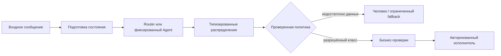
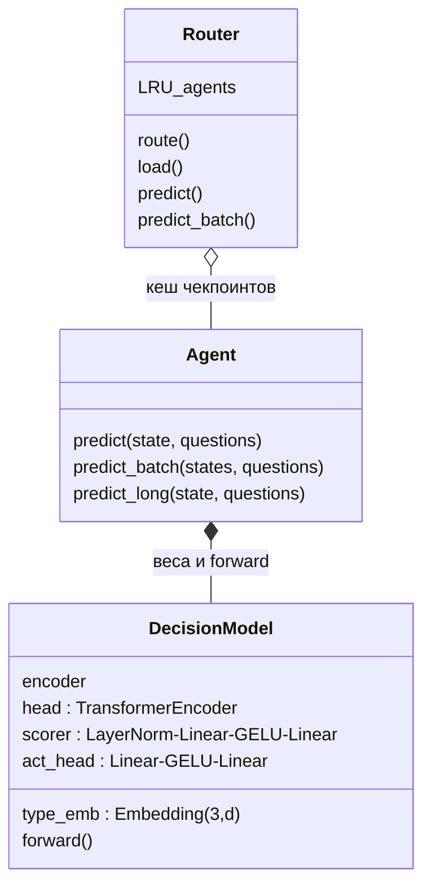
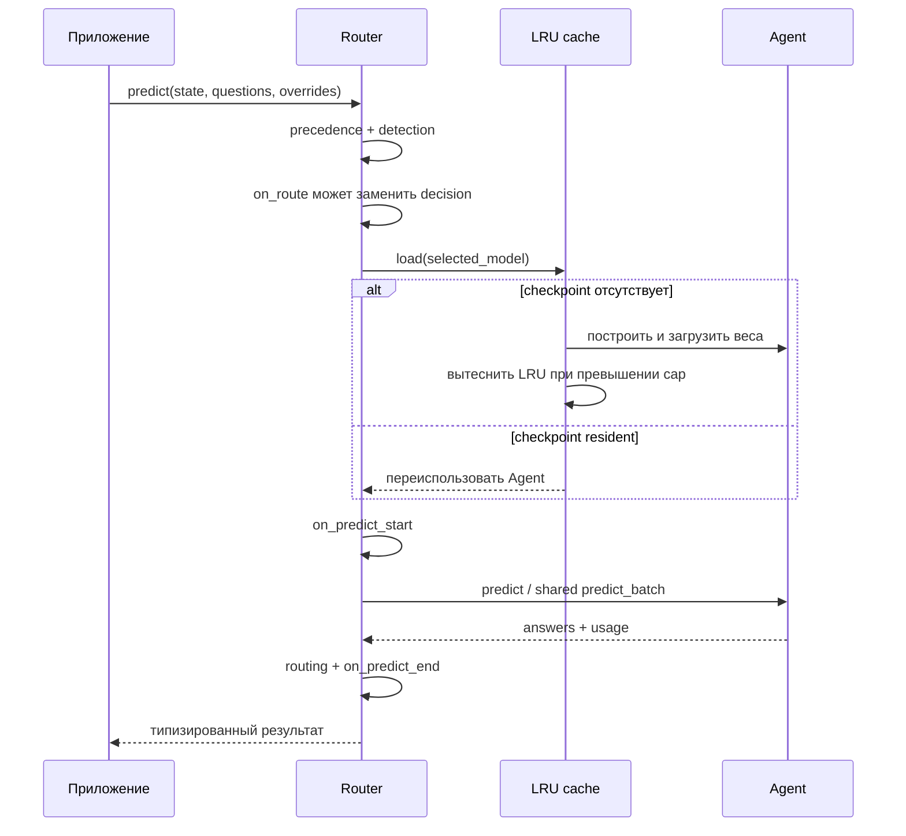
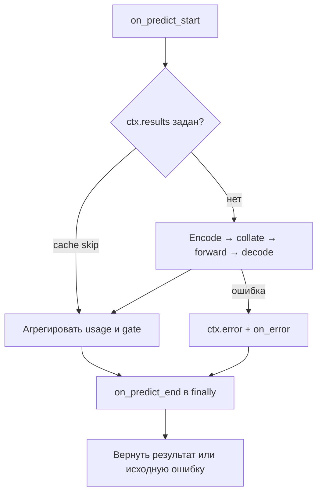

# Laya: устройство, API и официальная экосистема

> Самостоятельное руководство по исходникам Laya **0.4.21**, зафиксированным на Git SHA **`0565524a27bcb9821bcd7c42aaf49d925f6f8560`**. Это описание проверенных исходников, а не отчёт о запуске моделей: при подготовке не скачивались веса, не выполнялись инференс и обучение. Все приведённые измерения принадлежат указанным официальным источникам либо явно атрибутированным в них внешним авторам. Примеры ответов в исходниках не являются обещанием результата на другой версии.

Практическое продолжение — [02_PRODUCTION.md](02_PRODUCTION.md): установка, запуск шести сценариев, HTTP и Docker, калибровка и эксплуатационная политика. Здесь объясняется, **почему** эти решения устроены именно так. В этой папке `production/` и `examples/` — наш прикладной слой; ссылки ниже на GitHub ведут к **официальным** исходникам. Эти два набора примеров не надо смешивать.

## Оглавление

1. [Что делает Laya](#1-что-делает-laya)
2. [Три чекпоинта и загрузка](#2-три-чекпоинта-и-загрузка)
3. [Устройство одного решения](#3-устройство-одного-решения)
4. [Три примитива и контракт результата](#4-три-примитива-и-контракт-результата)
5. [Математика и достоверность вероятностей](#5-математика-и-достоверность-вероятностей)
6. [Состояния, батчи и длинные документы](#6-состояния-батчи-и-длинные-документы)
7. [Router: выбор, объяснения и память](#7-router-выбор-объяснения-и-память)
8. [Схемы, Pydantic и готовые вопросы](#8-схемы-pydantic-и-готовые-вопросы)
9. [Инструменты и hooks](#9-инструменты-и-hooks)
10. [Интеграции, CLI, HTTP, MCP и порты](#10-интеграции-cli-http-mcp-и-порты)
11. [Backends, производительность и измерения](#11-backends-производительность-и-измерения)
12. [Обучение и оценка](#12-обучение-и-оценка)
13. [Безопасность, ограничения и лицензии](#13-безопасность-ограничения-и-лицензии)
14. [Исправления объяснений DeepSeek](#14-исправления-объяснений-deepseek)
15. [Карта официальных примеров 01–41](#15-карта-официальных-примеров-0141)
16. [Дополнительные источники и навигация](#16-дополнительные-источники-и-навигация)

## 1. Что делает Laya

Laya — не генератор ответов и не векторная база. Это небольшой по сравнению с генеративными LLM **неавторегрессионный движок типизированных решений**: он читает состояние и набор вопросов с конечными вариантами, затем выдаёт распределения и их детерминированную проекцию. Подход подходит для выбора отдела, оценки срочности по рубрике, определения наличия явно выраженного намерения, выбора инструмента или фильтра перед более дорогой моделью.

Ключевое различие с embedding retrieval: Laya совместно обрабатывает текст состояния, формулировку вопроса и описания вариантов, а не просто ищет ближайший вектор. Различие с LLM: нет цикла «предсказать следующий токен → добавить токен → повторить», нет свободного ответа, chain-of-thought или произвольного извлечения строк. Факт, что выход ограничен схемой, предотвращает несуществующую метку, но не неверную метку. Сам выбор `billing` вместо `technical` может быть ошибкой.

Практический принцип: **модель оценивает; приложение разрешает действие**. Вопрос «клиент просит возврат?» не доказывает право на возврат по договору. Вопрос «похоже на инъекцию?» не заменяет контроль полномочий. Laya можно поставить перед человеком, LLM или бизнес-движком, но нельзя незаметно превратить классификацию текста в разрешение платежа.



На диаграмме исполнитель отделён от классификатора намеренно: даже высокое `answer_confidence` не заменяет проверку прав, баланса, идемпотентности и допустимости конкретной операции. В наших сценариях внешние действия вообще не выполняются.

## 2. Три чекпоинта и загрузка

Официальная [таблица моделей](https://github.com/NandhaKishorM/laya/blob/0565524a27bcb9821bcd7c42aaf49d925f6f8560/README.md) и реестр `laya/router.py` различают:

| Логическое имя Router | Публикация на Hub | Основа; размер | Обычный бюджет всей последовательности | Назначение |
|---|---|---|---|---|
| `english` | `convaiinnovations/laya` | ModernBERT-large; 421M | 512 | Общие англоязычные решения |
| `multilingual` | `convaiinnovations/laya-multilingual` | mmBERT-base; 322M | 1024; поддерживается расширение до 8192 | 100+ языков; это охват модели, не гарантированная одинаковая точность |
| `typed-decisions` | `convaiinnovations/laya-typed-decisions` | ModernBERT-large; 421M | 1024 | Специализация на четырёх typed-decisions workflows |

Размеры и окна — свойства официальных публикаций, а не замер этой машины. Контекст включает вопрос и варианты, а не только документ. Типичный `head_max_len` у multilingual — 256, у English — 192; фактическое место для состояния определяется построенной головой. Typed-decisions не становится мультиязычной специализацией только потому, что Router направил в неё немецкий или русский текст.

Кроме отдельных репозиториев есть **bundle**: корень `convaiinnovations/laya` содержит English, подкаталоги `multilingual` и `typed-decisions` — другие модели. В этой версии `Router.DEFAULT_MODELS` использует bundle; `STANDALONE_MODELS` содержит отдельные публикации. Ревизия bundle и ревизия standalone — разные идентификаторы, взаимозаменять их нельзя.

Для конкретных standalone snapshots интегратором проверены только JSON configs (без весов):

| Checkpoint revision | max/head | Per-type temperature | Важная поправка |
|---|---|---|---|
| English `7b928d828b7b0e022f929d9bd2e44165aa270148` | 512/192 | `[1.636903, 1.251430, 1.9833995]` | Bucket `noul:2=1.9833995` имеет precedence |
| Multilingual `1720e3e3357cfe1e281542e223f8273b0890ca34` | 1024/256 | `[1, 1, 1]` | Bucket map пустая: это не fitted calibration |
| Typed `e929ae5cf69bc34259cd2f95c9e91145b818b1f0` | 1024/256 | `[1.014802, 1.037426, 1.057513]` | Есть inherited bucket overrides: `noul:2=1.9833995`, `choice:3-5=1.7601519`; нельзя объявлять T(noul)=1.057513 |

Проверяемые источники: [English config](https://huggingface.co/convaiinnovations/laya/resolve/7b928d828b7b0e022f929d9bd2e44165aa270148/rl_agent_config.json), [multilingual config](https://huggingface.co/convaiinnovations/laya-multilingual/resolve/1720e3e3357cfe1e281542e223f8273b0890ca34/rl_agent_config.json), [typed config](https://huggingface.co/convaiinnovations/laya-typed-decisions/resolve/e929ae5cf69bc34259cd2f95c9e91145b818b1f0/rl_agent_config.json). Эти SHA относятся к артефактам, не к Git SHA исходного кода. Числа в этой таблице не являются результатами калибровки на нашем трафике.

Ещё одно различие источников: README описывает новый стек Transformers 5 / Torch 2.14, тогда как [pyproject.toml](https://github.com/NandhaKishorM/laya/blob/0565524a27bcb9821bcd7c42aaf49d925f6f8560/pyproject.toml) декларирует floors `torch>=2.0.0`, `transformers>=4.48.0`. Декларируемая устанавливаемость не доказывает поддержку каждой новой функции на старом стеке; parallel masks и export имеют отдельные ограничения. Production зависимости нужно закреплять совместимым набором, не собирать из противоречащих друг другу фрагментов README.

### 2.1. Прямой Agent

```python
import laya

# Hub: загрузит артефакты, если их ещё нет в кеше.
agent = laya.load("convaiinnovations/laya", device="cpu")
# Альтернативы, не требующие смены predict API:
# agent = laya.load("convaiinnovations/laya", subfolder="multilingual")
# agent = laya.load("convaiinnovations/laya-multilingual")
# agent = laya.load("/srv/models/laya-multilingual", device="cpu")

questions = {
    "refund_requested": {
        "type": "noul",
        "instructions": "Does the customer explicitly request a refund?",
        "criteria": {
            "false": "No explicit request for money to be returned.",
            "true": "The customer explicitly asks for money to be returned.",
        },
    }
}
# Выполнять только там, где разрешена реальная загрузка и инференс:
# result = agent.predict({"body": "Please refund the duplicate charge."}, questions)
```

Это пример использования API, не исполненный здесь transcript. `laya.load()` — путь к Agent. `Router()` — объект маршрутизации с ленивой загрузкой. В этом срезе исходников при `device=None` автоматический выбор — **CUDA → MPS → XPU → CPU**, если соответствующий backend доступен. XPU также можно указать явно. Уточняйте фактически выбранное устройство, а не только конфигурационное пожелание: некоторые старые тексты upstream ещё перечисляют только CUDA/MPS/CPU.

### 2.2. Что нужно для offline

Локальный checkpoint — это не один `model.safetensors`: нужны также `rl_agent_config.json`, `encoder/` с конфигурацией backbone и `tokenizer/` с его файлами. Экспортируйте полный каталог. Абсолютный путь или явно локальный `./...` не должен превращаться в попытку найти Hub repo; отсутствующий локальный каталог вызывает `FileNotFoundError`.

Для изолированной среды заранее, **на разрешённой машине**, скачайте проверенную ревизию и перенесите артефакты, проверьте SHA256, укажите локальные пути. `HF_HUB_OFFLINE=1` запрещает сетевой fallback Hub, но не создаёт отсутствующие файлы. При использовании кеша важно перенести всю структуру кеша, включая реальные blob-файлы, а не только битые символические ссылки. Для воспроизводимости предпочтительнее явный каталог и полный manifest.

`revision=` закрепляет версию Hub; `LAYA_REVISION=reviewed` использует проверенные SHA из `laya/revisions.py`. Встроенное pinning по умолчанию не следует предполагать: обычный Hub load без фиксации может увидеть обновление. Проверка digest и pin решают разные задачи: revision выбирает снимок, digest сверяет доставленные байты до загрузки. Наш runtime дополнительно использует `models.lock.json`; локальные overrides описаны в [02_PRODUCTION.md](02_PRODUCTION.md).

### 2.3. Не переносите `_common` в приложение

Официальные скрипты 02–41 импортируют `examples/_common.py`. Он принимает **логические имена** `english`, `multilingual`, `typed-decisions`, ищет checkpoint в `models/` относительно расположения самого файла, затем выбирает bundle Hub + subfolder. Это не тот же интерфейс, что `laya.load(path)`.

Официальный запуск `python /path/to/laya/examples/02_hello_world_decision.py` работает из другого cwd потому, что Python добавляет каталог скрипта в `sys.path`, а helper вычисляет ROOT по `__file__`. Helper также ставит ROOT впереди путей, чтобы `laya/email.py` не подменил стандартный `email`. Произвольное копирование `from _common import load` в notebook или свой проект эту структуру не создаёт. Наши примеры используют собственный `production.runtime`, не приватный helper upstream.

## 3. Устройство одного решения

Источник истины — [common.py](https://github.com/NandhaKishorM/laya/blob/0565524a27bcb9821bcd7c42aaf49d925f6f8560/laya/common.py), особенно `build_head`, `build_sequence`, `DecisionModel.forward`; декодирование — [agent.py](https://github.com/NandhaKishorM/laya/blob/0565524a27bcb9821bcd7c42aaf49d925f6f8560/laya/agent.py).

### 3.1. Последовательность и маски

Для **каждого вопроса** строится отдельная строка:

```text
[CLS] <type> question: <instructions> [SEP]
[MASK] <option 0> [MASK] <option 1> ... [SEP]
<serialized state> [SEP]
```

`[MASK]` здесь — маркер позиции варианта, не просьба сгенерировать пропущенное слово. Из скрытого вектора в этой позиции модель получает скалярный logit данного варианта. Внедрённые в пользовательский текст mask-токены заменяются пробелами, чтобы не спутать текст с техническими маркерами.

Состояние-строка используется как есть; dict/list сериализуется через JSON с `ensure_ascii=False`. `choice` превращает пары в строки вида `label: description`; `score` — в `level i: description`; `noul` всегда имеет семантический порядок `[false, true]`. Структурированные критерии сериализуются в JSON, не в Python repr.

Различайте несколько масок:

* `attention_mask` отделяет реальные токены от padding; backbone bidirectional, это не causal mask декодера.
* `marker_pos` указывает позиции вариантов, а `marker_mask` выключает padding-варианты в пачке, где вопросы имеют разное K.
* `src_key_padding_mask` в дополнительной transformer head скрывает padding последовательности.
* Специальные option masks существуют для обученного **parallel layout**, описанного ниже. Они не используются автоматически всеми опубликованными моделями.

### 3.2. Encoder, transformer head, MLP и action



В UML показаны логические компоненты, а не полный список методов. В фактической реализации:

1. Backbone ModernBERT/mmBERT создаёт `last_hidden_state`, по одному вектору размерности `d` на токен.
2. К каждому вектору добавляется embedding типа вопроса, общий словарь размером 3.
3. Если `head_layers > 0`, дополнительные `TransformerEncoderLayer` обрабатывают **всю последовательность**, не только markers. У layer `norm_first=True`, FFN имеет ширину `4d`; число attention heads вычисляется как `max(1, d // 64)`.
4. По `marker_pos` собираются option vectors. Общий scorer `LayerNorm(d) → Linear(d,d) → GELU → Linear(d,1)` даёт один logit на вариант. Padding logits маскируются большим отрицательным числом.
5. Отдельный `act_head` получает вектор CLS плюс четыре признака: top-1, top-1 минус top-2, нормированную энтропию и `K/255`. Для этих признаков softmax вычислен по detached logits. MLP имеет скрытую ширину 256 и выдаёт action logits.

Таким образом фраза «три независимые головы: классификатор, регрессор и бинарный sigmoid» **не соответствует коду**. Есть общая option-scoring архитектура, type embedding и разные правила чтения распределения. Score — не отдельный линейный регрессор; noul — не обязательная отдельная sigmoid-голова. Auxiliary action head — действительно отдельная ветвь. `action.act_probability` берётся из её распределения, это не дубликат top-1 confidence и не команда исполнить пользовательскую операцию. Количество action-выходов связано с `act_costs` в config; переносимость и качество этой вспомогательной ветви также требуют проверки.

### 3.3. Что означает один forward

`predict(state, Q)` обычно собирает Q строк в один батч. **Состояние присутствует в каждой строке и проходит encoder Q раз внутри батча.** Токенизация общего state может переиспользоваться, вопросные токены кешируются в рамках вызова, но скрытые состояния документа не являются общим вычисленным один раз контекстом. Один запуск GPU kernels на батче и одно вычисление документа — разные утверждения. При разбиении по `batch_size`/token budget будет несколько forward passes.

### 3.4. Порядок вариантов и parallel options

Опубликованные checkpoint по умолчанию обучены на **sequential** layout. Позиции вариантов и взаимное внимание могут влиять на выбор. `option_order` меняет порядок показанных options; runtime возвращает вероятности в исходные индексы через `unpermute_probs`. Перестановка входа не должна просто перепривязать старый ответ к другой метке.

В коде предусмотрен `option_layout: "parallel"`: варианты используют общие относительные позиции; option mask запрещает прямое внимание к токенам *другого* варианта, но разрешает общую часть и свой вариант. Local attention вычисляет окно по position ids, не по физическому индексу в конкатенации. Дополнительная head не имеет собственного позиционного кодирования; такой layout предназначен для перестановочной эквивариантности option logits.

Это **свойство формата обучения весов**, не бесплатная runtime-оптимизация sequential checkpoint. Нельзя включить parallel для старых весов и объявить корректность. Совместимость зависит и от Transformers: per-layer-type masks ModernBERT требуют соответствующего API. Для существующей модели полезны permutation tests и `OptionStabilityHook`; несколько перестановок повышают стоимость. Даже устойчивость к перестановке не доказывает правильность.

### 3.5. Внутреннее устройство backbone и размер вычислений

Проверенные конфигурации [English encoder](https://huggingface.co/convaiinnovations/laya/resolve/7b928d828b7b0e022f929d9bd2e44165aa270148/encoder/config.json) и [multilingual encoder](https://huggingface.co/convaiinnovations/laya-multilingual/resolve/1720e3e3357cfe1e281542e223f8273b0890ca34/encoder/config.json) содержат `model_type=modernbert`: mmBERT использует совместимую архитектуру с другим многоязычным обучением и tokenizer. Поэтому мультиязычность не реализуется переводом запроса перед inference.

| Параметр backbone | English ModernBERT-large | Multilingual mmBERT-base |
|---|---|---|
| Encoder layers | 28 | 22 |
| Hidden size d | 1024 | 768 |
| Attention heads encoder | 16 | 12 |
| FFN intermediate size из config | 2624 | 1152 |
| Tokenizer vocabulary | 50368 | 256000 |
| Local attention window | 128 | 128 |
| Full-attention cadence | Каждые 3 слоя, начиная с первого | Каждые 3 слоя, начиная с первого |
| Backbone max positions | 8192 | 8192 |

Это размеры **encoder**, а не добавленной Laya Transformer head: её FFN использует 4d. Поле `architectures=ModernBertForMaskedLM` в сохранённом config описывает происхождение backbone; Laya использует encoder hidden states, а не запускает MLM-декодер как свободный генератор. Backbone max positions=8192 не отменяет checkpoint runtime max_len=512/1024 и не доказывает качество English на расширенном контексте.

Слои чередуют глобальное и локальное bidirectional attention. Локальная связь ограничивает прямые взаимодействия окном; глобальные слои дают обмен между удалёнными участками. Концептуально полное attention имеет член стоимости O(L²d), локальное — O(Lwd), где L — длина, w — окно; linear/FFN projections добавляют O(Ld²), поэтому вся стоимость не сводится к квадрату L. Добавленная Laya head также обрабатывает последовательность и влияет на память/время. При Q вопросах и B состояниях работа масштабируется примерно по числу BQ строк с учётом padding, а не остаётся константой от числа вопросов.

В актуальных configs позиционная информация задаётся в том числе `rope_parameters` для `full_attention`/`sliding_attention`. Rotary position embeddings вращают пары координат query/key на угол, зависящий от позиции: для пары $(x_{2j},x_{2j+1})$ применяется матрица $R(\\theta_{m,j})$, где $\\theta_{m,j}=m\\,\\omega_j$. Тогда скалярное произведение вращённых Q/K кодирует относительное смещение позиций. Это объяснение механизма RoPE, не основание вручную менять частоты обученного checkpoint. Разные версии Transformers читают поля positional config по-разному; reference-окружение комплекта использует Transformers 5.0.0, соответствующий `transformers_version` этих encoder configs. Простого соответствия нижнему порогу зависимости недостаточно для гарантии одинаковой интерпретации нового config.


## 4. Три примитива и контракт результата

### 4.1. Choice

```python
q = {"department": {
    "type": "choice",
    "instructions": "Which department should handle the request?",
    "criteria": {
        "billing": "Invoices, duplicate charges and refunds.",
        "technical": "Bugs, outages and login failures.",
        "other": "Requests outside the named departments.",
    },
}}
```

Ключи задают допустимые ответы, значения — смысл. Дублирующиеся или почти одинаковые описания создают неоднозначность. Слишком широкое `billing: payment errors` пересекается с технической ошибкой checkout. Не стоит наделять произвольные имена меток магией: encoder читает и имя, и описание. `choice` — взаимоисключающий выбор; для нескольких независимых флагов нужны несколько noul-вопросов.

Ответ содержит `type`, `choice`, `probabilities` по всем меткам, `confidence`, `answer_confidence`, `action`. Победитель — argmax. Метки берутся из входного словаря; модель не генерирует новые.

### 4.2. Score

`criteria` — **упорядоченный список** от меньшего к большему. `score` — ожидаемый **нулевой индекс** уровня, а не вероятность и не обязательно целое число. При трёх уровнях диапазон 0…2; в `legend` и `probabilities` индексы строковые: `"0"`, `"1"`, `"2"`.

Среднее 1.0 может означать уверенный средний уровень или смесь крайностей 0 и 2. Поэтому показывайте распределение. `round(score)` не эквивалентен наиболее вероятному классу. Для hard class берите argmax вероятностей; для расчёта ожидаемой стоимости можно использовать среднее, но интервалы между словесными уровнями должны иметь бизнес-смысл. Деление на `K-1` нормирует диапазон, не делает разные рубрики содержательно равными.

### 4.3. Noul

`noul` возвращает **P(true)**. Стороны всегда false/true; необязательные `criteria` описывают каждую из них, а `labels` могут поменять отображаемые названия, но не семантический порядок. Симметричные положительная и отрицательная формулировки обычно лучше одностороннего внушения. Не путайте отсутствие свидетельства в обрезанном тексте со свидетельством отсутствия.

В noul-ответе нет отдельного публичного словаря `probabilities`: бинарное распределение восстанавливается как `[1-noul, noul]`, с оговоркой о округлении. Порог 0.5 — только симметричное решение при равных потерях и подходящих вероятностях; для возвратов, безопасности или эскалации он не задан природой модели.

### 4.4. Общий payload и usage

Обычный результат — dict с `model`, `answers`, `usage`; Router добавляет `routing`. Question IDs становятся ключами `answers`. В `usage`:

| Поле | Что означает |
|---|---|
| `input_tokens` | Сумма входных токенов строк данного результата: state повторяется для каждого вопроса. Это не размер одного контекста |
| `output_tokens` | **0**: нет генерации токенов. Это не отсутствие числовых выходов и не нулевая стоимость вычислений |
| `state_tokens` | Размер полного сериализованного state в токенах |
| `state_tokens_dropped` | Худший, то есть максимальный, объём отброшенного state среди вопросов |
| `truncated` | Было ли отброшено состояние хотя бы для одного вопроса |
| `truncated_questions` | IDs затронутых вопросов |
| `options` | Появляется при схлопывании разных вариантов в один и тот же token span; содержит total/distinct/tokens_per_option |

Вероятности публикуются с округлением до четырёх знаков. Их сумма может слегка отличаться от единицы; 0.0000 не обязательно математический ноль. Не восстанавливайте точные logits из такого payload и не сравнивайте пересчитанную энтропию с ожиданием побитового равенства. Strict Jev HTTP mode намеренно удаляет некоторые дополнительные поля; клиент должен знать, какой контракт он использует.

## 5. Математика и достоверность вероятностей

### 5.1. Attention

Для одной attention head концептуальная формула:

$$\operatorname{Attention}(Q,K,V)=\operatorname{softmax}\left(\frac{QK^\top}{\sqrt{d_k}}+M\right)V.$$

Здесь Q — query-проекции токенов, K — key-проекции, V — value-проекции; `d_k` — размерность ключа одной головы. `M` равна 0 в разрешённых связях и минус бесконечности в запрещённых. Softmax нормирует строки матрицы сходства. Это объясняющая формула, а не заявление, что реализация материализует все матрицы: SDPA, local/sliding attention и fused kernels могут вычислять эквивалентный результат иначе. Входные вопросы и варианты через bidirectional attention взаимодействуют с состоянием. `[MASK]` в названии токена не равен матрице attention mask.

### 5.2. Logits и temperature softmax

Пусть вопрос имеет K вариантов; `z_i` — скаляр scorer для варианта i. Runtime выбирает положительную температуру T и вычисляет:

$$p_i=\frac{\exp((z_i-z_{\max})/T)}{\sum_{j=0}^{K-1}\exp((z_j-z_{\max})/T)}.$$

Вычитание максимума предотвращает переполнение, не меняя распределение. При T>1 вероятности обычно мягче, при 0<T<1 — острее; положительное общее T сохраняет argmax в точной арифметике. Поэтому temperature scaling исправляет confidence, **не обучает правильной классификации**. У `score` может измениться среднее даже без изменения modal class.

Поиск T: сначала `temperature_by_options[temp_bucket(qtype,K)]`, иначе per-type `temperature[QTYPES[type]]`, где choice=0, score=1, noul=2. При распознанном переданном `lang` и настроенном `lang_temperatures` применяется языковой override. Текущая реализация ограничивает рабочие температуры диапазоном **[0.5, 5.0]**, некорректные значения обрабатывает защитно. `*_raw` сохраняет значения до clamp. Наличие числа в config не означает, что это же число было применено.

### 5.3. Что именно называется confidence

Энтропия распределения:

$$H(p)=-\sum_{i=0}^{K-1}p_i\log p_i.$$

Для `choice`/`score`:

$$\texttt{confidence}=1-\frac{H(p)}{\log K},\qquad
\texttt{answer\_confidence}_{raw}=\max_i p_i.$$

Для K=1 runtime обрабатывает вырожденный вариант отдельно. Для `noul`, где `p= P(true)`:

$$\texttt{confidence}=\max(p,1-p),\qquad
\texttt{answer\_confidence}_{raw}=\max(p,1-p).$$

Например, **арифметически**, не как результат нашего запуска: при `noul=0.1342` confidence равна 0.8658; при 0.9718 равна 0.9718. Это правило `max`, не «случайное совпадение с энтропией». Для бинарного choice при p=0.9 энтропийная confidence около 0.531, а noul confidence равна 0.9. Переносить один cutoff между этими полями нельзя.

`answer_confidence` может быть дополнительно remapped через `binning_map`; тогда она уже не обязана буквально совпадать с max опубликованных вероятностей. При языковом temperature override текущий декодер пропускает общий binning map. И даже без remapping округление создаёт малые расхождения. Для score max(p) — масса **модального уровня**, а не вероятность того, что дробное математическое ожидание «верно».

### 5.4. Score и потери решения

$$s=\sum_{i=0}^{K-1}i\,p_i.$$

Здесь i — нулевой индекс уровня, а s — ожидаемый индекс. Если приложению нужны реальные значения v_i, оно может вычислить `sum(v_i*p_i)` отдельно; поле `score` не узнаёт такую бизнес-шкалу автоматически. При произвольной матрице потерь L(a,i) обоснованное решение — минимизировать ожидаемые потери `sum_i L(a,i)p_i`, а не механически брать argmax. Это общая теория решения, **не дополнительный скрытый API Laya**.

### 5.5. RLCD и proper scoring rules

RLCD в официальной тренировке использует распределения teacher/gold, а не только жёсткие labels. В [proper_reward](https://github.com/NandhaKishorM/laya/blob/0565524a27bcb9821bcd7c42aaf49d925f6f8560/laya/common.py) для предсказанного q и целевого t концептуально:

$$R(q,t)=\sum_i t_i\log q_i
+\alpha\frac{\sum_i t_iq_i}{\sqrt{\sum_iq_i^2}}
-\mathbf{1}_{score}\,\beta\frac{\sum_i(F_q(i)-F_t(i))^2}{K-1}.$$

`t_i` — целевая масса на варианте i; q_i — заявленная моделью масса; F — накопленные суммы по упорядоченным уровням; alpha и beta — веса spherical score и ranked probability score. В функции defaults alpha=0.5, beta=1.0; notebook-рецепт задаёт spherical weight 0.75. Нельзя смешивать эти значения как одно универсальное значение модели.

Log score стимулирует не обнулять вероятный исход, spherical score вознаграждает согласование распределений, RPS учитывает **расстояние по порядку** уровней score. Strictly proper означает, что в идеализированном ожидаемом риске истинное распределение оптимально сообщать честно. Это свойство scoring rule, **не сертификат калибровки конечной обученной сети**. В реализации есть clipping `logq` снизу (`log_floor=-9.21`), численные floors и конечная оптимизация; строгую теорему для идеальной формулы нельзя безоговорочно переносить на clipped objective.

Тренировочная RLCD-loss сочетает GRPO-подобную policy-gradient часть на noisy-logit samples с полно-весовой soft cross-entropy `-sum_i t_i log q_i`. В notebook четыре sample на item; noise anneals 0.4→0.1. Это не текстовый RLHF и не online обучение во время `predict`. `td_lambda_targets` поддерживает траекторные multi-turn targets, но обычный inference не обновляет веса и не хранит скрытую историю диалога между запросами.

### 5.6. Калибровка и измерение

Калибровка — соответствие между заявленной уверенностью и наблюдаемой частотой правильных ответов на определённом распределении. «При c≈0.8 около 80% верны» — эмпирическое утверждение о группах, не гарантия отдельного случая. Источники прямо предупреждают: shipped checkpoints overconfident, multilingual не поставляется с fitted temperatures. Clamp только ограничивает экстремальное sharpening, не решает задачу.

Обычный цикл: train → отдельный calibration split → fit T → validation для выбора threshold по стоимости ошибок и coverage → нетронутый final test → shadow production. Не подгоняйте T и cutoff на том же тесте, которым объявляете итоговое качество. Для каждого языка, K, типа, домена, tokenizer/input format и backend проверяйте переносимость. `fit_temperatures`, `fit_one_temperature`, `fit_temperature_map`, `fit_binning_map`, `fit_abstention_thresholds` — официальные инструменты; `Agent.load_calibration` загружает сохранённые настройки. Некоторые buckets при малом N не fitted: отсутствие threshold может означать отсутствие abstention, а не консервативный отказ.

Для положительных точных вероятностей дополнительная температура вычисляется как `p'_i ∝ p_i^(1/T)`. Но публичный payload уже округлён и может содержать нули, исходная температура может быть неизвестна, binning map вообще меняет отдельную confidence. Поэтому calibrator на этих вероятностях — отдельный post-processing pipeline с собственной provenance, не восстановление исходных logits.

**Platt scaling** бинарной модели обычно имеет вид `sigmoid(a*logit(p)+b)`; temperature-only — ограниченный случай без свободного intercept. Называть произвольное возведение вероятностей в степень «Platt calibration» неверно.

Полезные метрики:

* Accuracy — доля верных modal labels; soft accuracy учитывает целевую массу teacher на выбранном варианте.
* Multiclass Brier: `mean(sum_i (p_i-t_i)^2)`; бинарный top-1 Brier: `mean((max(p)-correct)^2)`. В `laya-evals` поле `brier` описано как второй вариант, в training evaluation `brier` — первый, а `brier_top1` — второй. Всегда проверяйте определение, не только имя.
* ECE: сумма по confidence bins `n_b/N * abs(accuracy_b - confidence_b)`. Зависит от binning и выборки; малое значение не гарантирует отсутствие локальных ошибок.
* NLL штрафует малую вероятность истинного класса; score MAE измеряет ошибку по шкале; KL/TV оценивают различие распределений.
* Risk–coverage показывает ошибку среди принятых решений при увеличении доли abstention. Хорошая средняя accuracy не доказывает безопасность верхнего confidence-хвоста.

`min_confidence` — opt-in gate на `answer_confidence`, не на энтропийную confidence. Он сообщает низкую уверенность, а не автоматически отменяет произвольный downstream side effect. Храните raw answer вместе с решением политики и причиной отказа.

## 6. Состояния, батчи и длинные документы

### 6.1. Что подать как state

Строка, dict и список conversation turns — допустимые формы, но одинаковые факты в разных текстовых оболочках могут давать разные распределения. JSON keys, подписи письма, старые quoted replies и порядок записей также читаются как текст. `email_state` и `clean_email_body` помогают удалить подписи/цитаты; очистка может удалить полезный факт, поэтому её нужно оценивать, а не считать нейтральной.

Разделяйте record-level задачи: несколько вопросов `row_1`, `row_2` о большом JSON state всё равно видят **все** записи. Для независимого результата на каждую строку используйте отдельные states в `predict_batch`, иначе модель может перенести факт соседнего клиента.

### 6.2. Questions batch versus states batch

* `agent.predict(state, questions)` — одно состояние, несколько question rows.
* `agent.predict_batch(states, questions, batch_size=8, sort_by_length=True)` — несколько состояний с общей схемой; runtime разворачивает пары state×question, ограничивает batch, возвращает результат на каждый state в исходном порядке.
* `router.predict_batch(requests)` — список request dict со `state`, `questions` и per-request routing/budget controls. Router группирует по checkpoint, затем по совместимой order-sensitive схеме вопросов и token budgets, после inference восстанавливает исходный порядок.

```python
# API-форма, не выполненный здесь запуск:
# results = agent.predict_batch(states, questions,
#                               batch_size=8, sort_by_length=True)
# routed = router.predict_batch([
#     {"state": state_en, "questions": questions, "lang": "en"},
#     {"state": state_ru, "questions": questions, "lang": "ru"},
# ])
```

Официальный старый учебный пример 19 говорит «states loop»; это описание конкретного beginner-loop, **не ограничение нынешнего API**. Современный Batch Mode и `predict_batch` существенно важнее для throughput. Length sorting уменьшает padding, не меняя обещанного порядка результатов; численные различия около decision boundary возможны. Задавайте ограниченный chunk и не помещайте бесконечный JSONL целиком в память. Наш `examples/05_batch.py` реализует bounded chunks и сохраняет IDs.

### 6.3. Truncation и option budget

`max_len` — вся последовательность. `head_max_len` — бюджет, относительно которого сокращаются instructions/options, **не жёсткая верхняя граница реально построенной head**: при большом числе вариантов минимум токенов на option способен вывести её за этот бюджет. При построении each option сначала ограничивается до 48 текстовых токенов; затем применяется распределение общего бюджета, с минимумом блока. Варианты с общим префиксом могут схлопнуться после обрезки, даже если все `[MASK]` ещё присутствуют.

Место для state равно `max(0, max_len - len(actual_head) - 1)`. Не вычисляйте его как постоянное `max_len-head_max_len`. Если исчезают markers целых options, Agent может выбросить `ValueError`. Если исчезло различие описаний, смотрите `usage.options`; отсутствие exception не означает сохранение смысла.

Обычные string/dict сохраняют начало состояния. Conversation list обрезается слева, чтобы сохранить конец/последние turns; это обрезка сериализованных токенов, не обязательно аккуратная граница сообщения. Любое `usage.truncated=true` должно менять operational policy. В наших примерах это обязательный review, даже при высокой confidence.

### 6.4. Увеличить окно или сканировать

Multilingual поддерживает до 8192 токенов, но увеличение `max_len` повышает вычисления и не гарантирует качество на далёких фактах. Позиция evidence имеет значение даже без truncation. В официальном research position sweep на 20 support requests при 7000 filler tokens и `max_len=8192` accuracy менялась от 0.85 в начале до 0.40 в конце и 0.50 в середине; majority-class baseline этого набора 0.45. Это маленький синтетический протокол, не наша оценка и не универсальный закон, но достаточная причина не путать «вместилось» с «понято».

`predict_long(state, questions, window=..., stride=..., aggregate="auto", batch_size=...)` токенизирует один раз, строит перекрывающиеся окна, ограничивает их фактическим минимальным state_room всех вопросов и прогоняет через batch. Default stride — половина эффективного window; stride больше window запрещён, чтобы не оставлять непрочитанные дыры.

Текущая `auto` агрегация:

* noul — максимум P(true) по окнам: экзистенциальная семантика «хотя бы где-то»;
* choice/score — ответ наиболее уверенного окна, не усреднение нейтрального большинства;
* `answer.window` указывает index, token_start/token_end и count решающего окна, когда provenance не нарушена hooks;
* при полностью помещающемся состоянии вызывается обычный single-state путь.

Максимум по многим окнам повышается даже на шуме. Confidence решающего окна **не является калиброванной вероятностью истинности по всему документу**. Эта агрегация не подходит автоматически для «все разделы соответствуют политике», подсчёта событий, разрешения противоречий или объединения фактов из удалённых окон. Если hook переписал окна, исходные offsets уже нельзя выдавать как доказательство прочитанного текста; реализация снимает attribution. При `ctx.skip` без inference `usage.windows=0`. Для production долгих документов проверяйте именно документный pipeline, включая число окон.

## 7. Router: выбор, объяснения и память

[Routing guide](https://github.com/NandhaKishorM/laya/blob/0565524a27bcb9821bcd7c42aaf49d925f6f8560/docs/routing.md) задаёт precedence:

1. Явный `model=`.
2. Явный `task=`.
3. Точное совпадение question-ID set известного workflow, **только если** `auto_task_detection=True`.
4. Распознанный `lang=`.
5. Per-call `lang_guess=` либо настроенный callable/код.
6. Встроенный анализ письма/языка; при неопределённости `default`, с 0.4.0 это `multilingual`.

Первое правило выигрывает: `model="english"` сильнее `lang="ru"`. Это полезно для воспроизводимых тестов, но опасно, если приложение ошибочно закрепило модель. Неверное имя в запросе вызывает `ValueError`, не тихий fallback. `Router(models={"my-finetune": "/srv/model"})` регистрирует дополнительный checkpoint — само новое имя не ошибка.



`route` и `route_batch` сами по себе не запускают модель и не скачивают веса. Но построенный `Router(preload=...)` мог загрузить их раньше, а operator hooks могут иметь побочные эффекты. Следовательно «route без inference» не равно «любой процесс с Router ничего не загрузит».

Детектор — эвристический pure Python: script profile, доля нелатинских букв, диакритика, словарные признаки Latin languages, сегменты и строковые leaves структурированного state. Короткие команды, транслитерация, all caps и mixed language создают неопределённость. Достоверный язык из приложения лучше передать явно. Для Latin текста менее четырёх слов возможен `insufficient_words`; default multilingual не означает, что detector уверенно определил язык.

`explain=True` в route добавляет diagnostic со `stage`, `reason`, `source`; stages `whole_state`, `segment`, `value` показывают ветвь финального решения, не полный trace и не calibrated language probability. `source` содержит leaf_index/path/line, не evidence для правильности классификации. Исходные `script_profile` могут относиться к начальному sample, даже если позднее поле изменило итоговый выбор. Переопределённая модель/task/lang обычно пропускает detection, возвращая `detection=None`.

### LRU и resident memory

По умолчанию `max_loaded=2`, ленивая загрузка. English+multilingual могут оставаться hot. Если доступен также typed-decisions, для всех трёх нужны ресурсы и `max_loaded=3`; при cap=1 чередование языков создаёт повторные cold loads. `preload()` переносит эту стоимость на startup и увеличивает вместимость под запрошенные модели; `attach(name, agent)` использует уже построенный Agent без дублирования весов; `unload()` удаляет resident агенты.

LRU — кеш **весов**, не ответов. Освобождение ссылок и device cache не гарантирует немедленное падение RSS: allocator может удерживать страницы. Не создавайте Router на каждый HTTP request. Группировка heterogeneous batch по модели уменьшает churn, но не отменяет ограничения GPU RAM и стоимость загрузки третьего checkpoint.

## 8. Схемы, Pydantic и готовые вопросы

### 8.1. JSON Schema — только конечные решения

`agent.decide(state, schema=...)`/`router.decide(...)` компилируют поля в вопросы и проецируют ответы в значения. Поддерживается верхний object с плоскими properties:

| Поле схемы | Примитив | Проекция |
|---|---|---|
| enum / const | choice | Исходный тип значения enum сохраняется |
| boolean | noul | `noul >= 0.5` |
| integer или number с целыми minimum/maximum | score | **Модальный уровень**, возвращаемый как integer, не округлённое expected score |
| Optional с одной non-null веткой | underlying type | Null-ветка не создаёт nullable модельное решение |
| локальный `$ref` | соответствующая конечная схема | Разрешается через `$defs`/definitions |

`description` задаёт формулировку; `title` не читается. `enum: [1,2,3]` может вернуть число 2, не строку `"2"`. Бounded number не даёт произвольную непрерывную регрессию. Nullable/Optional не означает право модели «ничего не отвечать»: null-ветка служит синтаксической совместимости схемы, не отдельной option.

Не поддерживаются свободные строки, массивы, вложенные objects, рекурсивные refs и неоднозначные unions. Ограничения schema compiler: 32 поля, 32 options, 10 score levels. Это ограничения именно этого слоя, не универсальные пределы raw Agent/HTTP. Ошибки `SchemaError` называются с путём проблемного поля.

```python
from typing import Literal
from pydantic import BaseModel, Field

class TicketDecision(BaseModel):
    department: Literal["billing", "technical", "other"] = Field(
        description="Which department should handle the request?")
    needs_human: bool = Field(description="Does the request require human review?")

# decision = router.decide(state, schema=TicketDecision, return_details=True)
```

`laya[structured]` устанавливает Pydantic-поддержку. Без `return_details` возвращаются значения/модель; с ним `DecisionResult` сохраняет values, confidence, answer_confidence, probabilities, raw answers, usage, routing. Для аудита второй вариант предпочтительнее. Передавать нужно ровно одно из `schema` или `questions`. `decide_batch` планирует схему один раз и использует настоящий batch, а не неявный loop; на Router routing pins копируются в каждый request, call-level batch/hook controls передаются отдельно.

### 8.2. Presets

Официальные `email_questions`, `triage_questions`, `guard_questions`, `moderation_questions`, `router_questions` — фабрики **обычных словарей вопросов**, а не отдельные модели:

* Email: категория, spam/phishing, срочность и ожидание ответа. Очистка email и классификация — разные этапы.
* Support triage: intent, is_urgent, frustration, refund_requested, churn_risk. Просьба вернуть деньги и право вернуть деньги не одно поле.
* Guard: jailbreak, prompt injection и тяжесть вреда; ограничения indirect injection критичны (§13).
* Moderation: отдельные сигналы токсичности/преследования/угроз и других категорий; словесная шкала severity не вероятность.
* Model router preset: оценивает сложность/риск для дальнейшей **policy** small/frontier. Это не то же, что `laya.Router`, выбирающий English/multilingual checkpoint.

Typed-decisions workflow match использует точные ID sets четырёх семейств: agent trace observability, customer service, invoice processing, security incidents. Это не общий semantic task detector. Совпадение имён не доказывает, что ваши описания и gold совпадают с обученным workflow. Не включайте auto-task для чужой схемы без оценки. В official example 38 typed stage получает и немецкий state, но сам пример честно отмечает необходимость перевода или человека перед English specialist stage.

### 8.3. Большие пространства вариантов

`shortlist_choice`/`predict_shortlist` сначала сокращают кандидатов, затем оценивают выбранных; ошибка retrieval может исключить правильную option ещё до Laya. `predict_tournament` проводит elimination по небольшим группам и требует нескольких стадий. Это полезные компромиссы, не полноценный global softmax по исходным K. Winner probability финального раунда нельзя автоматически читать как вероятность победы среди всех вариантов. Evals имеет отдельную attribution для shortlist и tournament: измеряйте candidate recall, survivor errors, группировку и перестановки, а не только final accuracy.

## 9. Инструменты и hooks

### 9.1. Выбор инструмента — не генерация аргументов

`laya.integrations.tools.LayaToolSelector` строит выбор по названиям и описаниям tools. Принимаются Python functions, объекты LangChain/CrewAI, metadata LlamaIndex, OpenAI function specs, dictionaries и `name: description` strings. Поддерживаются `select`, `aselect`, local Agent/Router и remote `base_url`.

`ToolRouteDecision` содержит tool_name/index, распределение, confidence и признаки fallback/direct answer. `allow_direct_answer=True` добавляет решение «инструмент не нужен»; это **не генерация самого ответа**. `confidence_threshold` + fallback_tool либо `LayaLowConfidenceError` реализуют отказ от неуверенного выбора, если threshold действительно валидирован.

`call(prompt, **arguments)` выбирает и исполняет инструмент **с уже предоставленными приложением аргументами**. Laya не извлекает из произвольной фразы валидный SQL или параметры платежа автоматически. Поэтому небезопасный `query_database(sql)` остаётся небезопасным независимо от router confidence. В документации tools встречаются функции с демонстрационными константными ответами; их нельзя копировать как реальную реализацию поиска или расчёта.

### 9.2. Lifecycle hooks

Официальные [hooks docs](https://github.com/NandhaKishorM/laya/blob/0565524a27bcb9821bcd7c42aaf49d925f6f8560/docs/hooks/index.md) описывают `PredictContext` и события: `on_route`, `on_load`, `on_evict`, `on_predict_start`, `on_predict_end`, `on_error`. Контекст несёт states, questions, results, model, usage, run_id, elapsed_ms, error, agent/router и token budgets.



`ctx.skip(results)` заменяет **весь вызов**; batch требует по результату на каждое state. End hooks продолжают выполняться. `predict()` оборачивает `predict_batch([state], ...)`, поэтому Agent hooks обычно видят список states, даже при одиночном вызове. Пустой batch даёт results=[], usage с нулевыми tokens; это не то же, что неуспешный вызов с results=None.

Start hook может редактировать state/question/budget перед токенизацией. Назначайте новый dict `ctx.questions`, не мутируйте общий объект in-place в heterogeneous batches. Router hooks охватывают маршрутизацию и вызов; собственные hooks attached Agent также выполняются, но Router hook list не просто пересылается в Agent. В `Router.predict_batch` starts checkpoint-группы выполняются до общей inference, ends — в обратном порядке; это важно для contextvars/tracing.

Default `hooks_raise=True`: сломанный audit может прервать запрос. `False`: `RuntimeWarning` и продолжение, но уже сделанные мутации не откатываются. `on_error`/end на пути ошибки не должны маскировать первичное исключение. `hooks_timeout` ограничивает ожидание, **не убивает Python thread**; зависший hook продолжает работу, поэтому socket/HTTP внутри hook тоже должен иметь собственный timeout. AsyncHook предназначен для side-effect работы вне критического пути, но delivery/очередь/ошибки остаются предметом эксплуатационной политики.

Практические official extras:

* `examples/hooks/audit.py` пишет запись на каждую aligned пару state/result. Полный state может содержать PII; не отправляйте его без политики хранения.
* `redact.py` рекурсивно заменяет email/phone до inference. Regex — демонстрация, не исчерпывающий DLP.
* `cache.py` включает порядок criteria, модель и budgets в ключ; skip только если **весь** batch есть в кеше.
* `otel.py` показывает counters/histogram и опциональное подключение OpenTelemetry; счетчик call не автоматически равен числу state/question decisions.

В production ключ кеша должен включать checkpoint revision, tokenizer/input format, **порядок** вариантов, calibration artifact, budgets, язык и поведение policy/gate. Example 40 с `sort_keys=True` — упрощённое введение; при sequential layout такой hash может ложно склеить разные порядки criteria. Кеш-ответы лучше копировать, чтобы downstream мутация не меняла общий объект. Router `elapsed_ms` predict hooks исключает route/cold load; end-to-end latency измеряйте снаружи.

## 10. Интеграции, CLI, HTTP, MCP и порты

### 10.1. Framework adapters

| Слой | Компоненты | Что реально добавляет |
|---|---|---|
| LangChain / LangGraph | `LayaRouter`, `LayaGuardrail`, `LayaTriage`, `LayaEvaluator`, `LayaDecision` | Runnable/nodes, conditional edges, schema projection, input adaptation, hooks и batching |
| CrewAI | `LayaCrewRouter`, `LayaTaskGuard` | Выбор агента, назначение task.agent, pre-execution screen |
| Agno | `LayaAgnoRouter`, `LayaAgnoGuardrail` | Выбор Agent/Team и screen сообщений |
| LlamaIndex | `LayaSingleSelector`, `LayaMultiSelector`, `LayaQueryRouter` | Выбор query engine/tool, составной выбор, dispatch |
| Общие tools | `LayaToolSelector` | Выбор callable/spec из конечного набора |

Это адаптеры одного decision engine, не пять новых моделей. MultiSelector не превращает один choice в истинную многометочную вероятностную модель без собственного протокола. Большие rosters испытывают те же head token limits: расширить budget полезно, но не доказательство качества. Remote mode позволяет не ставить PyTorch в клиентское приложение. Совместимость версий framework и поведение исключений фиксируйте отдельно.

Официальные quickstarts `langchain_quickstart.py`, `crewai_quickstart.py`, `agno_quickstart.py`, `llamaindex_quickstart.py`, `tool_selection_quickstart.py` показывают local/remote соединение компонентов. CrewAI/Agno/LlamaIndex/tool quickstarts также содержат optional mock/demo agents: их константные ответы демонстрируют wiring, а не качество модели. Ветвь с настоящими весами требует optional dependencies и может скачать checkpoint; это не lightweight check.

### 10.2. CLI

`laya` имеет route-only режим, `--predict`, `--questions`, `--preset`, batch и interactive режимы. Route-only + `--explain --json` позволяет исследовать selection без весов. `--explain` не комбинируется с predict/preset/questions: объясняется routing, а не модельная причинность. Ошибка должна быть видна в stderr/exit status, не подменяться пустым «успехом».

`laya-evals` валидирует datasets, запускает evaluation и сравнивает reports с baseline/gates; `laya-train` обучает. Эти команды разной стоимости: проверка формата не требует модели, реальная evaluate/train — требует. При документационном копировании команды нельзя забывать, что последняя запустит скачивание или GPU работу.

### 10.3. Два разных HTTP примера

* `examples/server.py` — локальный playground GUI + `/predict`, обычно `http://127.0.0.1:8000`; Windows `start.bat 8080` меняет порт. Это не основной deployment contract.
* `laya-serve` из `laya[serve]` — FastAPI/ASGI service, по умолчанию bind `0.0.0.0:8000`; основные маршруты `/health`, `/v1/route`, `/v1/systemone`, `/v1/systemone/batch`. `create_app(router)` допускает injection собственного Router.
* Наша API в [examples/06_api.py](examples/06_api.py) документирована отдельно в 02_PRODUCTION; её endpoint нельзя автоматически считать копией upstream Jev wire API.

`POST /v1/route` возвращает snapshot выбора deployed Router, без inference. Нужны state и questions (пустые questions разрешены); `explain=true` добавляет ограниченный diagnostic. Endpoint не является полным валидатором prediction. По умолчанию возвращает model/repo/reason, не весь detection с verbatim mixed_segment. Однако reason/path всё равно могут содержать caller-controlled сведения: не считайте ответ полностью обезличенным. `examples/http_route.py` использует in-process TestClient без весов и демонстрирует разный default у клиента и server Router. Локальное MCP routing не доказывает deployment routing.

`POST /v1/systemone` принимает state + questions и optional routing/token/gate controls. `/batch` принимает states для общей схемы. Arbitrary path/неопубликованный repo в поле request model не должен заставлять server скачать чужой checkpoint: используйте зарегистрированное оператором имя из `LAYA_EXTRA_MODELS`. Для strict Jev clients `LAYA_JEV_STRICT=1` удаляет routing/action/answer_confidence, noul confidence и расширенный usage; строгий клиент теряет truncation-поля, поэтому такой режим требует отдельного контроля полноты входа.

### 10.4. Эксплуатационные настройки HTTP

Официальные defaults `laya-serve`: `LAYA_PRELOAD=1`, `LAYA_MAX_LOADED=2`, `LAYA_MAX_CONCURRENT=16`, `LAYA_MAX_TOKEN_BUDGET=8192`, `LAYA_MAX_BATCH_TOKENS=131072`, `LAYA_BODY_READ_TIMEOUT=10`. **Compose HTTP override может иметь другой preload default (0)**. Не объединяйте таблицы разных entrypoints в один набор неизменных defaults.

`LAYA_API_KEY` включает Bearer auth и отключает `/docs`, `/redoc`, `/openapi.json`. Liveness `/health` остаётся доступным, но без правильного bearer при настроенном ключе возвращает только `{"status":"ok"}`; с доступом можно увидеть resident revisions, фактические устройства и CPU fallback counters. HTTP 200 от health — живой процесс, не доказательство прогруженных весов или готовности нужного checkpoint.

Concurrency admission не равно числу одновременных GPU forwards. CPU-bound inference вынесена на worker, event loop обслуживает health; queued requests могут ждать. Превышение admission даёт 503, недопустимые параметры — 422, body timeout — 408; неожиданные ошибки не должны раскрывать внутренний traceback клиенту. `LAYA_MAX_BATCH_TOKENS` дробит проходы, а не означает максимальную длину одного state. `LAYA_IDLE_UNLOAD_SECONDS` экономит resident ресурсы ценой следующего cold load. Cancellation не гарантирует остановку уже работающего кода.

Reverse proxy: `LAYA_ROOT_PATH=/laya` для публичного префикса; прокси удаляет префикс перед передачей во внутренние `/v1/...`. TLS, сетевые ACL, rate limits и контроль доступа к логам остаются обязанностью deployment. Не публикуйте голый `0.0.0.0:8000` в интернет по умолчанию.

### 10.5. MCP и SDK

Built-in MCP запускается командой `laya-mcp-server` после установки `laya[mcp]`; это **stdio server**, отдельный TCP порт ему не нужен. Полный список tools смотрите в [cli-mcp.md](https://github.com/NandhaKishorM/laya/blob/0565524a27bcb9821bcd7c42aaf49d925f6f8560/docs/cli-mcp.md). В local mode каждый MCP process способен загрузить свои веса; `LAYA_BASE_URL=http://127.0.0.1:8000` отправляет prediction в общий server. Routing tools при этом могут остаться локальными, с отличающейся конфигурацией. Для deployed route snapshot используйте HTTP `/v1/route`.

Доступные MCP tools — не один универсальный текстовый чат:

| Tool | Назначение и ограничение |
|---|---|
| `laya_status` | Устройства, loaded/preload/readiness и версии; не доказательство качества |
| `laya_route`, `laya_route_batch` | Выбор без forward; optional explain, batch сохраняет порядок |
| `laya_predict`, `laya_predict_batch` | Типизированные ответы, routing, latency/device; batch группирует совместимые requests |
| `laya_shortlist` | Embedding shortlist, default k=20; исключённый gold уже не восстановится |
| `laya_tournament` | Elimination, default group_size=16; только in-process, final confidence условна на finalists |
| `laya_preset` | Пять схем; canonical router-предустановка здесь называется `model_router`, `router` — alias |
| `laya_decide` | Ограниченная JSON Schema из §8, не генерация произвольного JSON |
| `laya_predict_long` | Scan + window attribution; на этой MCP поверхности нет `min_confidence` и overrides max/head |

MCP принимает непустой JSON object state, хотя core Agent умеет также string/list. Это пример того, почему нельзя переносить все permissive core-входы на каждую транспортную поверхность. В shortlist cosine scores относятся к retrieval, не к вероятности правильного решения; при изменении множества вариантов исходный полный `option_order` отбрасывается с metadata, а не применяется к новым слотам.

`sdk/python` — лёгкий синхронный HTTP client без inference dependencies. `sdk/typescript` — types, validation, native fetch, presets, errors/cancellation; camelCase options отображаются в wire snake_case (`langGuess`→`lang_guess`, `maxLen`→`max_len`). Это **не** `laya-ts`, отдельная локальная inference-портировка.

### 10.6. Порты и контейнеры

В репозитории есть порты на Rust, TypeScript, .NET, Java, Go и C++; это не только HTTP SDK. Их `README.md`/`MODELS.md` описывают разные стадии готовности. **C++ пока не реализует ONNX inference**: опция `LAYA_ONNX` не означает работающий runtime. TypeScript использует split `encoder.onnx`/`head.onnx` через onnxruntime-node или browser WebGPU→WASM. Rust (`laya-onnx`, независимо версионируемый crate), .NET и Java поддерживают fused/split ONNX; Rust сериализует session access внутренним Mutex. Go отделяет pure-Go API от nested cgo ONNX module; без cgo `Open` возвращает `ErrNoCGO`, не фиктивный результат. Нельзя предполагать полную parity Python hooks, calibration, long windows и Router только из совпадения имени пакета. ONNX exports и tokenizer assets — самостоятельные версии артефактов; сверяйте numerics и option-order mapping. Даже port docs могут отставать: .NET README ещё утверждает отсутствие long API в laya-ts, хотя текущий TS README уже документирует `predictLong`.

Docker base `compose.yaml` — CPU, `compose.cuda.yaml` добавляет NVIDIA, `compose.spark.yaml` — ARM64 CUDA/DGX Spark, `compose.http.yaml` — daemon, `compose.modelscope.yaml` — подготовка зеркальных ModelScope assets. Linux AMD64/ARM64 CPU и NVIDIA имеют разную степень проверенности в официальных материалах. `docs/docker-platforms.md` отмечает только build/library-load evidence для Spark, тогда как более широкий `BENCHMARKS.md` уже содержит раздел NVIDIA GB10/DGX Spark CUDA с отдельными измерениями. Не переносите benchmark другого окружения на конкретный container image: документируйте точную конфигурацию и provenance. Linux ARM64 container на Apple Silicon не имеет доступа к host MPS: для MPS нужен native Python.

Секреты можно передавать файлами (`HF_TOKEN_FILE`, `LAYA_API_KEY_FILE`). Cache volume должен совпадать с `HF_HOME`; `HF_HUB_OFFLINE=1` работает только после реального prefetch. ModelScope mirror — иной источник provenance; фиксируйте его revision/digests, не выдавайте mirror branch за Hub SHA.

## 11. Backends, производительность и измерения

Базовый путь — PyTorch encoder + SDPA. `compile=True` включает torch.compile и соответствующий ModernBERT attention path; на меняющихся формах compilation/recompilation может быть дороже eager. `compile_warmup=False` позволяет контролировать startup; `agent.warmup(shapes=...)` прогревает известные размеры. Прогрев нужен до serving, но не должен скрываться в первом пользовательском SLA.

`fast=True`/`agent.accelerate()` выбирает TileLang fast path; при конфликте fast имеет precedence над compile. CUDA kernels не следует считать автоматически MPS/CPU kernels. В docs отдельно описаны CPU `target="c"` reference/fallback реализации и ограничения fragment/bf16: успешный микрокернел CPU probe не доказывает end-to-end ускоренный Agent на CPU. AOTInductor создаёт offline-compiled artifact под определённую среду и семейство shapes; это другой operational путь, не универсальный переносимый checkpoint. Opt-in CUDA graphs требуют подходящих стабильных форм и расходуют память.

ONNX экспорт (`scripts/export_onnx.py`, `ONNXAgent`) позволяет альтернативный runtime; calibration и preprocessing должны соответствовать PyTorch. TensorRT через ONNX Runtime встречается в research capacity benchmark, но не становится от этого встроенным backend `laya.load(backend="tensorrt")`. Такой API здесь не обещается.

Precision важна не только для скорости. `LAYA_CUDA_AMP` выбирает bf16/fp16/fp32; на CUDA capability <8 half режим использует fp16. CPU обычно fp32, opt-in `LAYA_CPU_AMP=bf16` требует подходящего железа. MPS autocast политика зависит от размера batch. Численные изменения могут менять argmax и gate около порога, особенно у неуверенных ответов. Поэтому «детерминировано» разумно понимать в фиксированной среде, не как побитовое равенство между CPU, CUDA, MPS, ONNX и fast.

### Что действительно опубликовано

* README официально приводит single-question T4 latency: multilingual **32.8 ms**, English **39.5 ms**. Это измерения проекта, не обещание для CPU и не наш результат.
* Research length batching сообщает **1775.71 s → 825.09 s (2.15×)** на 10000 синтетических English tickets, Ryzen 9 5950X/64 GiB/Windows 11/CPU fp32/16 Torch threads. Указаны ноль choice/action changes и max numeric delta 0.0001; это throughput/parity workload, **не accuracy test**.
* Fast-backends GPU parity table на 288 вопросах сообщает bf16 choice agreement 47/48 и fp16 48/48 при других максимальных численных отклонениях. Заголовок «same answers» не должен скрывать измеренный exception.

Сравнивая цифры, фиксируйте model revision, code version, устройство, threads, dtype, batch, K, длины, число questions, warm-up, cold load, tokenization и HTTP overhead. Выносите p50/p95/p99 и error/abstention/throughput. «33 ms» в заголовке — не end-to-end p99 production сервиса. На этой машине ничего из этих измерений не повторялось.

## 12. Обучение и оценка

### 12.1. Когда дообучать

Сначала определите task/rubric, добейтесь однозначных descriptions и целого evidence window. Если zero-shot не справляется с нужной семьёй решений, соберите размеченные state/questions/gold. Fine-tuning не создаёт missing input и не исправляет label leakage. Teacher distributions полезны для soft targets, но их ошибки также становятся обучающим сигналом.

`laya-train` поддерживает CSV/JSONL и dry-run проверки формата. Python API: `TrainConfig`, `finetune`, `train_model`, `calibration_records`. Режим `loss="rlcd"` сочетает RLCD+soft CE; `loss="soft-ce"` оставляет soft CE. `freeze_encoder` экономит ресурсы, но не гарантирует качество полноценного fine-tune. `shuffle_options` переупорядочивает choice с корректным переносом targets; это полезно для order bias, но не делает sequential архитектуру доказанно инвариантной.

Эффективный batch — micro_batch × ranks × grad_accum. Число optimizer updates, а не только epochs, определяет training budget. Разделяйте train/calibration/test на уровне реальных сущностей, чтобы один ticket/страница не появился в нескольких split в другой оболочке. Текущий training report умеет отмечать overlap и `is_held_out`; calibration-slice metrics не выдавайте за независимый test.

### 12.2. Два официальных notebook-пути

**Kaggle 2×T4 notebook** реально содержит подготовку `LocalLLaMA/typed-decisions`, DDP через `torchrun --nproc_per_node=2`, вызов канонических `laya.train`/`laya.calibrate`, calibration holdout до sharding, test и optional Hub publish. Набор: 1200 training cases / 6000 decisions; test 400 cases / 2000 decisions. Четыре workflow — agent trace observability, customer service, invoice processing, security incidents. Официальный рецепт: 4 epochs, effective batch 64, encoder LR 2.5e-5/head LR 1e-4, AdamW/cosine, gradient clipping 1.0, fp16, checkpointing, max_len 1024/head 256.

**MPS Python script** — не DDP на Apple GPU: single process MPS/CPU, preprocessing row JSONL cache с metadata, вызов общего `finetune`, экспорт. В нём отдельно переписывается config: model_name, max_tokens_per_batch, fallback температуры для отсутствующих calibration items и удаление inherited `temperature_by_options`. Это реальная разница поведения wrappers; нужно проверять итоговый экспортированный config, а не предполагать идентичность двух путей.

В docs/finetune есть историческое описание fitter clamp `[0.1,10]`, но актуальный runtime clamp `[0.5,5]`, а notebook уже вызывает общий `fit_temperature_map`. При конфликте prose с текущим кодом фиксируйте фактически применённое значение. Старая унаследованная bucket map имеет precedence над per-type T и способна незаметно отменить новую калибровку.

Официальные ablations в finetune docs показывают, что soft CE может быть конкурентнее RLCD на отдельном split; нет основания обещать универсальное превосходство RLCD. При collapse к prior используйте несколько seeds и positive control с явным label tag **только как диагностику**, не как реальную оценку качества. Успешный control показывает способность обучить лёгкий сигнал, но не решаемость настоящей задачи.

### 12.3. Browser-agent specialization

`docs/finetune_browser_agent.md` — contributed воспроизводимый кейс, связанный с `cklxx/laya-browser`, не четвёртый стандартный upstream checkpoint. Показано, что zero-shot typed-decisions не умеет автоматически выбирать DOM element. Входной формат оказался решающим: element candidates вынесли из обрезаемого state в options; state оставил goal/title/URL/history/ограниченный page text, head budget увеличили до 768. Dataset объединяет реальные страницы, reverse-generated goals, реальные DONE landing states, mid-task negatives, Mind2Web и DAgger corrections.

Методологический урок сильнее отдельной цифры: если DONE всегда имеет history, сеть учит history→DONE; если DONE goal шаблонный, учит шаблон. Разделяйте websites/pages при оценке. В опубликованном кейсе live success 62% для 322M на 16 задачах ×3 runs и latency 17–23 ms — **результаты авторов этого кейса на RTX 4070 Ti SUPER**, не обещание браузерной автономии Laya. Внешний executor, DOM reader и качество teacher могут быть главным ограничением.

### 12.4. Evals и research

`laya-evals` предназначен для row datasets с state/questions/gold, run identity, slices, baseline comparison и machine-readable reports. Проверяйте формат без модели до запуска дорогого evaluation. Отдельно задавайте threshold policy и её coverage. Slices по языкам, workflow, K, длине и источнику attack важнее одной общей средней. Gates на пустой или слишком маленькой slice не должны выдавать ложную уверенность.

`examples/evals/teacher_agreement.py` фиксирует первые 32 строки опубликованного parquet, проверяет SHA256 и сравнивает student с **двумя сохранёнными teacher observations**, не вызывает teacher API. Teacher immutable revision в publisher manifest отсутствует и честно записана null. Agreement — не accuracy и не performance ceiling: две модели могут согласиться в ошибке или не согласиться на неоднозначном вопросе.

В `research/` лежат MASSIVE/XNLI/English/typed sweeps, application suites, latency/capacity, length batching, long-context и position-sensitivity. Там же есть community Chinese diagnostics с историческими snapshots; они не заменяют актуальную оценку русскоязычного трафика. Часть output paths gitignored, часть curated results committed; не ссылайтесь на отсутствующий локальный JSON как будто он опубликован. В README research прямо отмечено, что старый multilingual sweep не воспроизводится current runtime, и таблицы используют refreshed run. Не выбирайте наиболее красивую из несовместимых исторических цифр.

## 13. Безопасность, ограничения и лицензии

### 13.1. Что запрещено заключать из схемы

Невозможность сгенерировать новый label не означает невозможность галлюцинировать факт в смысле неверного решения. Варианты могут быть неполными, вопрос внушающим, state противоречивым, атакующим или обрезанным. Высокая top-1 probability может означать ошибочно острую softmax. Недостаточный вариант `other/unknown` нельзя компенсировать уверенностью.

Prompt guard и moderation advisory. Официальный [guardrail-limitations.md](https://github.com/NandhaKishorM/laya/blob/0565524a27bcb9821bcd7c42aaf49d925f6f8560/docs/guardrail-limitations.md) атрибутирует issue #781: 53 синтетических labelled cases, Laya 0.3.21/0.3.22, CPU, pinned checkpoint. Для full screening rule reported recall 0.76 и FPR 0.29. Document-shaped injections проходили с низкими scores, а benign security lesson с quoted attack wording мог блокироваться. Это внешние наблюдения, опубликованные проектом, не наш benchmark и не оценка новой модели.

Снижение threshold не устраняет качественную инверсию и увеличивает false positives. `harm_severity=0.82` на шкале 0…3 — не 82% опасности. Для distributional guard threshold можно считать вероятность верхних уровней; это не то же, что среднее уровня. Никогда не выдавайте low score за «доказано безопасно».

### 13.2. Границы доверия

* State и вложенные документы — недоверенные данные, не системные полномочия. Instructions/criteria должны принадлежать приложению, если пользователь не авторизован менять политику.
* Не разрешайте HTTP caller задавать filesystem checkpoint path, hooks или произвольные model repositories. Operator registry — граница контроля поставки.
* Веса и tokenizer/config берите из проверенного источника, pin revision и сверяйте digests. Safetensors уменьшает риск pickle weights, но не доказывает безопасность зависимостей и input pipeline.
* Логи `state`, routing reasons, diagnostic paths и OTel attributes могут утечь PII. Минимизируйте payload, ограничивайте доступ и сроки хранения.
* Fallback к более крупной модели тоже может ошибаться. Пользовательская просьба перевести/удалить/оплатить требует отдельной авторизации, не более высокого confidence.
* Shadow → сравнение с baseline → валидированная risk–coverage policy → ограниченный rollout → мониторинг drift. При смене checkpoint/input format/calibration/backend повторно оцените policy.

### 13.3. Лицензирование

Исходный репозиторий распространяется по **Apache-2.0**: сохраняйте notices и соблюдайте требования распространения/изменений; лицензия не предоставляет гарантий качества. Отдельно проверяйте model cards каждого pinned checkpoint, лицензии backbone, tokenizer, training datasets и внешних contributions. Лицензия кода не автоматически лицензия на любые данные и generated training labels. Например teacher-agreement example отдельно атрибутирует MIT dataset localgate и происхождение MMLU-Pro; browser workflow использует другие datasets/Hub artifacts. Для коммерческого применения нужен manifest компонентов, а не строка «всё Apache».

## 14. Исправления объяснений DeepSeek

Этот раздел фиксирует технические поправки к обсуждению; они проверяются по реализации, а не по авторитету ответившей модели.

| Неточная формулировка | Правильное чтение |
|---|---|
| «Для noul confidence — нормированная энтропия» | В `_decode_answers`: `max(p_true, 1-p_true)`. Энтропийная формула — для choice/score |
| «0.1342 и 0.8658 случайно дополняют друг друга» | Это определение confidence при P(true)<0.5; при P(true)>0.5 confidence совпадает с noul |
| «Для gate используем любое confidence» | Используйте `answer_confidence` как согласованный API quantity, после held-out calibration/validation. Наличие binning map учитывайте отдельно |
| «Нет свободного текста — нет галлюцинаций и ошибок» | Нет выдуманного label/JSON-текста; неправильный label, неверный score и пропуск угрозы остаются возможны |
| «Output tokens — число вопросов/labels» | `usage.output_tokens=0`. Числовые ответы есть, autoregressive generated tokens нет |
| «Состояние вычислено один раз для всех вопросов» | Токены можно переиспользовать, но encoder читает отдельную sequence для каждого вопроса |
| «States можно только прогонять loop» | Текущий Agent/Router имеют настоящий `predict_batch`; example 19 — учебный loop, не предел API |
| «`_common.load('/path')` — способ local load» | `_common.load` ожидает логическое имя; `laya.load('/absolute/path')` — публичный local API. Helper находится в official examples, не стандартном пакете приложения |
| «Есть `return_logits=True` у predict» | Подтверждённого такого публичного API нет. Внутренние `_option_logits` и calibration records не дают права выдумать keyword для predict |
| «Temperature над probabilities — автоматически Platt scaling» | `p^(1/T)` — temperature-only post-processing при строгих предпосылках; Platt обычно имеет slope и intercept в logit space |
| «Три типа — три независимые MLP головы» | Общий scorer над option markers, type embedding, дополнительная transformer head; отдельна auxiliary action head |
| «Score можно округлить в класс» | Среднее и mode различны; raw API возвращает expectation, structured projection выбирает modal level |
| «8192 токена гарантируют чтение длинного документа» | Окно не гарантирует позиционную устойчивость; `predict_long` тоже имеет aggregation bias |
| «Published calibration всегда уже применена» | Проверяйте bucket precedence, raw/applied T, clamp, language overrides и inherited maps |

Наконец, никакие приблизительные вероятности из чата или tutorial print statements не следует выдавать за реальные результаты запуска. В приложенном production-коде сохраняются raw output и policy reasons; численные thresholds демонстрационные до явного подтверждения политики.

## 15. Карта официальных примеров 01–41

Все ссылки ведут к одному immutable SHA. Для каждого указан **реальный предмет скрипта**, практическое применение и ограничение. Эта карта не заменяет объяснения предыдущих разделов. Official scripts обычно запускают настоящий checkpoint и могут скачивать веса; не выполняйте `run_all.sh` на машине, где это запрещено.

| № и исходник | Содержание | Применение / подводный камень |
|---|---|---|
| [01 first_call_minimal](https://github.com/NandhaKishorM/laya/blob/0565524a27bcb9821bcd7c42aaf49d925f6f8560/examples/01_first_call_minimal.py) | Без helper: environment guards, local `models/laya`, один refund noul | Минимальная переносимая форма API; local weights не входят автоматически в source checkout, используйте существующий путь или Hub |
| [02 hello_world_decision](https://github.com/NandhaKishorM/laya/blob/0565524a27bcb9821bcd7c42aaf49d925f6f8560/examples/02_hello_world_decision.py) | `_common.load('english')`, один вопрос и token usage | Первый удобный вызов; docstring «nothing to hallucinate» не гарантия семантической правильности |
| [03 reading_the_result](https://github.com/NandhaKishorM/laya/blob/0565524a27bcb9821bcd7c42aaf49d925f6f8560/examples/03_reading_the_result.py) | Все поля choice/score/noul, action, обе confidence, usage | Основа consumer contract; input_tokens — batch sum, output_tokens=0 |
| [04 choice_question](https://github.com/NandhaKishorM/laya/blob/0565524a27bcb9821bcd7c42aaf49d925f6f8560/examples/04_choice_question.py) | Отдел для duplicate charge и outage, distributions | Closed-set routing; уверенность распределения не то же, что top probability |
| [05 choice_criteria_design](https://github.com/NandhaKishorM/laya/blob/0565524a27bcb9821bcd7c42aaf49d925f6f8560/examples/05_choice_criteria_design.py) | Vague/specific/confusable описания одних меток | Prompt/schema design; одинаковые payment/system descriptions создают конфликт |
| [06 score_question](https://github.com/NandhaKishorM/laya/blob/0565524a27bcb9821bcd7c42aaf49d925f6f8560/examples/06_score_question.py) | Срочность: expected 0-based level, legend и probabilities | Ранжирование; среднее не hard class |
| [07 score_levels](https://github.com/NandhaKishorM/laya/blob/0565524a27bcb9821bcd7c42aaf49d925f6f8560/examples/07_score_levels.py) | Та же оценка по 3/5/7 уровням | Выбор гранулярности; дополнительные bins не создают реальную разрешающую способность |
| [08 noul_question](https://github.com/NandhaKishorM/laya/blob/0565524a27bcb9821bcd7c42aaf49d925f6f8560/examples/08_noul_question.py) | P(true) и собственные пороги yes/no | Binary policy; слово calibrated в docstring требует фактической проверки |
| [09 noul_criteria_wording](https://github.com/NandhaKishorM/laya/blob/0565524a27bcb9821bcd7c42aaf49d925f6f8560/examples/09_noul_criteria_wording.py) | Без criteria, symmetric и biased criteria на true/false state | Дизайн обеих сторон; внушающий критерий меняет ответ |
| [10 mixed_primitives_one_pass](https://github.com/NandhaKishorM/laya/blob/0565524a27bcb9821bcd7c42aaf49d925f6f8560/examples/10_mixed_primitives_one_pass.py) | Три типа в одном call | Смешанные решения батчем; формулировку «different heads» уточняет фактический общий scorer |
| [11 json_state](https://github.com/NandhaKishorM/laya/blob/0565524a27bcb9821bcd7c42aaf49d925f6f8560/examples/11_json_state.py) | Nested dict state автоматически сериализуется | Передача бизнес-записи; это текстовое представление, не relational query executor |
| [12 state_wording_matters](https://github.com/NandhaKishorM/laya/blob/0565524a27bcb9821bcd7c42aaf49d925f6f8560/examples/12_state_wording_matters.py) | Одна жалоба как ticket, email и JSON | Оценка input format; форматирование меняет probabilities и иногда winner |
| [13 email_state_and_cleaning](https://github.com/NandhaKishorM/laya/blob/0565524a27bcb9821bcd7c42aaf49d925f6f8560/examples/13_email_state_and_cleaning.py) | email_state, quoted replies/signatures, clean=False, clean_email_body | Email preprocessing; удалённый текст может содержать нужное evidence |
| [14 conversation_turns](https://github.com/NandhaKishorM/laya/blob/0565524a27bcb9821bcd7c42aaf49d925f6f8560/examples/14_conversation_turns.py) | Список role/content turns как state | Вопросы о диалоге; нет скрытой памяти между вызовами |
| [15 truncation_basics](https://github.com/NandhaKishorM/laya/blob/0565524a27bcb9821bcd7c42aaf49d925f6f8560/examples/15_truncation_basics.py) | Evidence в начале/конце длинного документа, usage report | Контроль прочитанного; fixed head subtraction не универсальная точная оценка room |
| [16 many_questions_one_pass](https://github.com/NandhaKishorM/laya/blob/0565524a27bcb9821bcd7c42aaf49d925f6f8560/examples/16_many_questions_one_pass.py) | 13 независимых вопросов в одном predict | Throughput по questions; encoder повторяет state для каждой строки |
| [17 timing_a_call](https://github.com/NandhaKishorM/laya/blob/0565524a27bcb9821bcd7c42aaf49d925f6f8560/examples/17_timing_a_call.py) | Load, first call, warm-up, медианы и scaling | Корректный latency эксперимент; не смешивать cold и steady state |
| [18 confidence_gating](https://github.com/NandhaKishorM/laya/blob/0565524a27bcb9821bcd7c42aaf49d925f6f8560/examples/18_confidence_gating.py) | Routing emails по answer_confidence, инспекция applied temperatures | Gate с review; примерный cutoff 0.85 не доказанная production политика |
| [19 many_states_loop](https://github.com/NandhaKishorM/laya/blob/0565524a27bcb9821bcd7c42aaf49d925f6f8560/examples/19_many_states_loop.py) | 20 tickets через loop predict | Понятная baseline форма; сегодняшний API уже поддерживает настоящий states batch |
| [20 which_checkpoint](https://github.com/NandhaKishorM/laya/blob/0565524a27bcb9821bcd7c42aaf49d925f6f8560/examples/20_which_checkpoint.py) | Три checkpoint на English и Hindi | Осознанный выбор модели; typed specialization не обещает multilingual перенос |
| [21 routing_without_running](https://github.com/NandhaKishorM/laya/blob/0565524a27bcb9821bcd7c42aaf49d925f6f8560/examples/21_routing_without_running.py) | route-only, script/language и loaded status | Cheap selection diagnostics; route не quality prediction |
| [22 route_and_predict_multilingual](https://github.com/NandhaKishorM/laya/blob/0565524a27bcb9821bcd7c42aaf49d925f6f8560/examples/22_route_and_predict_multilingual.py) | English/Hindi/German request через Router.predict | Общий API multilingual intake; эвристика может нуждаться в lang hint |
| [23 local_offline_models](https://github.com/NandhaKishorM/laya/blob/0565524a27bcb9821bcd7c42aaf49d925f6f8560/examples/23_local_offline_models.py) | Resolution local/Hub, verify/checkpoints.json и prediction | Offline deployment; проверка только реально присутствующих local artifacts |
| [24 preload_and_memory](https://github.com/NandhaKishorM/laya/blob/0565524a27bcb9821bcd7c42aaf49d925f6f8560/examples/24_preload_and_memory.py) | Lazy cap=1/2, LRU, preload, attach, unload | Residency планирование; cap ниже working set создаёт reload churn |
| [25 preset_email_phishing](https://github.com/NandhaKishorM/laya/blob/0565524a27bcb9821bcd7c42aaf49d925f6f8560/examples/25_preset_email_phishing.py) | Raw mail → email_state → пять email questions | Mail triage, не антивирусная гарантия |
| [26 presets_triage](https://github.com/NandhaKishorM/laya/blob/0565524a27bcb9821bcd7c42aaf49d925f6f8560/examples/26_presets_triage.py) | Пять support решений для billing complaint | Быстрый schema старт; policy thresholds принадлежат приложению |
| [27 presets_guardrails](https://github.com/NandhaKishorM/laya/blob/0565524a27bcb9821bcd7c42aaf49d925f6f8560/examples/27_presets_guardrails.py) | Jailbreak, override и benign prompt | Демо сигнала; document-shaped indirect attacks вне доказанного покрытия |
| [28 presets_moderation](https://github.com/NandhaKishorM/laya/blob/0565524a27bcb9821bcd7c42aaf49d925f6f8560/examples/28_presets_moderation.py) | Targeted/generic insult, spam, benign; summary из measured output | Advisory moderation; выводы нельзя hard-code навсегда |
| [29 presets_model_router](https://github.com/NandhaKishorM/laya/blob/0565524a27bcb9821bcd7c42aaf49d925f6f8560/examples/29_presets_model_router.py) | Простое, сложное и legal request → small/frontier policy | Экономия LLM calls; это не checkpoint Router |
| [30 custom_schema_design](https://github.com/NandhaKishorM/laya/blob/0565524a27bcb9821bcd7c42aaf49d925f6f8560/examples/30_custom_schema_design.py) | Четыре bug-triage questions и пересчёт entropy confidence | Своя рубрика; выбирайте только реально используемые decisions |
| [31 structured_criteria](https://github.com/NandhaKishorM/laya/blob/0565524a27bcb9821bcd7c42aaf49d925f6f8560/examples/31_structured_criteria.py) | Dict/list criteria рендерятся в JSON для всех типов | Богатые descriptions; это не полная JSON Schema structured output API |
| [32 typed_decisions_workflow](https://github.com/NandhaKishorM/laya/blob/0565524a27bcb9821bcd7c42aaf49d925f6f8560/examples/32_typed_decisions_workflow.py) | invoice_processing целиком + auto detection по exact IDs | Specialist workflow; semantics не определяются одними именами |
| [33 high_cardinality_choice](https://github.com/NandhaKishorM/laya/blob/0565524a27bcb9821bcd7c42aaf49d925f6f8560/examples/33_high_cardinality_choice.py) | 20 и Banking77 options, build_head budget report, расширение окон | Большие labels; `head_max_len` не абсолютный cap, options могут потерять различимость |
| [34 calibration_temperature](https://github.com/NandhaKishorM/laya/blob/0565524a27bcb9821bcd7c42aaf49d925f6f8560/examples/34_calibration_temperature.py) | Raw/applied T, buckets и временное сравнение с T=1 | Понимание confidence; пример меняет mutable runtime state, не делайте так конкурентно |
| [35 device_selection_and_latency](https://github.com/NandhaKishorM/laya/blob/0565524a27bcb9821bcd7c42aaf49d925f6f8560/examples/35_device_selection_and_latency.py) | CPU/MPS timings, ответы и фактический per-call autocast | Device parity; dtype зависит от workload, не только agent attribute |
| [36 batch_throughput](https://github.com/NandhaKishorM/laya/blob/0565524a27bcb9821bcd7c42aaf49d925f6f8560/examples/36_batch_throughput.py) | Один question/call против трёх questions/call | Questions throughput; не путать с современным many-state predict_batch |
| [37 long_document](https://github.com/NandhaKishorM/laya/blob/0565524a27bcb9821bcd7c42aaf49d925f6f8560/examples/37_long_document.py) | Multilingual 1024→8192, actual head/room, тип state и направление truncation | Контекстный бюджет; это не пример автоматического predict_long scan |
| [38 multi_checkpoint_pipeline](https://github.com/NandhaKishorM/laya/blob/0565524a27bcb9821bcd7c42aaf49d925f6f8560/examples/38_multi_checkpoint_pipeline.py) | General triage по языку, затем specialist, resident cap=3 | Pipeline трёх весов; немецкий specialist stage требует осторожности |
| [39 error_handling](https://github.com/NandhaKishorM/laya/blob/0565524a27bcb9821bcd7c42aaf49d925f6f8560/examples/39_error_handling.py) | Typo model, missing path, empty criteria, overflow options, noul≈0.5 | Контракт ошибок; squeezed options могут не вызвать exception, uncertainty не exception |
| [40 caching_and_monitoring](https://github.com/NandhaKishorM/laya/blob/0565524a27bcb9821bcd7c42aaf49d925f6f8560/examples/40_caching_and_monitoring.py) | Cache hit/miss, auto-review-escalate monitor, applied T | Operational наблюдение; production cache должен учитывать order/revision/calibration, не только sorted inputs |
| [41 production_triage_service](https://github.com/NandhaKishorM/laya/blob/0565524a27bcb9821bcd7c42aaf49d925f6f8560/examples/41_production_triage_service.py) | Router + triage preset + собственная policy на четырёх tickets | Сборка компонентов; thresholds учебные, это не готовая безопасная бизнес-автоматизация |

## 16. Дополнительные источники и навигация

Ниже карта проверенных источников. Для краткости ссылки сгруппированы по смыслу; все GitHub URLs закреплены на том же SHA, а не `main`. Упомянутые имена внутри группы — отдельные реальные файлы; coverage numbered examples приведён выше.

### API и механика (§2–8)

* [README.md](https://github.com/NandhaKishorM/laya/blob/0565524a27bcb9821bcd7c42aaf49d925f6f8560/README.md): quickstart, модели, batch/long, option order, calibration и limits.
* [laya/common.py](https://github.com/NandhaKishorM/laya/blob/0565524a27bcb9821bcd7c42aaf49d925f6f8560/laya/common.py), [agent.py](https://github.com/NandhaKishorM/laya/blob/0565524a27bcb9821bcd7c42aaf49d925f6f8560/laya/agent.py), [router.py](https://github.com/NandhaKishorM/laya/blob/0565524a27bcb9821bcd7c42aaf49d925f6f8560/laya/router.py): приоритетные источники для фактической архитектуры/декодирования/registry.
* [questions-and-answers.md](https://github.com/NandhaKishorM/laya/blob/0565524a27bcb9821bcd7c42aaf49d925f6f8560/docs/questions-and-answers.md), [structured.md](https://github.com/NandhaKishorM/laya/blob/0565524a27bcb9821bcd7c42aaf49d925f6f8560/docs/structured.md), [routing.md](https://github.com/NandhaKishorM/laya/blob/0565524a27bcb9821bcd7c42aaf49d925f6f8560/docs/routing.md): поддерживаемый контракт и ограничения.
* [examples/_common.py](https://github.com/NandhaKishorM/laya/blob/0565524a27bcb9821bcd7c42aaf49d925f6f8560/examples/_common.py): только официальный helper и правила local/Hub resolution.
* [docs/reference/](https://github.com/NandhaKishorM/laya/tree/0565524a27bcb9821bcd7c42aaf49d925f6f8560/docs/reference): autogenerated API reference для agent/router/helpers/langchain/train; подробные сигнатуры нужно сверять с установленной версией.

### Интеграции и lifecycle (§9–10)

* [tools.md](https://github.com/NandhaKishorM/laya/blob/0565524a27bcb9821bcd7c42aaf49d925f6f8560/docs/tools.md), [tool_selection_quickstart.py](https://github.com/NandhaKishorM/laya/blob/0565524a27bcb9821bcd7c42aaf49d925f6f8560/examples/tool_selection_quickstart.py).
* [langchain.md](https://github.com/NandhaKishorM/laya/blob/0565524a27bcb9821bcd7c42aaf49d925f6f8560/docs/langchain.md), [crewai.md](https://github.com/NandhaKishorM/laya/blob/0565524a27bcb9821bcd7c42aaf49d925f6f8560/docs/crewai.md), [agno.md](https://github.com/NandhaKishorM/laya/blob/0565524a27bcb9821bcd7c42aaf49d925f6f8560/docs/agno.md), [llamaindex.md](https://github.com/NandhaKishorM/laya/blob/0565524a27bcb9821bcd7c42aaf49d925f6f8560/docs/llamaindex.md); соответствующие четыре `examples/*_quickstart.py` — runnable adapters, не новые checkpoints.
* [docs/hooks/](https://github.com/NandhaKishorM/laya/tree/0565524a27bcb9821bcd7c42aaf49d925f6f8560/docs/hooks): `index`, `api`, `lifecycle`, `errors`, `patterns`, `tracing`, `examples` описывают registry, context, ordering, failure/timeout и tracing; особенно существенны lifecycle и errors.
* [examples/hooks/](https://github.com/NandhaKishorM/laya/tree/0565524a27bcb9821bcd7c42aaf49d925f6f8560/examples/hooks): `audit.py`, `redact.py`, `cache.py`, `otel.py`, README — реальные дополнительные примеры, рассмотренные в §9.

### Доставка, порты и безопасность (§2, §10–13)

* [http-api.md](https://github.com/NandhaKishorM/laya/blob/0565524a27bcb9821bcd7c42aaf49d925f6f8560/docs/http-api.md), [cli-mcp.md](https://github.com/NandhaKishorM/laya/blob/0565524a27bcb9821bcd7c42aaf49d925f6f8560/docs/cli-mcp.md), [typescript-sdk.md](https://github.com/NandhaKishorM/laya/blob/0565524a27bcb9821bcd7c42aaf49d925f6f8560/docs/typescript-sdk.md).
* [examples/http_route.py](https://github.com/NandhaKishorM/laya/blob/0565524a27bcb9821bcd7c42aaf49d925f6f8560/examples/http_route.py), [examples/server.py](https://github.com/NandhaKishorM/laya/blob/0565524a27bcb9821bcd7c42aaf49d925f6f8560/examples/server.py) — routing TestClient и GUI playground соответственно.
* [docker.md](https://github.com/NandhaKishorM/laya/blob/0565524a27bcb9821bcd7c42aaf49d925f6f8560/docs/docker.md), [docker-platforms.md](https://github.com/NandhaKishorM/laya/blob/0565524a27bcb9821bcd7c42aaf49d925f6f8560/docs/docker-platforms.md), [examples/docker/](https://github.com/NandhaKishorM/laya/tree/0565524a27bcb9821bcd7c42aaf49d925f6f8560/examples/docker): one-shot quickstart и adjacent request.json.
* [security.md](https://github.com/NandhaKishorM/laya/blob/0565524a27bcb9821bcd7c42aaf49d925f6f8560/docs/security.md), [guardrail-limitations.md](https://github.com/NandhaKishorM/laya/blob/0565524a27bcb9821bcd7c42aaf49d925f6f8560/docs/guardrail-limitations.md), [staged-adoption.md](https://github.com/NandhaKishorM/laya/blob/0565524a27bcb9821bcd7c42aaf49d925f6f8560/docs/staged-adoption.md), [use-cases.md](https://github.com/NandhaKishorM/laya/blob/0565524a27bcb9821bcd7c42aaf49d925f6f8560/docs/use-cases.md): pin/digests, threat limits, shadow rollout, архитектурные паттерны.
* [LICENSE](https://github.com/NandhaKishorM/laya/blob/0565524a27bcb9821bcd7c42aaf49d925f6f8560/LICENSE): лицензия исходников; model/data licenses требуют собственной проверки.
* Порты: [laya-ts](https://github.com/NandhaKishorM/laya/tree/0565524a27bcb9821bcd7c42aaf49d925f6f8560/laya-ts), [laya-rust](https://github.com/NandhaKishorM/laya/tree/0565524a27bcb9821bcd7c42aaf49d925f6f8560/laya-rust), [laya-dotnet](https://github.com/NandhaKishorM/laya/tree/0565524a27bcb9821bcd7c42aaf49d925f6f8560/laya-dotnet), [laya-java](https://github.com/NandhaKishorM/laya/tree/0565524a27bcb9821bcd7c42aaf49d925f6f8560/laya-java), [laya-go](https://github.com/NandhaKishorM/laya/tree/0565524a27bcb9821bcd7c42aaf49d925f6f8560/laya-go), [laya-cpp](https://github.com/NandhaKishorM/laya/tree/0565524a27bcb9821bcd7c42aaf49d925f6f8560/laya-cpp). Их независимая версия/модельный формат — часть контракта, не автоматическая parity.

### Измерения и обучение (§5, §11–12)

* [compile-and-fast-path.md](https://github.com/NandhaKishorM/laya/blob/0565524a27bcb9821bcd7c42aaf49d925f6f8560/docs/compile-and-fast-path.md), [fast-backends.md](https://github.com/NandhaKishorM/laya/blob/0565524a27bcb9821bcd7c42aaf49d925f6f8560/docs/fast-backends.md): backend precedence, compile shapes, CUDA graphs, AOTI и portability.
* [BENCHMARKS.md](https://github.com/NandhaKishorM/laya/blob/0565524a27bcb9821bcd7c42aaf49d925f6f8560/BENCHMARKS.md), [docs/benchmarks.md](https://github.com/NandhaKishorM/laya/blob/0565524a27bcb9821bcd7c42aaf49d925f6f8560/docs/benchmarks.md), [research/README.md](https://github.com/NandhaKishorM/laya/blob/0565524a27bcb9821bcd7c42aaf49d925f6f8560/research/README.md): protocol, hardware, refreshed результаты и provenance.
* [finetune.md](https://github.com/NandhaKishorM/laya/blob/0565524a27bcb9821bcd7c42aaf49d925f6f8560/docs/finetune.md), [laya/train.py](https://github.com/NandhaKishorM/laya/blob/0565524a27bcb9821bcd7c42aaf49d925f6f8560/laya/train.py), [Kaggle notebook](https://github.com/NandhaKishorM/laya/blob/0565524a27bcb9821bcd7c42aaf49d925f6f8560/notebooks/laya_finetune_typed_decisions_2xT4_kaggle.ipynb), [MPS script](https://github.com/NandhaKishorM/laya/blob/0565524a27bcb9821bcd7c42aaf49d925f6f8560/notebooks/laya_finetune_typed_decisions_mps.py).
* [finetune_browser_agent.md](https://github.com/NandhaKishorM/laya/blob/0565524a27bcb9821bcd7c42aaf49d925f6f8560/docs/finetune_browser_agent.md): отдельный contributed browser training кейс.
* [evals.md](https://github.com/NandhaKishorM/laya/blob/0565524a27bcb9821bcd7c42aaf49d925f6f8560/docs/evals.md), [teacher_agreement.py](https://github.com/NandhaKishorM/laya/blob/0565524a27bcb9821bcd7c42aaf49d925f6f8560/examples/evals/teacher_agreement.py): labelled evaluation, run identity, slices, CI gates и agreement caveats.

### Как перейти к нашему production-набору

Читайте [02_PRODUCTION.md](02_PRODUCTION.md), затем сценарии: [refund](examples/01_refund.py), [route](examples/02_route.py), [moderation](examples/03_moderation.py), [priority](examples/04_priority.py), [batch](examples/05_batch.py), [HTTP API](examples/06_api.py). Общие [schemas](production/schemas.py) задают вопросы, [policies](production/policies.py) превращают ответы в ограниченные рекомендации, [runtime](production/runtime.py) отвечает за модели и routing. Сначала изучите `--help` и конфигурацию без весов; реальные model runs выполняйте только в разрешённом окружении. До валидации политики результат остаётся review, а не автоматическим финансовым или модерационным действием.
