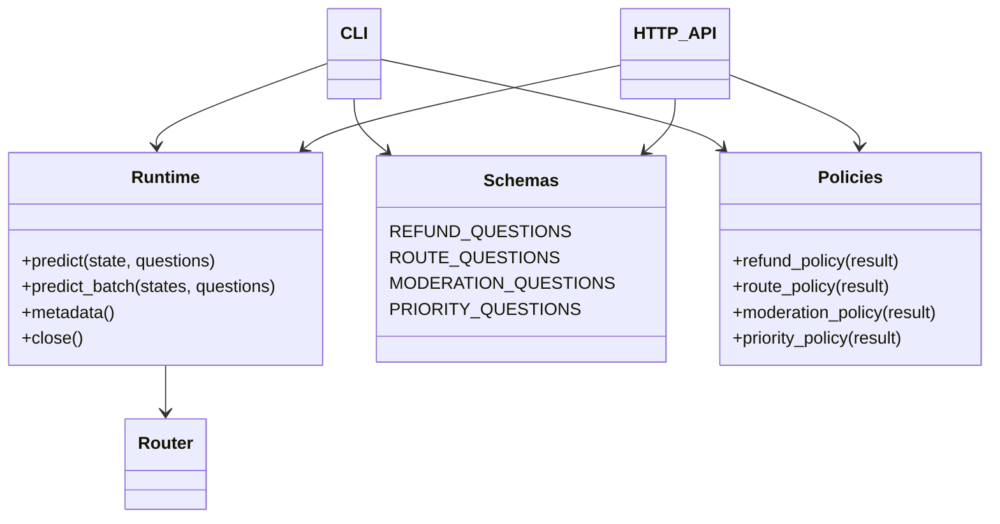
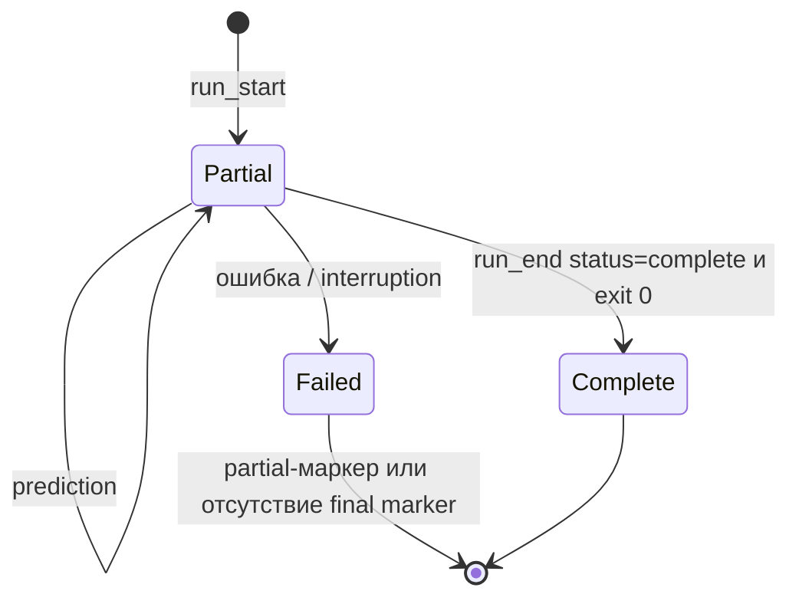
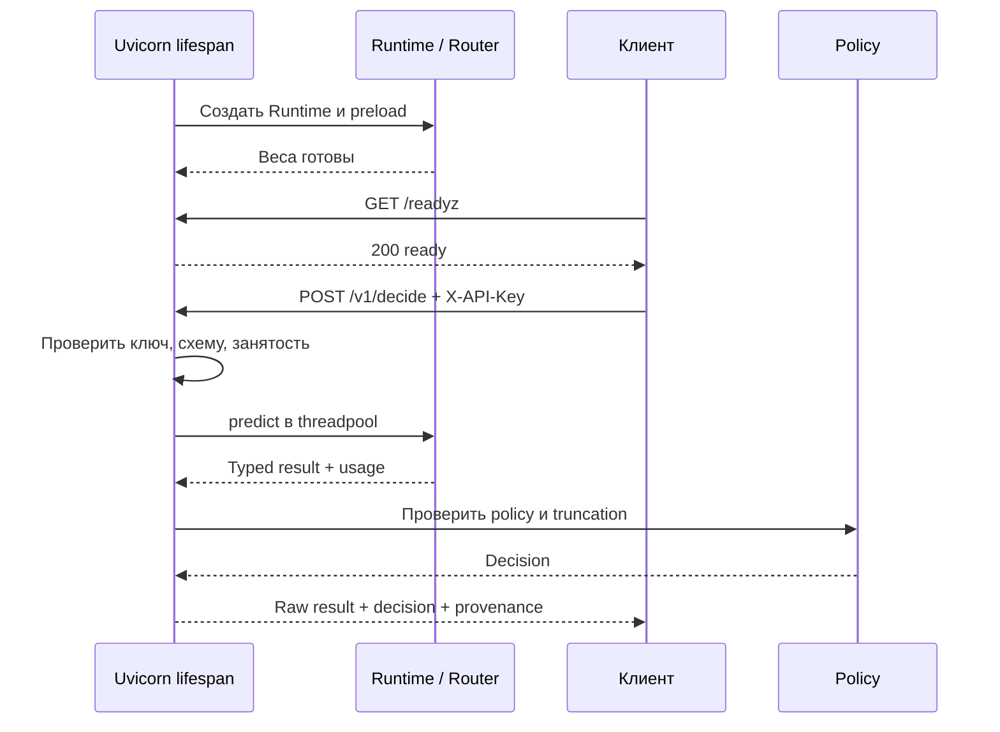

# Laya в production: шесть воспроизводимых сценариев

> Этот комплект относится к Laya **0.4.21** и официальному GitHub-срезу [`0565524a27bcb9821bcd7c42aaf49d925f6f8560`](https://github.com/NandhaKishorM/laya/tree/0565524a27bcb9821bcd7c42aaf49d925f6f8560). Общая теория, архитектура, математика, все официальные примеры и дополнительные интеграции находятся в [01_LAYA_GUIDE.md](01_LAYA_GUIDE.md). Здесь мы пройдём путь от установки собственного прикладного кода до проверки решений и работы сервиса.
>
> **Граница проверки:** по просьбе заказчика веса на машине подготовки не загружались и вычисление ответов модели, то есть инференс, не выполнялось. Команды ниже предназначены для вашей машины; они не доказывают, что модель уже дала правильные предсказания. Время ответа, потребление памяти GPU и качество на ваших данных предстоит измерить самостоятельно. Все учебные входы синтетические: это придуманные примеры, а не исследование качества модели и не достаточная выборка для её калибровки или итоговой проверки.

Слово production здесь означает использование программы в настоящем рабочем процессе. Например, письмо клиента должно попасть в нужную очередь не один раз на демонстрации, а каждый день, в том числе при перегрузке, ошибке входа или недоступных весах. Поэтому недостаточно получить красивую вероятность. Нужно знать, какой версией модели она вычислена, когда программа отказывается от решения, кто вправе вызвать сервис и как заметить, что решения стали хуже.

Мы не будем превращать классификатор в систему, которая самостоятельно возвращает деньги или блокирует пользователей. Laya отвечает на заранее сформулированные вопросы, а наш Python-код проверяет ответ и выдаёт рекомендацию. Связь этой рекомендации с платёжной системой, очередью поддержки или правилами доступа остаётся отдельной задачей вашего приложения.

## Оглавление

1. [Что входит в папку](#1-что-входит-в-папку)
2. [Окружение и воспроизводимость](#2-окружение-и-воспроизводимость)
3. [Все чекпоинты, Hub и офлайн](#3-все-чекпоинты-hub-и-офлайн)
4. [Как устроен общий код](#4-как-устроен-общий-код)
5. [Пример 01: запрос на возврат](#5-пример-01-запрос-на-возврат)
6. [Пример 02: маршрутизация обращений](#6-пример-02-маршрутизация-обращений)
7. [Пример 03: модерация](#7-пример-03-модерация)
8. [Пример 04: приоритет](#8-пример-04-приоритет)
9. [Пример 05: пакетный JSONL](#9-пример-05-пакетный-jsonl)
10. [Пример 06: HTTP API](#10-пример-06-http-api)
11. [Калибровка без выдуманного logits API](#11-калибровка-без-выдуманного-logits-api)
12. [Docker: CPU и NVIDIA GPU](#12-docker-cpu-и-nvidia-gpu)
13. [Приёмка на своей машине](#13-приёмка-на-своей-машине)
14. [Эксплуатация и границы безопасности](#14-эксплуатация-и-границы-безопасности)
15. [Проверки при подготовке и источники](#15-проверки-при-подготовке-и-источники)

## 1. Что входит в папку

Репозиторий — это папка проекта вместе с историей изменений. Для работы важна именно структура папки: Python-команды ниже рассчитывают, что рядом находятся `examples/`, `production/` и файлы зависимостей. Корень проекта — каталог `laya-production-guide/`, показанный на схеме, а не вложенный `examples/`. Если терминал открыт в другом месте, сначала перейдите в этот каталог обычной командой `cd` с вашим реальным путём.

В дереве ниже показано, где искать каждую часть. Сначала полезно различить три вида содержимого: исполняемый Python-код, настройки его окружения и учебные входные данные. Веса модели — большие файлы с выученными числовыми параметрами — в эту папку не включены.

```text
laya-production-guide/
├── 01_LAYA_GUIDE.md              # официальный API, теория, карта покрытия
├── 02_PRODUCTION.md              # этот документ
├── models.lock.json              # три репозитория + точные SHA весов
├── requirements.txt              # точные версии приложения и Laya
├── constraints-reference.txt     # предлагаемый стек ML для Python 3.12
├── Dockerfile                    # один образ, PyTorch index выбирается при сборке
├── compose.yaml                  # CPU-сервис, внешний доступ только через localhost
├── compose.gpu.yaml              # NVIDIA/CUDA override
├── .env.example                  # настройки без секретов
├── examples/
│   ├── 01_refund.py              # noul, bool/abstain, необязательная калибровка
│   ├── 02_route.py               # choice → очередь
│   ├── 03_moderation.py          # несколько независимых noul
│   ├── 04_priority.py            # score → ожидание и модальный уровень
│   ├── 05_batch.py               # bounded chunks, JSONL, явная полнота
│   └── 06_api.py                 # запуск HTTP API
├── production/
│   ├── runtime.py               # настройки, Router, происхождение результатов
│   ├── schemas.py               # явные критерии четырёх задач
│   ├── policies.py              # чистые функции принятия решения
│   ├── calibration.py           # бинарная post-hoc калибровка и метрики
│   └── api.py                   # FastAPI, lifespan, авторизация, backpressure
├── tools/
│   ├── download_models.py       # подготовка фиксированных локальных snapshots
│   └── calibrate.py             # collect → fit → evaluate
└── data/
    ├── tickets.jsonl            # восемь EN/RU обращений
    ├── api_request.json         # тело запроса API
    ├── calibration_fit.example.jsonl
    └── calibration_eval.example.jsonl
```

Пять программ командной строки и HTTP-сервис используют одну реализацию загрузки и правил принятия решения. Командный интерфейс, или CLI, позволяет запустить Python-модуль из терминала; HTTP-сервис принимает запросы других программ по сети. Дополнительные программы в `tools/` подготавливают модели и калибровку, но не являются седьмым и восьмым сценариями.

Начинать чтение кода удобнее с нужного файла в `examples/`: он связывает вход, общие вопросы из `production/schemas.py`, вычисление из `production/runtime.py` и правила из `production/policies.py`. `requirements.txt` описывает нужные пакеты Python, а `models.lock.json` — конкретные версии моделей. Это разные виды зависимостей: установка Laya не означает, что веса уже скачаны. В папке также нет официального учебного `_common.py`, секретных ключей и заранее придуманных предсказаний, выдаваемых за результаты модели.

## 2. Окружение и воспроизводимость

### 2.1. Базовый путь без Docker

Рекомендуемое окружение комплекта — **Python 3.12**. Хотя Laya декларирует Python ≥3.10, для конкретной версии Python, операционной системы и ускорителя должны существовать совместимые готовые пакеты — wheels. Это особенно важно для PyTorch: он выполняет численные вычисления модели и содержит компоненты, зависящие от платформы. Не следует устанавливать всё в системный Python, где уже могут жить несовместимые пакеты других приложений.

Для изоляции используется виртуальное окружение `venv`. Это отдельный каталог с интерпретатором и установленными пакетами; оно не является ни виртуальной машиной, ни контейнером. Программа `pip` устанавливает пакеты именно в выбранный интерпретатор. Поэтому мы пишем `python -m pip`, чтобы установка не ушла случайно в другой Python. Активация окружения меняет поиск команд в текущем терминале, но не устанавливает зависимости сама.

Начнём с CPU, то есть центрального процессора: такой путь не требует NVIDIA или CUDA. GPU — графический ускоритель — может выполнять подходящие матричные вычисления быстрее, но требует совместимых драйвера, пакетов и достаточной памяти. Само наличие GPU не меняет смысл вопросов модели и не гарантирует нужную скорость.

Все команды выполняйте **из корня этой папки**. Следующий блок предназначен для Bash в Linux/macOS. Первая команда создаёт `.venv`, вторая активирует его. Затем обновляется установщик, устанавливается CPU-версия PyTorch, а после неё — зависимости приложения с ограничениями версий. Последняя Python-команда выводит установленную версию Laya; `mkdir -p` создаёт каталог будущих результатов и не мешает, если он уже существует.

```bash
python3.12 -m venv .venv
source .venv/bin/activate
python -m pip install --upgrade pip

# CPU-путь, не требует CUDA.
python -m pip install torch==2.8.0 --index-url https://download.pytorch.org/whl/cpu
python -m pip install -r requirements.txt -c constraints-reference.txt
python -c "import importlib.metadata as m; print(m.version('laya'))"
mkdir -p outputs
```

Успешная установка заканчивается без сообщения об ошибке, а проверка версии должна показать `0.4.21`. Это проверяет установку пакета, но не загрузку модели. Сообщение `No matching distribution found` обычно требует проверить версию Python, платформу и выбранный индекс пакетов; его не стоит «лечить» случайным снятием всех ограничений версий.

Если ваш терминал работает в **Fish**, не выполняйте в нём Bash-активацию `source .venv/bin/activate`. После создания окружения используйте `source .venv/bin/activate.fish`; следующие команды `python -m pip ...` остаются теми же. Можно вообще не активировать окружение: во всех последующих Python-командах заменять `python` на `.venv/bin/python`. Например, `.venv/bin/python -m examples.01_refund --help` явно выбирает интерпретатор независимо от оболочки.

Windows PowerShell: `py -3.12 -m venv .venv`, затем `.\.venv\Scripts\Activate.ps1`; остальные Python-команды те же. Переменные задавать через `$env:LAYA_MODEL="multilingual"`, а не через `export`.

Если вы собираетесь считать на NVIDIA GPU, вместо CPU-команды установки PyTorch используйте следующий блок. Индекс `cu128` выбирает сборку PyTorch для соответствующей ветки CUDA — программной среды вычислений на NVIDIA. Повторная установка зависимостей сохраняет согласованный стек. Проверочная команда выводит доступность CUDA для этого Python и версию CUDA, под которую собран PyTorch.

```bash
python -m pip install torch==2.8.0 --index-url https://download.pytorch.org/whl/cu128
python -m pip install -r requirements.txt -c constraints-reference.txt
python -c "import torch; print(torch.cuda.is_available(), torch.version.cuda)"
```

Значение `True` в проверке доступности означает, что PyTorch видит CUDA, но ещё не доказывает успешный запуск Laya. `False` может означать неподходящий драйвер, CPU-сборку PyTorch или отсутствие GPU в текущем окружении. CUDA wheel требует совместимого драйвера. Видеокарта с 96 GB памяти не обязательна: у этих моделей сотни миллионов, а не десятки миллиардов параметров. При этом обещать конкретный объём VRAM, то есть памяти видеокарты, без запуска нельзя.

Потребление памяти зависит от длины входа, числа одновременно обрабатываемых примеров, точности хранения чисел (`dtype`), вычислительного механизма (`backend`) и числа загруженных моделей. Для MPS/XPU/другой CUDA выберите поддерживаемую вашим оборудованием сборку PyTorch по [официальной инструкции](https://pytorch.org/get-started/locally/) и осознанно адаптируйте reference constraint на torch, если он несовместим. Это не обещание проверенной работы комплекта на всех ускорителях.

Версии закрепляются, чтобы при следующей установке незаметно не получить другое поведение. Здесь зафиксированы Laya, FastAPI, Pydantic, Uvicorn, предлагаемые основные зависимости машинного обучения и SHA всех трёх снимков моделей с Hub. SHA — точный идентификатор версии содержимого репозитория; название модели само по себе такой точности не даёт. Однако `constraints-reference.txt` **не является полным lock-файлом**: он не фиксирует каждую косвенную зависимость и не гарантирует одинаковое исполнение вычислительных ядер на разных GPU.

После успешной приёмки сохраните вывод `python -m pip freeze` вместе с материалами вашего релиза. Он перечислит фактически установленные версии пакетов. Для Docker также закрепите digest образа и базового образа — идентификаторы их конкретного содержимого. Reference-стек использует Transformers 5.0.0 и Hugging Face Hub 1.3.0: сохранённые конфигурации encoder, то есть компонента кодирования текста, указывают `transformers_version=5.0.0` и новые поля `rope_parameters`. Совместимость графа зависимостей для Python 3.12 проверена, но полный стек машинного обучения здесь не устанавливался и реальный инференс не выполнялся.

### 2.2. Переменные перед импортом

Переменные окружения — это именованные строки, которые процесс получает при запуске. Ими удобно задавать настройки без изменения исходного Python-файла. В данном случае они важны ещё и по времени: библиотека может выбрать доступные вычислительные механизмы во время импорта, а не при первом предсказании. Поэтому `production.runtime` до импорта Laya устанавливает:

```python
os.environ.setdefault("USE_TF", "0")
os.environ.setdefault("USE_TORCH", "1")
os.environ.setdefault("TOKENIZERS_PARALLELISM", "false")
```

В версиях Transformers, которые учитывают эти переключатели, `USE_TF=0` просит не подключать TensorFlow, а `USE_TORCH=1` — использовать доступный PyTorch. Это помогает не загружать ненужную вычислительную библиотеку, однако не превращает саму Laya в TensorFlow-модель: наш код рассчитан на PyTorch. Набор поддерживаемых библиотек и роль таких переменных зависят от версии Transformers. Выбор CPU или GPU задаётся отдельно через `device`, а не этими строками.

`TOKENIZERS_PARALLELISM=false` относится к токенизатору — компоненту, который разбивает текст на входные единицы, токены. Эта настройка отключает его внутреннюю многопоточную обработку, но не запрещает пакетные вычисления модели и не выключает GPU. Поэтому её не нужно воспринимать как общий переключатель «работать медленнее, но точнее»: качество ответа она не настраивает.

Такую строку часто добавляют из-за предупреждения о создании дочернего процесса после запуска потоков токенизатора. В Unix-подобных системах операция `fork` копирует состояние процесса, но уже существующие потоки не продолжают работу в новой копии тем же образом. Из-за этого библиотека предупреждает о риске взаимного ожидания, то есть зависания. Отключение внутреннего параллелизма уменьшает именно этот риск; оно не гарантирует отсутствие любых зависаний в приложении. Если вы не используете несколько процессов, эта проблема может вообще не возникнуть, а влияние настройки на скорость нужно оценивать отдельно.

Метод `setdefault` сохраняет значение, уже заданное извне. Если в вашем терминале осталось `USE_TF=1` или `USE_TORCH=0`, программа не исправит противоречие автоматически. При встраивании в работающий Python-процесс задавайте эти переменные **до первого импорта Transformers**, включая неявный импорт через другие библиотеки. Позднее присваивание не перезапускает уже выбранный механизм.

В Bash переменную для дочерних процессов задают через `export ИМЯ=значение`; в Fish — через `set -gx ИМЯ значение`. Само имя и значение остаются одинаковыми. Ниже Bash-блоки сохранены как отдельный путь запуска; пользователю Fish следует переводить строки `export`, а не копировать их буквально.

## 3. Все чекпоинты, Hub и офлайн

### 3.1. Выбор во всех примерах

Чекпоинт (`checkpoint`) — сохранённая версия модели: её параметры и необходимые для загрузки настройки. Hugging Face Hub — хранилище, откуда эти файлы можно получить. В таблице перечислены три разные модели, а не три режима одной и той же копии весов. Выбирать стоит по языку и задаче; совпадение формата вызова не делает их взаимозаменяемыми по качеству.

| `--model` | Артефакт | Практическое назначение |
|---|---|---|
| `english` | `convaiinnovations/laya` | Англоязычные задачи, контекст по конфигурации 512 |
| `multilingual` | `convaiinnovations/laya-multilingual` | Русский и другие языки; default 1024, документированное расширение до 8192 |
| `typed-decisions` | `convaiinnovations/laya-typed-decisions` | Дообученные англоязычные workflows, default 1024 |
| `auto` | Один из зарегистрированных выше | Router выбирает модель по языку; это не ансамбль и не среднее трёх ответов |

В наших примерах установлено `auto_task_detection=False`. Поэтому `auto` выбирает модель по языку, но не обещает распознать по произвольной схеме специальный рабочий процесс, под который обучалась typed-модель. Чтобы сравнить специализированный чекпоинт, укажите `typed-decisions` явно. Качество English/typed-decisions на русском не заявляется; для русских обращений исходной точкой служит `multilingual`.

Файл `models.lock.json` закрепляет следующие Hub revision, то есть точные версии файлов в каждом репозитории:

| Имя | Hub revision |
|---|---|
| english | `7b928d828b7b0e022f929d9bd2e44165aa270148` |
| multilingual | `1720e3e3357cfe1e281542e223f8273b0890ca34` |
| typed-decisions | `e929ae5cf69bc34259cd2f95c9e91145b818b1f0` |

Здесь используются **отдельные репозитории моделей**, или standalone repos. Официальный `Router` по умолчанию также умеет брать подкаталоги `multilingual` и `typed-decisions` из объединённого `convaiinnovations/laya`. Это другой адрес содержимого. Нельзя взять имя объединённого репозитория и SHA отдельного и ожидать, что они образуют правильную пару.

### 3.2. Общее CLI

Начните со справки: `--help` покажет допустимые аргументы без загрузки весов. В остальных строках `python -m` запускает указанный модуль проекта. Вторая строка просит multilingual оценить русское обращение на CUDA; она предназначена только для подготовленного GPU-окружения. Две последние показывают тот же принцип для маршрутизации на CPU и приоритета на typed-модели.

```bash
python -m examples.01_refund --help
python -m examples.01_refund --model multilingual --device cuda \
  --text 'Списали деньги дважды. Прошу вернуть второе списание.'

python -m examples.02_route --model english --device cpu
python -m examples.04_priority --model typed-decisions --device cuda
```

После запуска смотрите не только на итоговую рекомендацию, но и на выбранную модель, исходные вероятности и сведения об усечении входа. Без внешне проверенной политики нормальным результатом будет `review`, а не автоматическое действие. Если `--help` работает, а предсказание нет, это не противоречие: справке не нужны веса и вычислительный стек, в отличие от настоящего запуска.

Аргумент `--model` выбирает чекпоинт, а `--device` — устройство вычисления. Без `--device` его выбирает Laya; `cuda` нельзя указывать на машине без доступной CUDA. `--max-len` ограничивает общую длину входной последовательности, а `--head-max-len` — бюджет части, где описаны вопрос и варианты. Например, слишком длинное описание категорий может отнять место у самого письма: увеличение только размера пакета это не исправит.

`--batch-size 8` задаёт число **состояний**, обрабатываемых в одном вычислительном проходе, а не число вопросов. Состояние (`state`) здесь — текст одного обращения. Если к нему заданы два вопроса, encoder получает отдельную строку на каждую пару state × question; в пакетном режиме состояние не превращается в один общий однажды вычисленный вектор на все вопросы. Увеличение пакета может улучшить загрузку устройства, но требует памяти. `--max-loaded 2` ограничивает число резидентных, то есть одновременно находящихся в памяти, моделей Router в CLI. Предварительная загрузка `preload` в сервисе может увеличить этот лимит.

Следующая команда показывает настройку для длинных русских документов. Она читает учебный файл, передаёт приложению порции по четыре текста и считает внутри них пакетами по два состояния. `--max-len 8192` увеличивает допустимую общую длину, а новое имя выхода позволяет отличить этот запуск от предыдущих.

```bash
python -m examples.05_batch --model multilingual --max-len 8192 \
  --batch-size 2 --chunk-size 4 --input data/tickets.jsonl --output outputs/long-run.jsonl
```

Число `8192` — общий бюджет последовательности в токенах, а не обещание прочитать документ из 8192 токенов целиком. За место конкурируют инструкция, варианты ответа, служебные токены и само состояние. Проверяйте `usage.truncated`: при усечении наши политики отправляют результат на `review`, то есть на отдельное рассмотрение без автоматического решения. Если выходной файл уже существует, пакетный пример откажется его перезаписывать; задайте другое имя. Метод `predict_long` описан в общем руководстве, но чтение отдельных окон не равно пониманию документа целиком и требует самостоятельной проверки качества.

### 3.3. Подготовка офлайн-машины

Если рабочий сервер не должен обращаться в интернет, файлы нужно подготовить заранее. Следующая команда выполняется на машине с доступом к Hub, **не обязательно на целевом сервере**. `--model all` выбирает все три модели, а `--directory models` задаёт каталог назначения. Это загрузка файлов, не вычисление ответов.

```bash
python -m tools.download_models --model all --directory models
```

Утилита получает нужные веса, конфигурации, токенизатор и encoder из закреплённой версии каждого отдельного репозитория, а не все вложенные модели английского объединённого набора. Она не загружает веса в torch и не запускает их. После завершения в `models/` должны находиться отдельные каталоги подготовленных моделей. Если папка уже содержит чужие файлы, программа откажется смешивать версии. При прерванной первой загрузке без `snapshot_identity.json` используйте новую папку либо отдельно проверьте и удалите именно незавершённую копию.

Перенесите `models/` и подготовьте совместимое установленное окружение или образ на целевой машине. Простое копирование `venv` между разными ОС или путями не является универсальным способом переноса Python. Следующий Bash-блок задаёт реальные **абсолютные** пути к моделям, запрещает библиотекам обращаться к Hub и запускает сценарий возврата. Здесь снова выбран GPU; для CPU замените устройство на `cpu`.

```bash
export LAYA_ENGLISH_PATH="$PWD/models/english"
export LAYA_MULTILINGUAL_PATH="$PWD/models/multilingual"
export LAYA_TYPED_DECISIONS_PATH="$PWD/models/typed-decisions"
export HF_HUB_OFFLINE=1
export TRANSFORMERS_OFFLINE=1
python -m examples.01_refund --model multilingual --device cuda
```

В Fish этим пяти присваиваниям соответствуют `set -gx LAYA_ENGLISH_PATH "$PWD/models/english"`, `set -gx LAYA_MULTILINGUAL_PATH "$PWD/models/multilingual"`, `set -gx LAYA_TYPED_DECISIONS_PATH "$PWD/models/typed-decisions"`, `set -gx HF_HUB_OFFLINE 1` и `set -gx TRANSFORMERS_OFFLINE 1`. Python-команда затем остаётся прежней, либо запускается через `.venv/bin/python`. Успех офлайн-подготовки проверяется запуском без сети, а не только тем, что путь существует. Ошибка отсутствующего файла означает, что комплект нужно дополнить, а не отключить запрет сети незаметно для эксплуатации.

Не заменяйте `laya.load` на `_common.load`: последняя — учебная обёртка официальных примеров с логическими именами моделей. В нашем коде `_common` вообще не нужен. Это важно при переносе кусочков из официального примера: похожее название функции не означает тот же контракт загрузки.

Полный локальный чекпоинт включает `model.safetensors`, `rl_agent_config.json`, `encoder/` и `tokenizer/`. Двух файлов без токенизатора и encoder может не хватить для настоящего офлайна. Runtime записывает локальный путь, хеш конфигурации, размер и время изменения (`mtime`) весов. Эти сведения помогают понять происхождение результата, но **не проверяют криптографически содержимое весов**. Для строгой поставки отдельно сохраните SHA-256 всех файлов и проверяйте их до развёртывания. Hub revision из lock-файла сам по себе не доказывает, что лежит по произвольному локальному пути.

## 4. Как устроен общий код

Во всех шести сценариях проходит одна цепочка: текст становится `state`, схема задаёт `questions`, модель возвращает вероятности, а политика решает, достаточно ли этих данных для рекомендации. На диаграмме стрелки показывают, кто использует общий компонент. Это позволяет не поддерживать отдельно «версию вопросов для терминала» и «версию для сервера».



`Runtime` отвечает за **вычисление**, `schemas.py` — за смысл вопросов, а `policies.py` — за **допустимое действие на основании ответа**. Вход схемы — не просьба модели написать произвольный текст, а описание нужных решений и вариантов. Результат содержит исходный ответ (`raw result`) и отдельно вывод политики. `metadata()` сохраняет версию Laya, SHA исходников, настройки, источники моделей и загруженные версии. Если в поле `model` исходного ответа написано обобщённое `laya-rl-agent`, фактически выбранный чекпоинт ищите в `result.routing.model`.

В коде нет автоматической оплаты, удаления сообщений, вызова внешней большой языковой модели (LLM) или отправки тикета в чужую систему. `route_candidate` и `block_candidate` — рекомендации вызывающему бизнес-сервису, а не отчёт об исполненной операции. При подключении реального действия нужны проверка прав, защита от повторного исполнения одной операции (идемпотентность), журнал действий и возможность отмены или возврата к прежней версии. Модель не должна получать эти полномочия напрямую.

### Общие инварианты политик

По умолчанию политика работает осторожно: без `--validated-policy` она **всегда возвращает `review`**. Это не поломка модели и не утверждение, что все её ответы плохи. Программа просто не знает, проверяли ли вы именно эту модель, вопросы, данные и пороги. Флаг означает ваше заявление о проведённой внешней проверке; сам он ничего не обучает и не измеряет.

Даже с флагом автоматическая рекомендация допустима не всегда. Если `usage.truncated=true`, текст был усечён; если не поместились варианты, исказился сам вопрос. Деградация бюджета вариантов, отсутствующие обязательные поля, нечисловые значения или NaN вероятностей ведут к `review`. Неверно настроенные пороги считаются ошибкой конфигурации, а не ещё одним способом получить отрицательный ответ.

Правила используют `answer_confidence`, а не одно общее поле `confidence` для всех задач. Для бинарного `noul` вероятность `p` относится к «да», а уверенность выбранной стороны равна `max(p, 1-p)`. Для `choice` и `score` поле `confidence` связано с концентрацией всего распределения: `1-H/log(K)`, где `H` — энтропия, мера разброса вероятностей, а `K` — число вариантов. `answer_confidence` относится к выбранному ответу и может учитывать калибровочное отображение `binning_map`, а не просто совпадать с максимальной вероятностью. Поэтому нельзя без проверки подставлять одно поле вместо другого.

Ни слово confidence, ни наличие калибровки не дают гарантии правильности отдельного решения. Калибровка проверяет статистическое соответствие вероятностей частотам на подходящих данных; она не превращает ошибочную классификацию в доказанный факт. Исходные ответы не затираются политикой, поэтому приложение может проверить распределение и причину `review`.

## 5. Пример 01: запрос на возврат

**Файл:** [`examples/01_refund.py`](examples/01_refund.py). Представьте сотрудника поддержки, которому нужно отделить новые просьбы вернуть деньги от остальных писем. Это распознавание намерения, а не проверка права на возврат. Текст передаётся как `state`, а `REFUND_QUESTIONS` задаёт вопрос: просит ли человек вернуть деньги или отменить списание? Для такой задачи подходит тип `noul`: модель оценивает две стороны, «да» и «нет», но возвращает не готовое логическое значение, а вероятность «да».

Первая команда проводит русское обращение через эту цепочку и оставляет политику в режиме `review`. Вторая показывает два порога на письме с просьбой прислать счёт. Флаг `--validated-policy` в ней допустим только после вашей внешней проверки, а не ради получения более решительного вывода.

```bash
python -m examples.01_refund --model multilingual \
  --text 'Оплата прошла дважды. Верните повторное списание.'

# Только ПОСЛЕ внешней проверки вашей схемы, модели и порогов:
python -m examples.01_refund --model multilingual \
  --text 'Пожалуйста, пришлите счёт за март.' \
  --negative-threshold 0.2 --positive-threshold 0.8 --validated-policy
```

В `REFUND_QUESTIONS` варианты `false` и `true` имеют явные смысловые описания: упоминание возврата ещё не обязательно является новой просьбой. В исходном ответе `answers.refund_requested.noul = P(request=true)` содержит вероятность именно положительной стороны. Обозначим её `p`; политика сравнивает её с порогами и отдельно проверяет уверенность выбранной стороны.

| Условие | Рекомендация при проверенной политике |
|---|---|
| p ≥ positive_threshold и условие уверенности выполнено | `refund_review_candidate`, `refund_requested=true` |
| p ≤ negative_threshold и условие уверенности выполнено | `no_refund_request`, `refund_requested=false` |
| Между порогами или условие уверенности не выполнено | `review`, `refund_requested=null`, если ответ удалось разобрать |
| Нет внешней валидации, усечение или повреждённый ответ | `review`; при раннем отказе некоторые поясняющие поля отсутствуют |

В учебной политике действует дополнительное условие допуска: `answer_confidence >= 0.8`. Изменить только положительный порог недостаточно. Например, **для расчётной иллюстрации**, при `p=0.6` и пороге `0.55` вероятность уже выше порога, но уверенность выбранной стороны составляет лишь `0.6`. Результат всё равно уйдёт на `review`, поэтому проверять нужно правило целиком.

Минимальное двоичное решение на Python выглядит как `flag = answer['noul'] >= threshold`. Однако `bool` оставляет только `True` и `False`: всё ниже порога становится «нет». В рабочем процессе полезно различать уверенное «нет» и отказ от решения. Поэтому используются `True / False / None` и причина в `reason`; при записи в JSON Python-значение `None` становится `null`. Обработчик не должен превращать `None` в отрицательный ответ обычной проверкой истинности.

Другая расчётная иллюстрация: при `p=0.1342` уверенность отрицательной стороны равна `1−0.1342=0.8658`. Поэтому `confidence=0.8658` не означает вероятность просьбы о возврате 86%. В реальном результате сначала проверьте имя вопроса и `noul`, затем решение, причину отказа и `usage.truncated`. Отсутствующее свидетельство при раннем отказе тоже нельзя считать `false`.

Когда ответ удалось разобрать, политика добавляет `eligibility_assessed=false`: право на возврат не проверялось. При раннем отказе из-за повреждённого ответа или усечения этого поля может не быть, однако его отсутствие тоже не означает разрешения на операцию. Даже явная просьба не доказывает наличие платежа, отсутствие прошлого возврата, право клиента или успешность денежной операции. `refund_review_candidate` предлагает рассмотреть запрос, а не перечислить деньги. Номер платежа и свободное текстовое объяснение этот вызов Laya также не извлекает.

## 6. Пример 02: маршрутизация обращений

**Файл:** [`examples/02_route.py`](examples/02_route.py). Здесь нужно выбрать отдел для обращения. Текст становится `state`, а вопрос `department` предлагает варианты `billing` для расчётов, `technical` для технической помощи, `sales` для продаж и `other` для остальных случаев. Тип `choice` означает выбор среди альтернатив, а не несколько независимых признаков.

Первая команда использует автоматический выбор модели для английского сообщения об ошибке загрузки файла. Вторая явно выбирает multilingual для русского вопроса о корпоративном договоре и показывает порог `0.9` для `answer_confidence`. Флаг проверки политики по-прежнему допустим только после реальной приёмки.

```bash
python -m examples.02_route --model auto \
  --text 'The application returns an error whenever I upload a file.'
python -m examples.02_route --model multilingual \
  --text 'Хочу узнать стоимость корпоративного договора.' \
  --min-answer-confidence 0.9 --validated-policy
```

Здесь есть две разные маршрутизации. Сначала официальный `Router` выбирает **чекпоинт**, например multilingual для русского. Затем вопрос `department` выбирает **бизнес-очередь**. Успешный выбор модели ещё не доказывает правильность отдела.

`decision.department` отражает ответ классификатора, а `routing.target_queue` содержит пригодную рекомендацию очереди только после разрешения политики. Категория `other`, равенство верхних округлённых вероятностей или недостаточный `answer_confidence` приводят к `review`. **Для иллюстрации**, лидер с вероятностью `0.55` не проходит порог уверенности `0.9` лишь потому, что остальные ещё ниже. Это пример чтения правила, не результат запуска.

После команды проверьте отдельно выбранную модель, распределение вариантов, итоговую очередь и причину `review`. Искать тикет в реальной системе поддержки не нужно: `dispatch_performed=false` говорит, что код его никуда не отправлял. `external_llm_called=false` означает отсутствие скрытого вызова внешнего платного API.

Ту же идею можно приспособить для выбора большой языковой модели: заменить отделы классами сложности или предметными областями, измерить качество последующего ответа и связать категории с конкретными LLM во внешнем сервисе. Но метка «лёгкий» сама по себе не доказывает, что маленькая генеративная модель ответит правильно. Официальные интеграции LangChain/LangGraph/LlamaIndex/CrewAI/Agno разобраны в общем документе; данный пример их не вызывает.

## 7. Пример 03: модерация

**Файл:** [`examples/03_moderation.py`](examples/03_moderation.py). Одно сообщение может одновременно угрожать человеку и просить одноразовый код входа. Поэтому `state` проверяется двумя отдельными вопросами `noul`: об адресном оскорблении/угрозе и о мошеннической просьбе раскрыть секретные данные доступа (`credentials`). Критерии различают собственное высказывание автора и цитату из жалобы.

Первая команда показывает несогласие с ценой, вторая — просьбу передать код входа. Это входные ситуации, а не заранее известные предсказания. Во втором запуске политика открыта флагом только как образец запуска после проверки; флаг не заменяет исследования ложных блокировок.

```bash
python -m examples.03_moderation --model multilingual \
  --text 'Не согласен с ценой продукта, но спасибо за подробное объяснение.'
python -m examples.03_moderation --model english \
  --text 'Send me your one-time login code so I can unlock your account.' \
  --validated-policy
```

Это задача с несколькими метками, или **multi-label**. Два положительных ответа не противоречат друг другу, а их вероятности не обязаны в сумме давать единицу. Выбирать лишь «самую опасную» категорию через `choice` было бы потерей второго признака. Все вопросы передаются одним вызовом, однако вычислительная работа растёт с числом пар состояния и вопроса.

При проверенной политике каждый признак должен пройти условие `answer_confidence >= 0.9`. Любой риск с `p≥0.9` даёт `block_candidate`, все риски с `p≤0.1` — `allow_candidate`, а промежуточные случаи требуют `review`. **Для расчётного примера**, значения `0.03` и `0.95` нельзя усреднять до «среднего риска»: второе уже достаточно для рекомендации блокировки при выполнении остальных проверок. В реальном выходе читайте оба ответа.

`advisory_only=true` сохраняется всегда: код советует, но не удаляет сообщение и не лишает пользователя доступа. Это **не граница безопасности**. Отсутствие двух выбранных признаков не доказывает безопасность текста: схема не охватывает все виды вреда, попытки навязать приложению инструкции (`prompt injection`), юридические требования и культурные контексты. Права доступа, изоляция инструментов и правила хранения данных должны работать независимо от модели. Настоящие секреты в примеры не подставляйте.

## 8. Пример 04: приоритет

**Файл:** [`examples/04_priority.py`](examples/04_priority.py). Теперь требуется оценить влияние проблемы на работу, а не силу эмоций автора. Описание инцидента становится `state`, а схема задаёт четыре упорядоченных уровня от low до critical. Тип `score` возвращает распределение уровней и численное ожидание индекса.

Первая команда описывает недоступность оформления заказов для всех клиентов; вторая — проблему одного пользователя с ручным обходом. Они показывают различие критериев воздействия, но правильность ответа модели предстоит проверить. Вторая команда также иллюстрирует явный выбор typed-decisions после проверки политики.

```bash
python -m examples.04_priority --model english \
  --text 'Production checkout is unavailable for all customers; orders cannot be placed.'
python -m examples.04_priority --model typed-decisions \
  --text 'One user cannot export a report; a manual workaround is available.' \
  --validated-policy
```

Поле `score = Σ i·p_i` — математическое ожидание индекса. Здесь `i` принимает значения `0,1,2,3`, а `p_i` — вероятность соответствующего уровня. Мы умножаем каждый индекс на его вероятность и складываем результаты. Это не шкала 1–4 и не процент; дробное значение нормально.

Среднее (`mean`) и самый вероятный уровень (`mode`, мода) отвечают на разные вопросы. **Для ручного расчёта**, распределение `[0.45, 0.05, 0.05, 0.45]` даёт `0×0.45+1×0.05+2×0.05+3×0.45=1.5`. При этом лидируют оба края с вероятностью `0.45`, а не середина. Выбор через `round(score)` выдумал бы класс, не поддержанный распределением.

Поэтому пример отдаёт `expected_index` как возвращённое моделью ожидание и отдельно `modal_index`, `modal_label`, `modal_probability` как индекс, название и вероятность максимума распределения (`argmax`). `answer_confidence` хранится отдельно: после калибровочного отображения по интервалам оно может отличаться от вероятности модального класса.

В политике порог уверенности равен `0.9`, а равенство модальных округлённых вероятностей означает `review`. После запуска сравните распределение, средний индекс и модальную метку. `sla_assigned=false` напоминает, что код не назначает обязательный срок реакции. SLA — согласованное обязательство по уровню обслуживания — зависит ещё от контракта, сегмента клиента, графика дежурства и уже открытых инцидентов; этих сведений может не быть в тексте.

## 9. Пример 05: пакетный JSONL

**Файл:** [`examples/05_batch.py`](examples/05_batch.py). Когда писем много, удобнее обработать файл, чем запускать отдельный процесс для каждого. Учебный [`data/tickets.jsonl`](data/tickets.jsonl) содержит восемь синтетических обращений. JSON — текстовый формат структурированных объектов с полями, а JSONL хранит по одному JSON-объекту на строку. Такой файл можно читать порциями.

Первая команда выбирает `--schema route`, то есть вопросы и политику маршрутизации; вторая — `--schema refund` для возвратов. Также поддерживаются `moderation` и `priority`, а по умолчанию используется `route`. `mkdir -p` готовит каталог результатов. Разные имена выходов нужны потому, что каждый запуск создаёт новый файл.

```bash
mkdir -p outputs
python -m examples.05_batch --model multilingual \
  --input data/tickets.jsonl --output outputs/tickets-route-001.jsonl \
  --schema route --batch-size 8 --chunk-size 32

python -m examples.05_batch --model english \
  --input data/tickets.jsonl --output outputs/tickets-refund-001.jsonl \
  --schema refund --batch-size 4 --chunk-size 16
```

Второй запуск технически возможен на смешанном англо-русском файле, но **не доказывает пригодность English checkpoint для русского**. При приёмке выделяйте отдельные языковые группы и измеряйте качество каждой: общий успешный запуск может скрыть ошибки на одной из них.

Каждая входная строка имеет вид `{"id":"ticket-001","text":"..."}`. `text` становится состоянием, а `id` позволяет сопоставить письмо и предсказание без копирования текста в результат. Порядок и соответствие ID сохраняются. Пустая строка, повторный ID, повторный JSON-ключ, неверный тип и NaN/Infinity считаются ошибкой, а не пропускаются незаметно.

Размер порции `chunk-size` и вычислительного пакета `batch-size` решают разные задачи. При `chunk-size=32` приложение передаёт Router до 32 текстов за раз; `batch-size=8` ограничивает внутренний вычислительный проход восемью состояниями. Router дополнительно группирует разные модели, схемы и бюджеты длины. `sort_by_length=True` собирает близкие длины для вычисления, но восстанавливает внешний порядок.

Память не становится постоянной, то есть O(1). Порция и максимальная строка ограничивают объём текстов в памяти, но множество всех увиденных ID растёт как **O(N)** с числом записей. Для очень больших потоков уникальность следует обеспечить внешней базой или очередью. Этот пример не реализует такую замену и не является полноценным планировщиком задач.

### Полнота результата

Появление предсказаний ещё не означает обработки всего входа: процесс может остановиться после седьмой строки из восьми. Следующая схема показывает состояние запуска, а не уверенность модели. До подтверждённого завершения результат считается частичным.



Выход создаётся только как новый файл через `open('x')`: существующий файл не перезаписывается. Первая запись `run_start` уже объявляет запуск частичным (`partial`), затем идут `prediction`, а в конце — `run_end`. Полноту подтверждают **вместе** статус complete, ожидаемое число записей и нулевой код завершения процесса. Для учебного входа проверяйте восемь предсказаний отдельно от служебных маркеров.

При заполненном диске или принудительной остановке конечного маркера может не быть. При обычной ошибке программа по возможности пишет partial-маркер и завершается с ненулевым кодом. Несколько корректных JSON-строк не исправляют неполноту всего запуска. После команды проверьте маркеры, количество, ID и порядок; для повтора задайте новое имя. Автоматического продолжения с места остановки здесь нет.

В `prediction` находятся исходный результат модели, решение, схема и сведения об окружении и происхождении (`runtime/provenance`). Текст намеренно не копируется в выход, однако распределения категорий и маршрутизация тоже могут раскрывать чувствительные сведения. Ограничивайте доступ к этим файлам.

## 10. Пример 06: HTTP API

**Файлы:** [`examples/06_api.py`](examples/06_api.py), [`production/api.py`](production/api.py). Если классификацию вызывает другая программа, вместо запуска CLI ей удобнее отправить сетевой запрос. HTTP — протокол запроса и ответа, а API — согласованный интерфейс сервиса. Здесь библиотека FastAPI принимает JSON, проверяет его структуру и вызывает настоящий Laya Runtime. Это не заглушка с заранее приготовленными ответами.

Цепочка остаётся знакомой: `text` становится состоянием, `scenario` выбирает набор вопросов, модель вычисляет ответ, политика формирует рекомендацию. Следующий Bash-блок генерирует случайный секретный ключ локально, передаёт его серверу через окружение и запускает сервер на порту 8000. Адрес `127.0.0.1` разрешает подключаться только с этой машины; он не публикует сервис в интернет.

```bash
# Выберите собственный секрет; пример генерирует его локально.
export LAYA_API_KEY="$(python -c 'import secrets; print(secrets.token_urlsafe(32))')"
python -m examples.06_api --model multilingual --device cuda --host 127.0.0.1 --port 8000
```

Для машины без NVIDIA выберите `--device cpu` либо не указывайте устройство. Ключ передаётся через окружение, а не аргумент командной строки и не исходный файл. В Fish строка генерации имеет вид `set -gx LAYA_API_KEY (python -c 'import secrets; print(secrets.token_urlsafe(32))')`; затем сервер запускается той же Python-командой. При прямом запуске `uvicorn production.api:app` настройки читаются из `LAYA_MODEL`, `LAYA_DEVICE`, `LAYA_MAX_LEN`, `LAYA_HEAD_MAX_LEN`, `LAYA_BATCH_SIZE`, `LAYA_MAX_LOADED`; они соответствуют выбору модели, устройства и ограничений, разобранных выше.

Оставьте сервер работающим и откройте второй терминал. В него нужно безопасно передать **тот же** секрет: переменная одного терминала не появляется автоматически в другом. Не генерируйте второй новый ключ для клиента. Первые две команды ниже проверяют состояние сервиса. Третья отправляет POST-запрос на классификацию: заголовок `X-API-Key` подтверждает знание ключа, `Content-Type` сообщает формат, а `--data-binary @...` читает тело из файла. Параметр `--fail-with-body` позволяет увидеть тело ошибки и получить ненулевой код при HTTP-ошибке.

```bash
curl --fail-with-body http://127.0.0.1:8000/healthz
curl --fail-with-body http://127.0.0.1:8000/readyz
curl --fail-with-body http://127.0.0.1:8000/v1/decide \
  -H "X-API-Key: $LAYA_API_KEY" -H 'Content-Type: application/json' \
  --data-binary @data/api_request.json
```

В успешном ответе ищите исходный результат, решение и сведения о происхождении, а не сгенерированный текст. Тело запроса принимает `text`, `scenario` (`refund`, `route`, `moderation`, `priority`) и необязательный `request_id`. Контроль модели остаётся у сервера: недоверенный клиент не выбирает чекпоинт в каждом запросе. Лишние поля отклоняются. После удаления крайних пробелов (`strip`) текст должен быть непустым и не длиннее 16000 символов.

Этот лимит проверяется **после разбора JSON**. Он не ограничивает размер сетевого тела до чтения и не гарантирует, что текст поместится в токены модели. Для защиты от огромного запроса нужен дополнительный сетевой лимит. При неверном ключе ожидается `401`, при нарушении схемы — `422`; такие ответы нельзя превращать в отрицательную классификацию.

### Жизненный цикл

Сервису нужно время между запуском процесса и готовностью весов. В FastAPI этот этап организован как жизненный цикл (`lifespan`) приложения; ASGI — интерфейс, через который сервер Uvicorn запускает приложение и передаёт ему запросы. Диаграмма показывает порядок: сначала Runtime и предварительная загрузка, потом запрос и политика.



На старте проверяется ключ длиной не менее 16 символов, создаётся Runtime и загружаются веса. До окончания ASGI startup сервер обычно ещё не принимает запросы. `/healthz` означает, что обработчик жив, а `/readyz` — что запуск завершён и модели загружены. Это разные вопросы: процесс может быть жив, но ещё не готов обслуживать классификацию. Ни один из этих ответов не подтверждает качество модели или завершение первого прогревочного вычисления GPU.

При `LAYA_MODEL=auto` API заранее загружает **все три** чекпоинта, и Laya увеличивает лимит резидентных моделей под `preload`. При фиксированном `multilingual` загружается только он. Поэтому для ограниченной памяти разумнее фиксированная модель. В CLI загрузка без `preload` ленивая: модель появляется по необходимости, а исходный лимит — две.

Здесь один процесс и одно место для одновременного вычисления — inference slot. Численная работа выполняется в пуле потоков (`threadpool`), чтобы не занимать цикл обработки сетевых событий (`event loop`). Но это не разрешает считать несколько запросов одновременно: следующий пересекающийся запрос получает `429` и `Retry-After: 1`. Заголовок предлагает повторить попытку позднее, но сам повтор сервер не делает. Так ограничивается нагрузка вместо неограниченной очереди в памяти. Объединения HTTP-запросов в вычислительный пакет нет; для массовой обработки предназначен пример 05.

Ошибки инференса возвращаются как `503` без текста исключения и содержимого обращения. В журнал попадают только `request_id` и тип ошибки. Успешный HTTP-ответ с `review` отличается от `503`: в первом случае вычисление завершилось, но политика не разрешила рекомендацию; во втором вычислению доверять нельзя. `429` воспроизводится только при реальном пересечении запросов по времени.

По умолчанию `LAYA_VALIDATED_POLICY=0`, поэтому решения остаются `review`. Значение `1` допустимо после проверки соответствующих сценариев. Это **общий переключатель четырёх политик**: если проверена одна, не открывайте им остальные; при интеграции ограничьте интерфейс отдельной предметной задачей. API не применяет файл из `tools.calibrate` автоматически: дополнительная бинарная калибровка показана только в CLI 01. Официальную калибровку чекпоинта при адаптации API следует загрузить отдельно и проверить на той же модели и схеме.

`request_id` помогает связать запрос, ответ и журнал, но **не защищает от повторного исполнения**. Пока сервис только классифицирует, внешних побочных операций нет. При подключении платежей или инструментов потребуется устойчивый ключ идемпотентности в базе данных. Несколько процессов Uvicorn (`workers`) на одной GPU также не являются бесплатным ускорением: каждый создаёт собственную копию моделей. Статический API-ключ — лишь минимальная проверка доступа примера, а не система управления ролями (IAM), выдача полномочий через OAuth или взаимная проверка сертификатов (mTLS).

## 11. Калибровка без выдуманного logits API

### 11.1. Что исправляет T

Может оказаться, что среди ответов с вероятностью около `0.9` правильны заметно меньше 90%. Это повод проверить калибровку: насколько численная уверенность соответствует наблюдаемой частоте правильных ответов на ваших данных. Она отличается от точности классификации: можно изменить вероятности, не изменив выбранные классы.

Laya уже применяет температуру чекпоинта — числовой коэффициент масштаба уверенности, а иногда отдельные настройки по группам вопросов или языкам. Публичный `noul` — уже преобразованная и округлённая вероятность. Здесь **не предполагается** существование `return_logits=True` или `answer['logits']`: логиты, внутренние численные оценки до превращения в вероятности, этот прикладной путь не получает.

Для бинарной вероятности `p` можно приближённо восстановить логарифм отношения шансов и выполнить дополнительное преобразование:

$$z=\log\frac{\operatorname{clip}(p,\varepsilon,1-\varepsilon)}{1-\operatorname{clip}(p,\varepsilon,1-\varepsilon)},\qquad p_{app}=\sigma(z/T_{app}).$$

В формуле `clip` ограничивает `p` диапазоном от `ε` до `1−ε`, чтобы не делить на ноль и не брать логарифм нуля. Здесь `ε=10⁻⁶`. Отношение `p/(1−p)` — шансы положительного ответа, `log` — натуральный логарифм, а `z` — восстановленный бинарный логит. Положительная температура `T_app` делит этот логит, после чего сигмоида `σ(x)=1/(1+exp(−x))` возвращает число от нуля до единицы. Результат `p_app` используется как дополнительная прикладная вероятность.

**Для ручного расчёта**, при `p=0.8` шансы равны `4`, `z=log(4)≈1.3863`. Если `T_app=2`, получаем `σ(0.6931)≈0.6667`: сильное «да» становится осторожнее, но остаётся «да». При `T_app=1` ничего не меняется; при положительном `T_app<1` распределение становится резче. Это иллюстрация формулы, не измеренная калибровка Laya.

Такое дополнительное температурное масштабирование (`temperature scaling`) работает в пространстве опубликованных вероятностей. Это не автоматически метод Platt scaling, который обычно подбирает и наклон, и свободный сдвиг. Если бы внутренняя температура была известна, а вероятности не округлялись, итоговый масштаб соответствовал бы произведению внутренней и дополнительной температур. Здесь округление до четырёх знаков уже потеряло часть информации, поэтому преобразование приблизительно.

В `production/calibration.py` выбирается температура из детерминированной логарифмической сетки `[0.05,20]`, включая `1`, по минимуму NLL на калибровочной части данных. Смысл NLL разобран ниже. Веса модели и encoder при этом не обучаются. Если лучший коэффициент близок к краю диапазона, файл результата содержит предупреждение: нужно проверить данные, а не автоматически принять крайнее значение. Порядок и знак логитов сохраняются, поэтому при пороге `0.5` ошибочно выбранная сторона не исправится. Значения `p=0/1` ограничиваются через clipping; утраченную округлением информацию восстановить нельзя.

### 11.2. Полный воспроизводимый процесс

Учебные файлы содержат **по 12 ручных синтетических текстов**, оба класса и один вопрос. Они показывают работу процесса, но не являются достаточной проверкой для эксплуатации. Метка (`label`) описывает «новую явную просьбу вернуть деньги», поэтому вопрос о статусе уже запрошенного возврата размечен как false. Сначала согласуйте определение задачи с бизнесом; если оно другое, изменить нужно и критерии вопроса, и разметку.

На вашей машине с установленной моделью выполните следующую последовательность. Сначала `mkdir -p` готовит выходной каталог. Два запуска `collect` вычисляют вероятности на двух разных наборах с **одним** чекпоинтом, схемой и бюджетами токенов. `fit` подбирает температуру на первом наборе и записывает её в JSON; `--cohort billing-en-teaching-only` подписывает, для какой группы данных проводился опыт, но не делает выборку представительной. `evaluate` оценивает уже выбранный коэффициент на втором наборе, не подбирая его заново. Эти две команды модели не загружают. Последняя команда показывает применение файла в сценарии возврата; без флага проверенной политики решение по-прежнему останется `review`.

```bash
mkdir -p outputs
# Оба collect должны использовать ОДИН checkpoint, schema и token budgets.
python -m tools.calibrate collect --model english \
  --input data/calibration_fit.example.jsonl --output outputs/refund-fit-probs.jsonl
python -m tools.calibrate collect --model english \
  --input data/calibration_eval.example.jsonl --output outputs/refund-eval-probs.jsonl

# Следующие две команды уже не загружают модели.
python -m tools.calibrate fit --input outputs/refund-fit-probs.jsonl \
  --output outputs/refund-temperature.json --cohort billing-en-teaching-only
python -m tools.calibrate evaluate --artifact outputs/refund-temperature.json \
  --input outputs/refund-eval-probs.jsonl --output outputs/refund-evaluation.json

python -m examples.01_refund --model english \
  --calibration outputs/refund-temperature.json \
  --text 'Please refund the duplicate charge.'
```

Для русского нужны представляющие вашу реальную задачу русскоязычные данные и `--model multilingual` в **обоих** сборах вероятностей и последующем запуске. Для typed-decisions нужна своя проверка с его данными. Подобранную температуру нельзя переносить между версиями чекпоинта, формулировками вопроса, числом вариантов и языковыми областями без новой проверки.

`collect` отказывается от `--model auto`, чтобы не смешивать модели, и отклоняет усечённые входы. В файл попадают `p`, метка, ID, хеш текста и `identity` — описание условий вычисления, но не сам исходный текст. Все выходные файлы должны быть новыми. При ошибке сбор может остаться частичным; успех подтверждают нулевой код завершения и статус complete в стандартном выводе. Существующий выход или усечение — причина разобраться с данными, а не использовать неполную коллекцию как успешную.

Файл калибровки привязан к модели и её источнику, версии Laya и SHA исходников, хешу схемы с учётом порядка вариантов и переопределениям `max_len/head_max_len`. Это своего рода паспорт опыта: он не позволяет незаметно применить коэффициент от другого вопроса. Пример 01 проверяет совпадение, сохраняет исходный ответ отдельно от `calibrated_result` и передаёт политике откалиброванное `p`.

Такой паспорт не доказывает, что данные остались прежними. Сдвиг предметной области (`domain drift`), например переход от писем об оплате к юридическим претензиям, нужно отслеживать отдельно. Локальные path/config/size/mtime слабее хеша содержимого весов; заменять веса на месте нельзя. Для контрольной эталонной выборки (`golden set`) храните также версию разметки, определение метки, язык и группу данных, дату, схему, версии модели и параметры запуска: без этого сравнение двух отчётов может оказаться сравнением разных задач.

**Наш файл не совместим с `agent.load_calibration`.** У него собственный `format=laya-guide.noul-temperature.v1`, который читает только наша функция. Официальный `laya.calibrate` работает с внутренними логитами и группами по типу вопроса/числу вариантов; его возможности и отображение вероятностей по интервалам (`binning`) разобраны в первом документе. Два формата нельзя смешивать.

### 11.3. Как читать отчёт и выбирать пороги

В отчёте несколько показателей, потому что одного числа недостаточно. NLL (`negative log-likelihood`, отрицательное логарифмическое правдоподобие) усредняет `−log(p)` для истинного положительного класса и `−log(1−p)` для истинного отрицательного. Чем ниже значение, тем лучше; уверенная ошибка штрафуется особенно сильно. Brier score — средний квадрат отклонения вероятности от метки: `(p−y)²`, где `y` равно 0 или 1. Например, при истинном `y=1` и `p=0.8` вклад Brier равен `0.04`, а при `p=0.2` — `0.64`. Эти числа служат расчётной иллюстрацией.

ECE (`expected calibration error`, ожидаемая ошибка калибровки) сравнивает уверенность и долю правильных ответов внутри интервалов. Здесь top-label ECE считается по 10 интервалам (`bins`) для уверенности выбранной стороны, с весом по числу примеров в каждом. Если группа со средней уверенностью `0.9` верна лишь в 70% случаев, её разрыв равен `0.2`. Итоговый ECE усредняет такие разрывы с весами. Он зависит от разбиения и размера выборки; маленький ECE не доказывает отсутствие редких опасных ошибок.

Accuracy — доля правильных двоичных решений при пороге `0.5`. Отдельно отчёт показывает coverage и error для **иллюстративной** зоны `p≤0.2` или `p≥0.8`. Coverage — доля примеров, на которых правило вообще допускает решение; error — доля ошибок среди допущенных. Если таких случаев нет, `error=null`: это отсутствие оценки, а не нулевая ошибка. При ужесточении порогов можно снизить число ошибок среди принятых ценой роста ручной проверки.

Оценка на данных подбора (`fit`) не доказывает переноса на новые данные. Утечка (`leakage`) возникает, когда сведения из будущей проверки прямо или косвенно участвуют в выборе модели, температуры или порогов. `evaluate` проверяет `identity` и отсутствие пересечения ID и хешей текстов с fit, но не распознаёт перефразированные дубли, один разговор в нескольких строках или письма одного клиента. Делить по клиентам, разговорам или времени нужно до выгрузки.

Поле `validated_for_production=false` остаётся и после evaluate: отчёт не выдаёт разрешение на развёртывание. Для реальной работы нужны отдельные части для обучения, калибровки, выбора порогов и финального теста либо тщательно спроектированная вложенная процедура оценки. Нельзя многократно смотреть на финальный тест и под него выбирать настройки: он перестанет быть независимым.

Для положительного решения precision — доля настоящих положительных случаев среди выбранных положительных, а recall — доля найденных среди всех настоящих положительных. Например, если из 100 настоящих просьб найдено 80, а всего помечено 90 писем, recall равен `80/100=80%`, precision — `80/90≈88.9%`. Аналогично проверяйте отрицательное решение, долю `review` и ошибки по языкам и клиентским группам. Доверительные интервалы показывают неопределённость оценки по конечной выборке. Даже 100–200 примеров не дают универсальной гарантии, особенно для редких опасных событий.

Пороги зависят и от цены ошибки. При откалиброванной вероятности и только двух действиях теоретический оптимальный по стоимости порог равен $C_{FP}/(C_{FP}+C_{FN})$. Здесь `C_FP` — стоимость ложного положительного решения, `C_FN` — стоимость пропущенного положительного случая. Формула предполагает нулевую стоимость правильных решений и пригодность вероятности для данной группы данных: цена выбора «да» равна `(1−p)C_FP`, цена «нет» — `pC_FN`; выбираем «да», когда первая меньше второй.

**Для расчёта**, если ложное срабатывание стоит 10 условных единиц, а пропуск — 90, порог равен `10/(10+90)=0.1`. При `p=0.2` ожидаемая цена «да» составляет `0.8×10=8`, а «нет» — `0.2×90=18`. Это объясняет низкий порог при дорогом пропуске, но не разрешает автоматически менять учебную политику. При наличии ручной проверки добавляется её цена и возникают два порога; в примере 01 условие уверенности `0.8` тоже часть правила. Снижение ECE не гарантирует повышения precision при конкретном пороге.

## 12. Docker: CPU и NVIDIA GPU

### 12.1. CPU Compose

Docker нужен, когда хочется переносить не только Python-файлы, но и подготовленную среду их выполнения. **Образ** (`image`) — собранный шаблон файлов и зависимостей. **Контейнер** — запущенный экземпляр этого образа со своим процессом и изменяемым слоем файлов. Остановка или удаление контейнера не должна уничтожать единственную копию важных результатов, поэтому постоянные данные выносят отдельно.

Docker Compose читает описание сервиса из `compose.yaml`: какой образ собрать, какие переменные передать, какой порт открыть и где хранить данные. Следующий Bash-блок задаёт ключ и фиксированную multilingual-модель, затем `up --build` собирает образ при необходимости и запускает сервис. `.env.example` показывает имена настроек; `.env` — локальный файл значений, а не место для публикации секретов в истории Git.

```bash
export LAYA_API_KEY="$(python -c 'import secrets; print(secrets.token_urlsafe(32))')"
export LAYA_MODEL=multilingual
# .env.example можно скопировать в .env для настроек; не коммитьте реальные секреты.
docker compose up --build
```

В Fish перед этим запуском используйте `set -gx LAYA_API_KEY (python -c 'import secrets; print(secrets.token_urlsafe(32))')` и `set -gx LAYA_MODEL multilingual`; сама команда Docker не меняется. Сохраните ключ для клиентского терминала. После запуска проверяйте `/readyz` и запрос классификации теми же командами `curl`, что выше. Сообщение о старте контейнера не означает, что веса уже загрузились.

По умолчанию используются CPU-сборка PyTorch, `device=cpu` и один процесс сервера. Приложение работает не от администратора, а с UID 10001 — числовым идентификатором пользователя. Кэш Hub хранится в именованном томе (`named volume`): это отдельное управляемое Docker хранилище, которое позволяет не скачивать те же веса при каждом создании контейнера. Порт доступен только через `127.0.0.1`.

Веса скачиваются при первом старте из закреплённых версий и **не встраиваются в образ автоматически**. Поэтому первый запуск может требовать сеть и занимать существенно больше времени. Docker healthcheck обращается к `/readyz`, а `start-period 300s` задаёт начальную отсрочку учёта неудач проверки. Это настройка, не обещание закончить загрузку за пять минут. Если сервис не готов, проверяйте доступность весов, ключ, память и журналы запуска, а не только статус контейнера.

### 12.2. NVIDIA Compose

Для GPU мало передать строку `cuda` внутрь контейнера. Нужны совместимый драйвер на хосте, Docker Compose с поддержкой `gpus: all` и NVIDIA Container Toolkit, который предоставляет контейнеру доступ к устройству. Обычно требуется Compose ≥2.30; проверьте вашу версию перед использованием этого пути. Следующая команда сначала задаёт ключ, затем объединяет базовый `compose.yaml` с дополнительным `compose.gpu.yaml`: второй файл переопределяет настройки для GPU.

```bash
export LAYA_API_KEY="$(python -c 'import secrets; print(secrets.token_urlsafe(32))')"
docker compose -f compose.yaml -f compose.gpu.yaml up --build
```

В Fish ключ задаётся той же формой `set -gx`, что в предыдущем подразделе. Дополнительный файл выбирает cu128 wheel и `LAYA_DEVICE=cuda`. Он не превращает уже установленный CPU torch в GPU-версию без пересборки, поэтому здесь сохранён `--build`. Для другой ветки CUDA меняйте аргумент сборки осознанно и проверяйте совместимость. Образ GPU, драйвер и реальный инференс здесь не проверялись: успешность этого пути предстоит установить на вашей машине.

### 12.3. Обычные скрипты в том же образе

Один образ можно использовать не только для долгоживущего сервера, но и для разовой команды. `docker build -t laya-guide:cpu .` собирает образ из текущего каталога и даёт ему имя. Первый `docker run` заменяет обычную стартовую программу на `python` через `--entrypoint`, запускает пример 01 и удаляет завершённый контейнер через `--rm`. Это удаление контейнера, а не образа.

Вторая команда `run` запускает пакетный пример. Привязка `-v "$PWD/outputs:/app/outputs"` делает каталог хоста доступным внутри контейнера: файл, записанный в `/app/outputs`, остаётся снаружи после удаления контейнера. До запуска создаётся `outputs`; затем нужно обеспечить право записи пользователю UID 10001. Делать весь проект доступным для записи всем пользователям ради обхода ошибки доступа не следует.

```bash
docker build -t laya-guide:cpu .
docker run --rm --entrypoint python laya-guide:cpu \
  -m examples.01_refund --model multilingual --device cpu \
  --text 'Верните повторную оплату.'

# Для batch выход должен быть доступен UID 10001; не делайте весь проект world-writable.
mkdir -p outputs
# При необходимости назначьте outputs владельца UID 10001 по правилам вашей системы.
docker run --rm --entrypoint python \
  -v "$PWD/outputs:/app/outputs" laya-guide:cpu \
  -m examples.05_batch --model multilingual --device cpu \
  --output outputs/container-run-001.jsonl
```

После выполнения проверьте обычный вывод примера 01 и полный протокол пакетного файла. Если контейнер сообщает об отказе в записи, проверьте владельца и права именно смонтированного каталога. Если имя результата уже существует, используйте новое: правило исключительного создания действует и внутри контейнера. Эти разовые `docker run` не наследуют именованный кэш Compose автоматически, поэтому доступность весов для них нужно учитывать отдельно.

Для офлайн-API сначала скачайте полные снимки моделей и подготовьте образ с зависимостями на машине с сетью. Следующая команда передаёт существующий ключ из окружения через `-e LAYA_API_KEY`, задаёт CPU и multilingual, запрещает сетевую загрузку моделей и подключает каталог `models/` только для чтения (`:ro`). Путь `/models/multilingual` относится к контейнеру, а `$PWD/models` — к хосту. Публикация порта связывает локальный порт 8000 хоста с портом 8000 контейнера.

```bash
docker run --rm -p 127.0.0.1:8000:8000 \
  -e LAYA_API_KEY -e LAYA_MODEL=multilingual -e LAYA_DEVICE=cpu \
  -e HF_HUB_OFFLINE=1 -e TRANSFORMERS_OFFLINE=1 \
  -e LAYA_MULTILINGUAL_PATH=/models/multilingual \
  -v "$PWD/models:/models:ro" laya-guide:cpu
```

Убедитесь, что ключ действительно задан в текущем терминале; `-e LAYA_API_KEY` не создаёт его. После запуска проверяйте `/readyz` и классификацию с выключенной сетью. При `LAYA_MODEL=auto` передайте **все три** переменные локальных путей, иначе предварительная загрузка попробует открыть отсутствующие снимки в кэше и завершит запуск ошибкой. Для GPU-варианта образ собирается с `--build-arg TORCH_INDEX_URL=https://download.pytorch.org/whl/cu128`, а запуск требует `--gpus all` и `device=cuda`. Это инструкция подготовки, не отчёт о выполненной здесь проверке.

## 13. Приёмка на своей машине

### 13.1. Проверка API/формата, не качества

Приёмка отвечает сначала на вопрос «правильно ли программа соблюдает договорённости», и лишь затем — «полезны ли её решения». Следующие шаги предназначены для вашей машины; выполнение их с моделью не заявляется в этом документе. Сохраняйте фактические результаты вместе с версиями окружения, чтобы отказ можно было воспроизвести.

1. Начните с `--help` всех шести примеров: это проверяет доступность команд, не требуя импорта вычислительных библиотек и скачивания весов.
2. Запустите 01–04 на английских входах, а для русских используйте multilingual. В исходных `answers` должны быть значения ожидаемых типов, а `usage.output_tokens=0` показывает, что модель не генерирует последовательность выходных токенов. Ноль здесь не означает отсутствие вычисления.
3. Сверьте `result.routing.model` и сведения о происхождении с ожидаемым чекпоинтом. Без `--validated-policy` ожидайте `review` даже при высокой вероятности: это проверка ограничения политики.
4. Создайте новый пакетный выход и проверьте ID, порядок, количество предсказаний и конечный complete. Повтор с тем же именем должен отказаться от перезаписи; иначе защита результата не соблюдается.
5. Подайте текст, не помещающийся в бюджет токенов. В исходном `usage` должно быть видно усечение, а в политике — `review`. Количество символов само по себе эту проверку не заменяет: разные тексты разбиваются на разное число токенов.
6. Проверьте неверный ключ (`401`), лишнее поле или пустой `text` (`422`), одновременно пришедший запрос при занятом слоте (`429`) и недоступные веса при запуске (ошибка startup). Для `429` нужно реальное пересечение вычислений во времени; два последовательных запроса перегрузку не проверяют.
7. Наконец, повторите нужные пути с полными локальными снимками и выключенной сетью. Попадание в кэш при работающем интернете ещё не доказывает автономность.

### 13.2. Сравнение трёх чекпоинтов

Следующие три команды оставляют текст одинаковым и меняют только чекпоинт. Это позволяет убедиться, что все три действительно загружаются и возвращают согласованный формат. Результаты нужно записать, но разница вероятностей на одном письме ещё не даёт основания выбрать победителя.

```bash
python -m examples.01_refund --model english --text 'Please refund the duplicate charge.'
python -m examples.01_refund --model multilingual --text 'Please refund the duplicate charge.'
python -m examples.01_refund --model typed-decisions --text 'Please refund the duplicate charge.'
```

Это проверка загрузки и контракта, не сравнительное исследование качества (`benchmark`). Для выбора модели прогоните один и тот же независимый размеченный тестовый набор на каждом подходящем чекпоинте. Сохраните схемы вопросов, версии моделей, настройки контекста, `dtype/backend/device` и реальные ошибки. Набор должен отражать рабочие языки и случаи, а не состоять только из очевидных просьб. Одно письмо не показывает ни частоты пропусков, ни цены ложных срабатываний.

### 13.3. Производительность

Скорость нужно измерять по этапам. Скачивание файлов, создание объекта и загрузка весов, первый вычислительный проход с прогревом (`warm-up`) и установившаяся работа (`steady-state`) — разные расходы времени. Если смешать их, нельзя понять, медленно ли приложение отвечает постоянно или только впервые. Перед измерением задержки GPU синхронизируйте устройство: иначе таймер может измерить лишь постановку асинхронной работы в очередь, а не её завершение.

Задержка (`latency`) — время ответа на отдельный запрос. Перцентили p50/p95/p99 показывают, за какое время завершились соответственно 50%, 95% и 99% запросов; среднее может скрыть редкие долгие ответы. Пропускная способность (`throughput`) — число обработанных примеров за единицу времени. Вместе с ними записывайте максимальное потребление памяти, долю усечений, `review`, ошибок и нехватки памяти (`OOM`, out of memory).

Для Router полезно считать повторные загрузки и вытеснения редко использованных моделей: политика LRU (`least recently used`) освобождает место за счёт давно не использованных копий. Частая смена моделей может съесть выигрыш от самого вычисления. Сравнивайте одинаковые длины состояний, число вопросов на состояние, число вариантов и размеры пакетов. Заявленные авторами «33 ms» нельзя переносить на другой GPU, CPU или вход из 8192 токенов без измерений.

## 14. Эксплуатация и границы безопасности

После запуска ответственность не заканчивается: меняются тексты клиентов, зависимости, нагрузка и правила бизнеса. Наблюдение за сервисом должно различать его доступность, скорость и качество решений. Таблица отделяет уже реализованные ограничения от того, что предстоит сделать в вашей системе; правая колонка не является обещанием возможностей примеров.

| Риск | Что уже есть | Что требует интеграции в вашу систему |
|---|---|---|
| Неверное уверенное решение | По умолчанию review, пороги допуска, исходные вероятности | Собственная разметка, калибровка, независимая оценка, наблюдение за изменением данных |
| Длинный или враждебный ввод | Лимит text в API и review при усечении | Ограничение сетевого тела на обратном прокси, времени запроса, частоты обращений и квот |
| Перегрузка GPU | Одно место для инференса и ответ 429 | Расчёт нужной мощности, очереди, дополнительные экземпляры, контроль переходов с GPU на CPU |
| Повтор внешнего действия | Побочных действий пока нет | Устойчивый учёт ключей идемпотентности и транзакции при подключении инструментов |
| Утечка входных данных | API не пишет text и сообщение исключения в журнал | Шифрование соединения TLS, безопасное хранение секретов, удаление чувствительных фрагментов, права на журналы, выходы и резервные копии |
| Навязанные текстом инструкции | Модерация только советует, инструкции не исполняются | Разрешённый список инструментов, минимальные права, изолированное выполнение и строгая авторизация |
| Несовместимое обновление | Закреплённые версии и сведения о происхождении | Проверка происхождения зависимостей, полная фиксация состава и хешей, пробное обновление части трафика и возврат к прежней версии |
| Ошибка пакетного запуска | Маркеры partial/complete и создание нового файла | Устойчивый учёт заданий, ограничение входящего потока и разделение работы, правила повторов вашего планировщика |

Начните мониторинг с частоты `401/422/429/503`, задержек, памяти, усечений и доли `review` по сценарию и языку. Резкое изменение доли положительных ответов может означать изменение входов, а не улучшение модели. Для качества нужна периодическая ручная разметка репрезентативной части новых обращений и сравнение с эталонным набором; одно наблюдение за HTTP `200` этого не заменяет. Порог тревоги и ответственный за неё должны соответствовать вашей цене ошибки.

Не подменяйте отсутствие весов фиктивным `p=0`, не отправляйте текст автоматически внешней LLM при неудаче и не считайте низкую уверенность отсутствием риска. У самой Laya есть некоторые резервные пути выполнения (`fallback`); следите за предупреждениями и числом переходов на CPU. Иначе внешне исправный сервис может нарушать SLO — вашу целевую границу задержки или доступности. Автоматических повторов в примерах нет: повторять ли ошибку и с какой задержкой, решает вызывающая система с учётом нагрузки и возможности дублирования действий.

Секрет API нужно менять при раскрытии, а сетевой доступ выдавать только нужным клиентам. Обратный прокси перед приложением может завершать TLS, ограничивать размер и частоту запросов, но его требуется настроить отдельно. Публичный порт, общий статический ключ и отсутствие журналирования текста не составляют полноценную систему безопасности. В особенности защищайте выходные файлы и резервные копии: отсутствие исходного письма не делает информацию о его категории общедоступной.

## 15. Проверки при подготовке и источники

Подробный протокол находится в поле `verification` файла [delivery_manifest.json](delivery_manifest.json). При подготовке на Python **3.12.16** прошли **18 тестов без моделей**: они проверяли политики, границы вероятностей, усечение, различие моды и среднего, разбиение JSONL, калибровку и утечку данных между выборками. Также выполнялись синтаксическая компиляция и `--help` шести сценариев и двух утилит без импорта вычислительных библиотек.

Команды `calibrate fit/evaluate` действительно выполнялись, но на временных **математических тестовых данных**, не на предсказаниях Laya. Через TestClient проверялся HTTP-контракт до инференса, без запуска жизненного цикла и загрузки моделей. Проверялся разбор YAML файлов Compose. Это разные виды проверки: корректный YAML не доказывает успешную сборку контейнера.

Опубликованный Laya Router 0.4.21 проверялся в автономном режиме только выбора маршрута для трёх селекторов и русского текста. Загруженных моделей было **ноль**, torch и Transformers не импортировались. Проверены локальные ссылки и переходы к заголовкам, существование путей в закреплённых исходниках, а также присутствие всех 41 нумерованных примеров в карте покрытия. Граф зависимостей reference-стека разрешён для Python 3.12; ключевые API сверены с опубликованным wheel.

Чтобы повторить только тесты без моделей, используется следующая команда стандартной библиотеки Python. Она ищет тесты в `tests/`, выполняет их и с `-v` показывает отдельные имена и результаты. Нулевой код завершения и итоговый `OK` подтверждают успех именно этих тестов, а не качество модельных решений.

```bash
python -m unittest discover -s tests -v
```

Полный инференс модели, работа на GPU, запуск сервиса с весами, конкуренция настоящих GPU-вычислений, Docker build/run, автономная загрузка самих чекпоинтов и оценка качества для эксплуатации **не выполнялись**. HTTP-проверка упражняла ответы до инференса: `200` для живого обработчика, `503` для неготового сервиса, `401` при неверном ключе и `422` при неверном входе. Успешного модельного предсказания она не проверяла и развёртывание не заменяет.

При попытке установить прежний Pydantic 2.11.7 в системный Python 3.14 обнаружилась несовместимость его pydantic-core/PyO3. После этого проверки проводились на заявленном Python 3.12. Поэтому Python 3.14 нельзя считать проверенным окружением комплекта.

Официальные источники (зафиксированный GitHub-срез):

- [`examples/README.md`](https://github.com/NandhaKishorM/laya/blob/0565524a27bcb9821bcd7c42aaf49d925f6f8560/examples/README.md) — исходная учебная траектория;
- [`laya/agent.py`](https://github.com/NandhaKishorM/laya/blob/0565524a27bcb9821bcd7c42aaf49d925f6f8560/laya/agent.py) — фактическое преобразование выхода модели в ответ, сведения usage и пакетная обработка;
- [`laya/common.py`](https://github.com/NandhaKishorM/laya/blob/0565524a27bcb9821bcd7c42aaf49d925f6f8560/laya/common.py) — сериализация, варианты ответа и построение последовательности;
- [`laya/router.py`](https://github.com/NandhaKishorM/laya/blob/0565524a27bcb9821bcd7c42aaf49d925f6f8560/laya/router.py) — выбор модели, закреплённые версии, группировка и вытеснение LRU;
- [`docs/questions-and-answers.md`](https://github.com/NandhaKishorM/laya/blob/0565524a27bcb9821bcd7c42aaf49d925f6f8560/docs/questions-and-answers.md) — типы и ограничения уверенности;
- [`docs/finetune.md`](https://github.com/NandhaKishorM/laya/blob/0565524a27bcb9821bcd7c42aaf49d925f6f8560/docs/finetune.md), [`laya/calibrate.py`](https://github.com/NandhaKishorM/laya/blob/0565524a27bcb9821bcd7c42aaf49d925f6f8560/laya/calibrate.py) — официальное обучение и калибровка;
- [`docs/docker.md`](https://github.com/NandhaKishorM/laya/blob/0565524a27bcb9821bcd7c42aaf49d925f6f8560/docs/docker.md), [`docs/http-api.md`](https://github.com/NandhaKishorM/laya/blob/0565524a27bcb9821bcd7c42aaf49d925f6f8560/docs/http-api.md) — официальный сервер, отличающийся от нашего API для конкретных прикладных задач;
- [исходный DeepSeek-чат](https://chat.deepseek.com/share/9zkj4jbteyxicng47f) — постановка вопросов, **не** нормативный источник API/формул.

Условия использования модели и кода проверяйте у соответствующей закреплённой версии оригинального проекта; официальный проект указывает Apache-2.0. Примеры комплекта — наш прикладной код поверх публичного API. Они не являются заявлением авторов Laya о готовности вашей задачи к эксплуатации.
