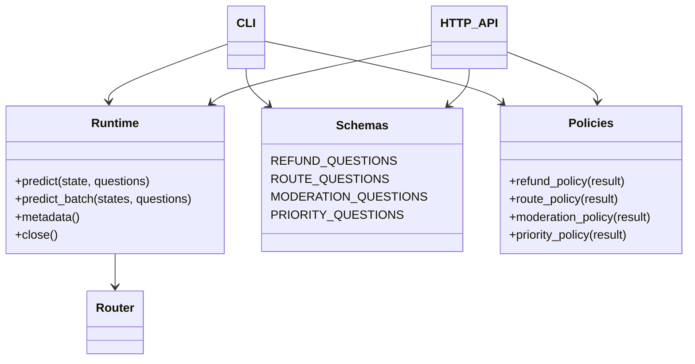
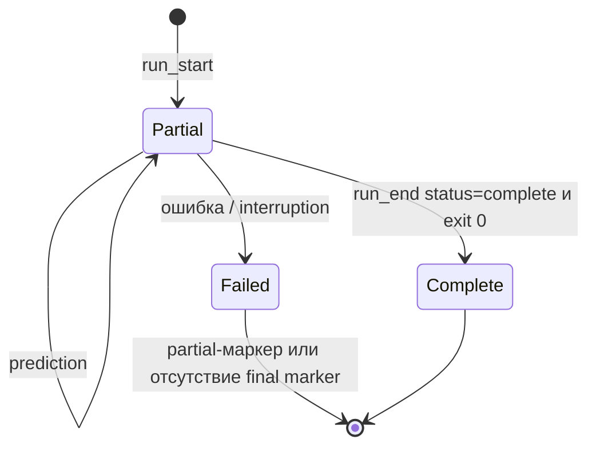
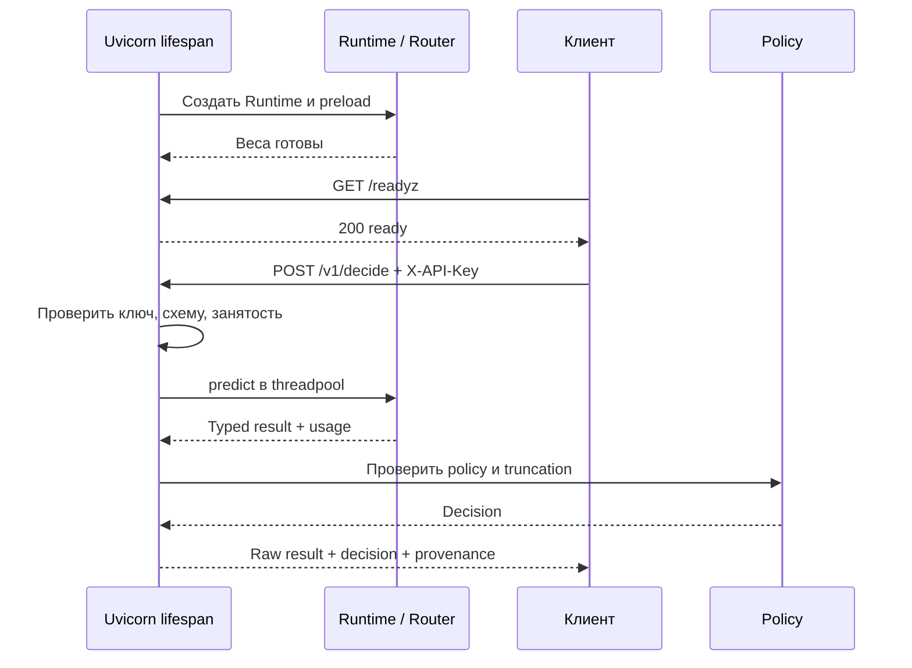

# Laya в production: шесть воспроизводимых сценариев

> Комплект для Laya **0.4.21**, официальный GitHub-срез [`0565524a27bcb9821bcd7c42aaf49d925f6f8560`](https://github.com/NandhaKishorM/laya/tree/0565524a27bcb9821bcd7c42aaf49d925f6f8560). Общая теория, архитектура, математика, все официальные примеры и дополнительные интеграции — в [01_LAYA_GUIDE.md](01_LAYA_GUIDE.md). Здесь — собственный код, его запуск, политика решений и эксплуатация.
>
> **Граница проверки:** по просьбе заказчика веса на машине подготовки не загружались и инференс не выполнялся. Ниже приведены команды для вашей машины, а не утверждение, что получены правильные предсказания. Числовые результаты, latency, VRAM и точность на ваших данных необходимо измерить самостоятельно. Учебные входы синтетические; это не benchmark и не достаточный calibration/test dataset.

## Оглавление

1. [Что входит в папку](#1-что-входит-в-папку)
2. [Окружение и воспроизводимость](#2-окружение-и-воспроизводимость)
3. [Все чекпоинты, Hub и офлайн](#3-все-чекпоинты-hub-и-офлайн)
4. [Как устроен общий код](#4-как-устроен-общий-код)
5. [Пример 01: запрос на возврат](#5-пример-01-запрос-на-возврат)
6. [Пример 02: маршрутизация обращений](#6-пример-02-маршрутизация-обращений)
7. [Пример 03: модерация](#7-пример-03-модерация)
8. [Пример 04: приоритет](#8-пример-04-приоритет)
9. [Пример 05: пакетный JSONL](#9-пример-05-пакетный-jsonl)
10. [Пример 06: HTTP API](#10-пример-06-http-api)
11. [Калибровка без выдуманного logits API](#11-калибровка-без-выдуманного-logits-api)
12. [Docker: CPU и NVIDIA GPU](#12-docker-cpu-и-nvidia-gpu)
13. [Приёмка на своей машине](#13-приёмка-на-своей-машине)
14. [Эксплуатация и границы безопасности](#14-эксплуатация-и-границы-безопасности)
15. [Проверки при подготовке и источники](#15-проверки-при-подготовке-и-источники)

## 1. Что входит в папку

```text
laya-production-guide/
├── 01_LAYA_GUIDE.md              # официальный API, теория, карта покрытия
├── 02_PRODUCTION.md              # этот документ
├── models.lock.json              # три репозитория + точные SHA весов
├── requirements.txt              # точные версии приложения и Laya
├── constraints-reference.txt     # предлагаемый стек ML для Python 3.12
├── Dockerfile                    # один образ, PyTorch index выбирается при сборке
├── compose.yaml                  # CPU-сервис, внешний доступ только через localhost
├── compose.gpu.yaml              # NVIDIA/CUDA override
├── .env.example                  # настройки без секретов
├── examples/
│   ├── 01_refund.py              # noul, bool/abstain, необязательная калибровка
│   ├── 02_route.py               # choice → очередь
│   ├── 03_moderation.py          # несколько независимых noul
│   ├── 04_priority.py            # score → ожидание и модальный уровень
│   ├── 05_batch.py               # bounded chunks, JSONL, явная полнота
│   └── 06_api.py                 # запуск HTTP API
├── production/
│   ├── runtime.py               # настройки, Router, происхождение результатов
│   ├── schemas.py               # явные критерии четырёх задач
│   ├── policies.py              # чистые функции принятия решения
│   ├── calibration.py           # бинарная post-hoc калибровка и метрики
│   └── api.py                   # FastAPI, lifespan, авторизация, backpressure
├── tools/
│   ├── download_models.py       # подготовка фиксированных локальных snapshots
│   └── calibrate.py             # collect → fit → evaluate
└── data/
    ├── tickets.jsonl            # восемь EN/RU обращений
    ├── api_request.json         # тело запроса API
    ├── calibration_fit.example.jsonl
    └── calibration_eval.example.jsonl
```

Пять CLI и HTTP-сервис используют одну реализацию загрузки и политик. В папке нет весов, официального `_common.py`, секретов и заранее выдуманных предсказаний. Дополнительные `tools/` — служебные программы, а не седьмой/восьмой production-сценарий.

## 2. Окружение и воспроизводимость

### 2.1. Базовый путь без Docker

Рекомендуемое окружение комплекта — **Python 3.12**. Laya декларирует Python ≥3.10, но наличие подходящих wheels зависит от версии Python, ОС и ускорителя. Не используйте системное окружение с чужим стеком ML.

Все команды выполнять **из корня этой папки**. Linux/macOS:

```bash
python3.12 -m venv .venv
source .venv/bin/activate
python -m pip install --upgrade pip

# CPU-путь, не требует CUDA.
python -m pip install torch==2.8.0 --index-url https://download.pytorch.org/whl/cpu
python -m pip install -r requirements.txt -c constraints-reference.txt
python -c "import importlib.metadata as m; print(m.version('laya'))"
mkdir -p outputs
```

Windows PowerShell: `py -3.12 -m venv .venv`, затем `.\.venv\Scripts\Activate.ps1`; остальные Python-команды те же. Переменные задавать через `$env:LAYA_MODEL="multilingual"`, а не через `export`.

Для NVIDIA заменить **только команду установки PyTorch**:

```bash
python -m pip install torch==2.8.0 --index-url https://download.pytorch.org/whl/cu128
python -m pip install -r requirements.txt -c constraints-reference.txt
python -c "import torch; print(torch.cuda.is_available(), torch.version.cuda)"
```

CUDA wheel требует совместимый драйвер. Доступная GPU с 96 GB не обязательна: эти модели имеют сотни миллионов, а не десятки миллиардов параметров. Точные требования по памяти зависят от контекста, batch, dtype, backend и числа резидентных чекпоинтов; цифру VRAM этот комплект не обещает. Для MPS/XPU/другого CUDA выберите поддерживаемый вашим железом PyTorch wheel по [официальной инструкции](https://pytorch.org/get-started/locally/) и осознанно адаптируйте reference constraint на torch, если он несовместим.

**Что зафиксировано:** Laya, FastAPI, Pydantic, Uvicorn, предлагаемые основные ML-зависимости, SHA всех трёх Hub snapshots. **Что не является полным lock:** `constraints-reference.txt` не фиксирует каждую транзитивную зависимость и не гарантирует одинаковые kernels на разных GPU. После успешной приёмки сохраните `python -m pip freeze` в артефакты вашего релиза; закрепите digest Docker-образа и digest базового образа. Reference использует Transformers 5.0.0 и Hugging Face Hub 1.3.0: сохранённые encoder configs этих весов указывают `transformers_version=5.0.0` и новые поля `rope_parameters`. Разрешимость dependency graph для Python 3.12 проверена; установка полного ML-стека и реальный инференс здесь не выполнялись.

### 2.2. Переменные перед импортом

`production.runtime` до импорта Laya устанавливает:

```python
os.environ.setdefault("USE_TF", "0")
os.environ.setdefault("USE_TORCH", "1")
os.environ.setdefault("TOKENIZERS_PARALLELISM", "false")
```

Это выбор доступности backend для Transformers и отключение tokenizer thread parallelism, не настройка качества модели. `setdefault` сохраняет заданное извне значение. Поэтому противоречивые `USE_TF=1`/`USE_TORCH=0` в окружении сами собой не исправятся. Для интеграции в уже работающий Python-процесс задавайте переменные **до первого транзитивного импорта** Transformers; поздняя установка не переинициализирует backend.

## 3. Все чекпоинты, Hub и офлайн

### 3.1. Выбор во всех примерах

| `--model` | Артефакт | Практическое назначение |
|---|---|---|
| `english` | `convaiinnovations/laya` | Англоязычные задачи, контекст по конфигурации 512 |
| `multilingual` | `convaiinnovations/laya-multilingual` | Русский и другие языки; default 1024, документированное расширение до 8192 |
| `typed-decisions` | `convaiinnovations/laya-typed-decisions` | Дообученные англоязычные workflows, default 1024 |
| `auto` | Один из зарегистрированных выше | Router выбирает модель по языку; это не ансамбль и не среднее трёх ответов |

У наших примеров `auto_task_detection=False`: `auto` не обещает распознать специальный typed-workflow из произвольной схемы. Для сравнения специализированного чекпоинта указывайте его явно. Качество на русском у English/typed-decisions не заявляется; одинаковый API не означает одинаковое качество.

`models.lock.json` фиксирует:

| Имя | Hub revision |
|---|---|
| english | `7b928d828b7b0e022f929d9bd2e44165aa270148` |
| multilingual | `1720e3e3357cfe1e281542e223f8273b0890ca34` |
| typed-decisions | `e929ae5cf69bc34259cd2f95c9e91145b818b1f0` |

Мы используем **standalone repos**. По умолчанию официальный Router также умеет брать подкаталоги `multilingual` и `typed-decisions` из объединённого `convaiinnovations/laya`; это другой путь адресации, его нельзя смешивать с SHA другого репозитория.

### 3.2. Общее CLI

```bash
python -m examples.01_refund --help
python -m examples.01_refund --model multilingual --device cuda \
  --text 'Списали деньги дважды. Прошу вернуть второе списание.'

python -m examples.02_route --model english --device cpu
python -m examples.04_priority --model typed-decisions --device cuda
```

Везде есть `--model`, `--device`, `--max-len`, `--head-max-len`, `--batch-size`, `--max-loaded`. По умолчанию device выбирает Laya; не указывайте `cuda`, если его нет. `--batch-size 8` задаёт число **состояний**, не вопросов, в одном forward batch. `--max-loaded 2` — резидентный лимит Router в CLI; `preload` у сервиса может его увеличить.

Длинные русские документы:

```bash
python -m examples.05_batch --model multilingual --max-len 8192 \
  --batch-size 2 --chunk-size 4 --input data/tickets.jsonl --output outputs/long-run.jsonl
```

`8192` — общий budget последовательности: инструкция, варианты, служебные токены и state конкурируют за него. Он не гарантирует 8192 токена самого документа. Наши политики отправляют усечённый документ на review. `predict_long` описан в общем руководстве: окна не равны глобальному чтению и требуют отдельной валидации.

### 3.3. Подготовка офлайн-машины

На машине с доступом к Hub, **не обязательно на целевом сервере**:

```bash
python -m tools.download_models --model all --directory models
```

Утилита скачивает только нужные веса/конфигурации/tokenizer/encoder из pinned revision каждого standalone repo, а не все вложенные модели английского bundle. Веса не загружаются в torch и не запускаются. При чужой непустой папке она отказывается смешивать snapshots. При прерванной первой загрузке без `snapshot_identity.json` используйте новую папку или отдельно проверьте и удалите именно незавершённую копию.

Перенесите `models/` вместе с установленным окружением/образом, затем задайте реальные **абсолютные** пути:

```bash
export LAYA_ENGLISH_PATH="$PWD/models/english"
export LAYA_MULTILINGUAL_PATH="$PWD/models/multilingual"
export LAYA_TYPED_DECISIONS_PATH="$PWD/models/typed-decisions"
export HF_HUB_OFFLINE=1
export TRANSFORMERS_OFFLINE=1
python -m examples.01_refund --model multilingual --device cuda
```

Не переименовывайте `laya.load` в `_common.load`: последняя — учебная обёртка официальных examples с логическими именами. В нашем коде `_common` вообще не нужен.

Локальный checkpoint включает `model.safetensors`, `rl_agent_config.json`, `encoder/`, `tokenizer/`. Два файла без tokenizer/encoder могут оказаться недостаточны для настоящего офлайна. Runtime записывает local path, hash конфигурации, размер и mtime весов. Это **не криптографическая проверка весов**; для строгой поставки отдельно сохраните SHA-256 всех файлов и проверяйте до деплоя. Содержимое локального пути не доказывается Hub revision из lock.

## 4. Как устроен общий код



`Runtime` отвечает за **вычисление**, `schemas.py` — за смысл вопросов, `policies.py` — за **допустимое действие**. CLI и API не дублируют формулировки вопросов. `metadata()` сохраняет версию Laya, source SHA, настройки, источники моделей и загруженные revisions. Модель Laya в raw поле `model` может называться обобщённо `laya-rl-agent`: реальный выбранный checkpoint ищите в `result.routing.model`.

В коде нет автоматической оплаты, удаления сообщений, вызова внешней LLM или отправки тикета в чужую систему. `route_candidate` и `block_candidate` — готовые рекомендации для вызывающего бизнес-сервиса, а не имитация исполненных операций. Подключая реальное действие, отдельно обеспечьте права, идемпотентность, аудит и rollback. Модель не должна получать эти полномочия напрямую.

### Общие инварианты политик

- Без `--validated-policy` результат **всегда `review`**. Это сознательный default, не сломанная модель.
- Флаг означает ваше утверждение о внешней проверке. Он ничего не обучает и не измеряет.
- `usage.truncated=true`, деградация option budget, отсутствующие поля, нечисловые/NaN вероятности — review. Недопустимая конфигурация порогов — ошибка.
- Используется `answer_confidence`, а не энтропийное `confidence` как универсальная шкала. Само имя `answer_confidence` не означает доказанную калибровку.
- Полные raw ответы не затираются политикой. Приложение может проверить исходные вероятности и причины review.

## 5. Пример 01: запрос на возврат

**Файл:** [`examples/01_refund.py`](examples/01_refund.py). **Primitive:** `noul`. Вопрос: просит ли человек вернуть деньги/отменить списание; не «положен ли возврат».

```bash
python -m examples.01_refund --model multilingual \
  --text 'Оплата прошла дважды. Верните повторное списание.'

# Только ПОСЛЕ внешней проверки вашей схемы, модели и порогов:
python -m examples.01_refund --model multilingual \
  --text 'Пожалуйста, пришлите счёт за март.' \
  --negative-threshold 0.2 --positive-threshold 0.8 --validated-policy
```

`false` и `true` имеют явные семантические описания в `REFUND_QUESTIONS`. Из результата берётся `answers.refund_requested.noul = P(request=true)`.

| Условие | Рекомендация при проверенной политике |
|---|---|
| p ≥ positive_threshold и confidence gate пройден | `refund_review_candidate`, `refund_requested=true` |
| p ≤ negative_threshold и confidence gate пройден | `no_refund_request`, `refund_requested=false` |
| Между порогами или gate не пройден | `review`, `refund_requested=null`, когда evidence доступно |
| Нет внешней валидации, усечение или повреждённый ответ | `review`; при раннем отказе некоторые evidence-поля отсутствуют |

Дополнительный gate в текущей учебной политике: `answer_confidence >= 0.8`. Поменяв только положительный порог, вы **не** меняете этот gate: например, p=0.6 с положительным порогом 0.55 всё равно уйдёт в review. При адаптации доменной политики настраивайте её целиком, а не одну цифру.

Минимальный bool, если отказ от решения не нужен: `flag = answer['noul'] >= threshold`. Но `False` и «данных недостаточно» — разные состояния. В production безопаснее трёхзначное `True / False / None` плюс reason. `confidence=0.8658` при p=0.1342 — уверенность отрицательной стороны, не 86% вероятность наличия просьбы.

Всегда возвращается `eligibility_assessed=false`: даже явный запрос не доказывает оплату, отсутствие прошлого возврата, право клиента или успешность денежной операции. Извлекать номера платежей/объяснение свободным текстом Laya этим вызовом не умеет.

## 6. Пример 02: маршрутизация обращений

**Файл:** [`examples/02_route.py`](examples/02_route.py). **Primitive:** `choice`; варианты `billing`, `technical`, `sales`, `other`.

```bash
python -m examples.02_route --model auto \
  --text 'The application returns an error whenever I upload a file.'
python -m examples.02_route --model multilingual \
  --text 'Хочу узнать стоимость корпоративного договора.' \
  --min-answer-confidence 0.9 --validated-policy
```

Здесь две разные маршрутизации:

1. Официальный `Router` выбирает **checkpoint** (например multilingual для русского).
2. Вопрос `department` выбирает **бизнес-очередь**.

`decision.department` — ответ классификатора, `routing.target_queue` — пригодная рекомендация очереди, если policy её допустила. `other`, ничья верхних rounded probabilities или недостаточный `answer_confidence` дают review. `dispatch_performed=false`: код никуда не отправлял тикет. `external_llm_called=false`: маршрутизация не скрывает платного API.

Вариант применения к LLM-router: заменить критерии очередей на классы сложности/домены, измерить downstream quality, затем отображать выбор на конкретную LLM в вызывающем сервисе. Нельзя считать «лёгкий» вопрос доказательством, что маленькая генеративная модель ответит правильно. Для официальных готовых интеграций LangChain/LangGraph/LlamaIndex/CrewAI/Agno см. общий документ.

## 7. Пример 03: модерация

**Файл:** [`examples/03_moderation.py`](examples/03_moderation.py). Два независимых `noul`: адресное оскорбление/угроза и мошенническая просьба о секретных credentials.

```bash
python -m examples.03_moderation --model multilingual \
  --text 'Не согласен с ценой продукта, но спасибо за подробное объяснение.'
python -m examples.03_moderation --model english \
  --text 'Send me your one-time login code so I can unlock your account.' \
  --validated-policy
```

Это **multi-label**, а не выбор одной взаимоисключающей категории: текст может одновременно содержать угрозу и credential theft. Критерии отличают авторское высказывание от цитирования жалобы. Все вопросы передаются одним вызовом; вычислительная работа растёт с числом вопросных строк.

При проверенной политике: gate `answer_confidence >= 0.9` для каждого признака; любой риск p≥0.9 → `block_candidate`; все риски p≤0.1 → `allow_candidate`; остальное review. `advisory_only=true` сохраняется всегда.

**Не security boundary:** отсутствие этих двух признаков не доказывает безопасность текста. Схема не покрывает все виды вреда, prompt injection, юридические требования и культурные контексты. Авторизации, изоляция инструментов и правила хранения данных должны работать независимо от модели. Не печатайте реальные секреты в таких примерах.

## 8. Пример 04: приоритет

**Файл:** [`examples/04_priority.py`](examples/04_priority.py). **Primitive:** `score`, четыре уровня от low до critical; критерии описывают operational impact, а не эмоциональность автора.

```bash
python -m examples.04_priority --model english \
  --text 'Production checkout is unavailable for all customers; orders cannot be placed.'
python -m examples.04_priority --model typed-decisions \
  --text 'One user cannot export a report; a manual workaround is available.' \
  --validated-policy
```

`score = Σ i·p_i`, где i=0,1,2,3. Это **ожидаемый индекс**, а не число 1–4, не оценка в процентах и не обязательно самый вероятный класс. Пример одновременно отдаёт:

- `expected_index`: возвращённое моделью математическое ожидание;
- `modal_index`, `modal_label`, `modal_probability`: argmax распределения;
- `answer_confidence`: отдельное reported поле, которое может отличаться от modal probability после calibration binning.

Нельзя выбирать класс через `round(score)`: распределение с массой на краях способно иметь среднее около середины без поддержки среднего класса. Gate политики — 0.9; ничья модальных rounded probabilities даёт review. `sla_assigned=false`: реальный SLA зависит от контракта, сегмента клиента, времени дежурства и уже открытых инцидентов, которых в тексте может не быть.

## 9. Пример 05: пакетный JSONL

**Файл:** [`examples/05_batch.py`](examples/05_batch.py). Восемь входов в [`data/tickets.jsonl`](data/tickets.jsonl). Поддерживает `--schema refund|route|moderation|priority`, default `route`.

```bash
mkdir -p outputs
python -m examples.05_batch --model multilingual \
  --input data/tickets.jsonl --output outputs/tickets-route-001.jsonl \
  --schema route --batch-size 8 --chunk-size 32

python -m examples.05_batch --model english \
  --input data/tickets.jsonl --output outputs/tickets-refund-001.jsonl \
  --schema refund --batch-size 4 --chunk-size 16
```

Второй запуск технически возможен на смешанном EN/RU файле, но это **не утверждение о пригодности English checkpoint для русского**. Для реальной приёмки разделяйте language cohorts и сравнивайте качество.

Входная строка: `{"id":"ticket-001","text":"..."}`. Сохраняется порядок и соответствие ID. Пустая строка, повторный ID, повторный JSON-ключ, неверный тип и NaN/Infinity во входном JSON считаются ошибкой.

Память не O(1): bounded chunk и максимальная строка плюс **O(N) set ID** для контроля дублей. На очень больших потоках замените глобальное множество внешней уникальностью в БД/очереди. `chunk-size` определяет число текстов, переданных приложением Router; `batch-size` — размер model forward внутри него. Разные checkpoints/schema/budgets разбиваются Router на группы. `sort_by_length=True` группирует схожие длины, сохраняя внешний порядок.

### Полнота результата



Выход **создаётся исключительно новым** (`open('x')`); существующий файл не перезаписывается. Первая запись `run_start` уже помечает run как partial. За ней идут `prediction`, в конце — `run_end`. Полноту подтверждают **одновременно** complete-маркер, ожидаемое число записей и exit code 0. При заполненном диске или kill конечного маркера может не быть — такой run неполон. При ошибке приложение по возможности пишет partial-marker и завершает работу ненулевым кодом. Для повтора выберите новое имя; автоматического resume здесь нет.

В `prediction` содержатся raw result, decision, schema, runtime/provenance. Исходный текст не копируется в выход специально, но distributions и routing тоже могут раскрывать чувствительные сведения. Ограничьте доступ к артефактам.

## 10. Пример 06: HTTP API

**Файлы:** [`examples/06_api.py`](examples/06_api.py), [`production/api.py`](production/api.py). Это настоящий FastAPI endpoint с Laya Runtime, не mock.

```bash
# Выберите собственный секрет; пример генерирует его локально.
export LAYA_API_KEY="$(python -c 'import secrets; print(secrets.token_urlsafe(32))')"
python -m examples.06_api --model multilingual --device cuda --host 127.0.0.1 --port 8000
```

`--device cpu` или отсутствие `--device` — альтернативы без NVIDIA. Ключ передаётся через окружение, не CLI и не файл исходников. Прямой `uvicorn production.api:app` читает `LAYA_MODEL`, `LAYA_DEVICE`, `LAYA_MAX_LEN`, `LAYA_HEAD_MAX_LEN`, `LAYA_BATCH_SIZE`, `LAYA_MAX_LOADED`.

Во втором терминале с тем же секретом:

```bash
curl --fail-with-body http://127.0.0.1:8000/healthz
curl --fail-with-body http://127.0.0.1:8000/readyz
curl --fail-with-body http://127.0.0.1:8000/v1/decide \
  -H "X-API-Key: $LAYA_API_KEY" -H 'Content-Type: application/json' \
  --data-binary @data/api_request.json
```

Тело запроса принимает `text`, `scenario` (`refund`, `route`, `moderation`, `priority`) и необязательный `request_id`. В API checkpoint закреплён серверной конфигурацией, а не выбирается недоверенным клиентом на каждом запросе. Лишние поля отклоняются. Текст после strip должен быть непустым и не длиннее 16000 символов: это лимит схемы **после парсинга JSON**, не сетевой body-size limit и не гарантия попадания в token budget.

### Жизненный цикл



На старте проверяется ключ (не менее 16 символов), создаётся Runtime и загружаются веса. До окончания ASGI startup сервер обычно ещё не принимает запросы. `/healthz` означает живой обработчик, `/readyz` — startup завершён и модели загружены; это **не** сертификат качества или завершённого GPU kernel warm-up.

При `LAYA_MODEL=auto` API делает preload **всех трёх** чекпоинтов; Laya увеличивает resident limit под preload. При фиксированном `multilingual` загружается только он. Для небольшой памяти используйте фиксированную модель. В CLI без preload Router ленивый, resident default — два.

Один процесс и один inference slot: вычисление идёт в threadpool, event loop не занят torch. Конкурентный inference получает `429` и `Retry-After: 1` вместо неограниченной application queue. Это простой предсказуемый режим; batching HTTP запросов здесь не реализован — для throughput есть пример 05. Ошибки инференса дают `503` без текста исключения/содержимого обращения. В логе только request_id и тип ошибки.

По умолчанию `LAYA_VALIDATED_POLICY=0`, решения review. Установить `1` допустимо только после реальной проверки соответствующих сценариев. Это **глобальный switch для четырёх политик**: валидировали только одну — не открывайте непроверенные сценарии этим переключателем; ограничьте интерфейс доменным endpoint при интеграции. API не применяет артефакт из `tools.calibrate` автоматически; дополнительная бинарная калибровка показана в CLI 01. Официальную checkpoint calibration при адаптации API загружайте отдельно и проверяйте ту же модель/схему.

`request_id` — корреляция, **не** идемпотентность/защита от повторов. Сервис выполняет только классификацию без побочных операций. При будущем подключении billing/tool actions реализуйте durable idempotency key в БД. Не запускайте много Uvicorn workers на одной GPU без измерений: каждый процесс создаёт собственные копии моделей. Static API key — минимальная аутентификация примера, не IAM/OAuth/mTLS.

## 11. Калибровка без выдуманного logits API

### 11.1. Что исправляет T

Laya уже применяет checkpoint temperature, а иногда bucket/language overrides. Публичный `noul` — уже масштабированная и округлённая вероятность. Мы **не** предполагаем существование `return_logits=True` или поля `answer['logits']`.

Для бинарного p можно вычислить:

$$z=\log\frac{\operatorname{clip}(p,\varepsilon,1-\varepsilon)}{1-\operatorname{clip}(p,\varepsilon,1-\varepsilon)},\qquad p_{app}=\sigma(z/T_{app}).$$

Это дополнительное temperature scaling в probability space, не автоматически Platt scaling: последний обычно обучает slope **и intercept**. При известной внутренней T и неокруглённых probabilities эффективная температура равна произведению внутренней и дополнительной T; здесь округление до четырёх знаков уже потеряло информацию, поэтому это приближение.

В `production/calibration.py` выбирается T из детерминированной log-grid [0.05,20], включая 1, минимизируя NLL на **calibration** split. Модель/encoder не обучаются. Вблизи границы диапазона artifact помечает предупреждение: проверьте данные, а не принимайте автоматически крайний T. T>1 смягчает probabilities, T<1 заостряет. Порядок и знак logit сохраняются, следовательно при пороге 0.5 классификационная ошибка не исправляется. При p=0/1 используется clipping 1e-6; вернуть утраченную округлением уверенность невозможно.

### 11.2. Полный воспроизводимый процесс

Учебные файлы содержат **по 12 ручных синтетических текстов**, оба класса, один вопрос; это проверка процесса, не достаточная production-валидация. Разметка соответствует «новая явная просьба вернуть деньги», поэтому вопрос о статусе ранее запрошенного возврата размечен false. Для реальной задачи сначала согласуйте это определение с бизнесом и при необходимости измените критерии и labels.

На вашей машине с установленной моделью:

```bash
mkdir -p outputs
# Оба collect должны использовать ОДИН checkpoint, schema и token budgets.
python -m tools.calibrate collect --model english \
  --input data/calibration_fit.example.jsonl --output outputs/refund-fit-probs.jsonl
python -m tools.calibrate collect --model english \
  --input data/calibration_eval.example.jsonl --output outputs/refund-eval-probs.jsonl

# Следующие две команды уже не загружают модели.
python -m tools.calibrate fit --input outputs/refund-fit-probs.jsonl \
  --output outputs/refund-temperature.json --cohort billing-en-teaching-only
python -m tools.calibrate evaluate --artifact outputs/refund-temperature.json \
  --input outputs/refund-eval-probs.jsonl --output outputs/refund-evaluation.json

python -m examples.01_refund --model english \
  --calibration outputs/refund-temperature.json \
  --text 'Please refund the duplicate charge.'
```

Для русского замените учебные тексты representative русскоязычными данными и **обе** коллекции/инференс на `--model multilingual`. Для typed-decisions — аналогично, с его собственными данными. Нельзя переносить fitted T между checkpoint revisions, формулировками, числом вариантов или языковыми доменами.

`collect` отказывается от `--model auto`, чтобы не смешивать модели, и от усечённых inputs. Записывает p, label, ID, hash текста и identity; исходный текст в prediction-файл не копируется. Все выходные файлы должны быть новыми. Collection может остаться частичной при ошибке; успех подтверждается exit 0 и status complete на stdout.

Artifact привязан к модели/источнику, Laya/source SHA, hash схемы с сохранением порядка вариантов и overrides `max_len/head_max_len`. Пример 01 проверяет это совпадение, хранит raw result отдельно от `calibrated_result` и передаёт calibrated p в policy. `identity` не доказывает отсутствие domain drift: cohort нужно контролировать организационно. Локальный path/config/size/mtime — слабее digest весов; менять содержимое весов на месте недопустимо.

**Наш artifact не совместим с `agent.load_calibration`.** Он имеет собственный `format=laya-guide.noul-temperature.v1` и применяется только нашей функцией. Официальный `laya.calibrate` умеет работать с внутренними logits и type/option-count buckets; его возможности и binning разобраны в первом документе. Не смешивайте два формата файлов.

### 11.3. Как читать отчёт и выбирать пороги

Отчёт показывает NLL, Brier, top-label ECE по 10 bins, accuracy при 0.5 и coverage/error для **иллюстративной** зоны p≤0.2 или p≥0.8. Отсутствие accepted cases даёт error=null, не нулевую ошибку. Метрики fit не служат доказательством generalization; `evaluate` проверяет совпадение identity и отсутствие пересечения ID/hash текстов с fit. Он не обнаруживает перефразированные дубли, общие разговоры и клиентов — групповые/time-based splits организуйте до выгрузки.

`validated_for_production=false` сохраняется и после evaluate: одна метрика не сертифицирует deploy. Нужны отдельные train/calibration/threshold-selection/final-test splits либо строго спроектированный nested процесс; нельзя подбирать все гиперпараметры на final test. Проверьте precision/recall положительного и отрицательного решений, долю review, ошибки по языкам/клиентским группам, доверительные интервалы и цену ошибок. 100–200 примеров не являются универсальной гарантией, особенно для редких опасных событий.

При calibrated p и только двух действиях теоретический cost-optimal threshold равен $C_{FP}/(C_{FP}+C_{FN})$ при соответствующих предпосылках и нулевой цене правильного решения. При ручной проверке добавляется стоимость review, появляются два порога. В примере 01 gate 0.8 тоже часть policy и должен быть проверен. Уменьшение ECE не гарантирует улучшения precision при конкретном gate.

## 12. Docker: CPU и NVIDIA GPU

### 12.1. CPU Compose

```bash
export LAYA_API_KEY="$(python -c 'import secrets; print(secrets.token_urlsafe(32))')"
export LAYA_MODEL=multilingual
# .env.example можно скопировать в .env для настроек; не коммитьте реальные секреты.
docker compose up --build
```

По умолчанию PyTorch CPU, device=cpu, один worker, non-root UID 10001, Hub cache в named volume, порт опубликован только на 127.0.0.1. Веса скачиваются на первом старте из pinned revisions, **не** встраиваются автоматически в образ. Docker healthcheck смотрит `/readyz`; start-period 300s — настройка, а не гарантия завершения медленной загрузки за пять минут.

### 12.2. NVIDIA Compose

Требуются совместимый драйвер, Docker Compose с поддержкой `gpus: all` и NVIDIA Container Toolkit. Обычно нужна Compose ≥2.30; проверьте вашу версию.

```bash
export LAYA_API_KEY="$(python -c 'import secrets; print(secrets.token_urlsafe(32))')"
docker compose -f compose.yaml -f compose.gpu.yaml up --build
```

Override выбирает cu128 wheel и `LAYA_DEVICE=cuda`. Он не превращает CPU torch в GPU без пересборки. Для другой CUDA-ветки отредактируйте build arg осознанно и повторите проверку совместимости. GPU image/driver/инференс здесь не проверялись.

### 12.3. Обычные скрипты в том же образе

```bash
docker build -t laya-guide:cpu .
docker run --rm --entrypoint python laya-guide:cpu \
  -m examples.01_refund --model multilingual --device cpu \
  --text 'Верните повторную оплату.'

# Для batch выход должен быть доступен UID 10001; не делайте весь проект world-writable.
mkdir -p outputs
# При необходимости назначьте outputs владельца UID 10001 по правилам вашей системы.
docker run --rm --entrypoint python \
  -v "$PWD/outputs:/app/outputs" laya-guide:cpu \
  -m examples.05_batch --model multilingual --device cpu \
  --output outputs/container-run-001.jsonl
```

Офлайн API после скачивания snapshots и подготовки образа:

```bash
docker run --rm -p 127.0.0.1:8000:8000 \
  -e LAYA_API_KEY -e LAYA_MODEL=multilingual -e LAYA_DEVICE=cpu \
  -e HF_HUB_OFFLINE=1 -e TRANSFORMERS_OFFLINE=1 \
  -e LAYA_MULTILINGUAL_PATH=/models/multilingual \
  -v "$PWD/models:/models:ro" laya-guide:cpu
```

Для `LAYA_MODEL=auto` передайте **все три** local path env; иначе preload попробует открыть отсутствующие cache snapshots и честно завершит startup ошибкой. Для GPU варианта соберите образ с `--build-arg TORCH_INDEX_URL=https://download.pytorch.org/whl/cu128`, добавьте `--gpus all` и device=cuda.

## 13. Приёмка на своей машине

### 13.1. Проверка API/формата, не качества

1. Запустите `--help` всех шести примеров: импорты ML/скачивание весов при этом не нужны.
2. Выполните 01–04 на EN; на RU используйте multilingual. Убедитесь, что raw `answers` имеют нужные типы и `usage.output_tokens=0`.
3. Проверьте `result.routing.model` и provenance: ожидать именно запрошенную модель. Без validated-policy ожидать review независимо от «красивого» p.
4. Сохраните batch в новый файл, проверьте ID, порядок и final complete. Повторный запуск с тем же output обязан отказаться от перезаписи.
5. Передайте длинный текст сверх budget: raw usage должен отражать truncation, policy — review. Не имитируйте проверку через количество символов.
6. Проверьте API с неверным ключом (401), лишним полем/пустым text (422), параллельным inference (429 при занятом слоте), недоступными весами на старте (startup failure). Воспроизведение 429 зависит от реального overlap запросов.
7. С выключенной сетью и полными локальными snapshots повторите нужные пути. Cache hit при включённой сети не доказывает офлайн-работу.

### 13.2. Сравнение трёх чекпоинтов

```bash
python -m examples.01_refund --model english --text 'Please refund the duplicate charge.'
python -m examples.01_refund --model multilingual --text 'Please refund the duplicate charge.'
python -m examples.01_refund --model typed-decisions --text 'Please refund the duplicate charge.'
```

Это проверка загрузки и контракта, не benchmark. Для принятия решения измерьте один и тот же размеченный test split на каждом подходящем checkpoint; сохраните схемы, revisions, настройки контекста, dtype/backend/device и ошибки. Не выбирайте модель по одному письму.

### 13.3. Производительность

Разделяйте download, construction/load, первый forward/warm-up и steady-state. Перед измерением GPU latency синхронизируйте устройство. Считайте p50/p95/p99, throughput, peak memory, долю truncation, долю review, ошибки/OOM и reload/LRU churn. Сравнивайте одинаковые state lengths, questions per state, option counts и batch sizes. Заявленные авторами «33 ms» нельзя переносить на другой GPU/CPU/8192-token input без измерения.

## 14. Эксплуатация и границы безопасности

| Риск | Что уже есть | Что требует интеграции в вашу систему |
|---|---|---|
| Неверное уверенное решение | review-first, gates, raw evidence | Собственная разметка, калибровка, evaluation, мониторинг drift |
| Длинный/враждебный ввод | ограничение text в API, truncation review | Reverse proxy request-size limit, timeouts/rate limits, отдельные quotas |
| GPU перегружена | один inference slot, 429 | Capacity planning, очереди, replicas, контроль GPU/CPU fallback |
| Дубли внешних действий | побочных действий нет | Durable idempotency и транзакции при подключении инструментов |
| Утечка входов | API не логирует text/exception message | TLS, secret management, redaction, доступ к logs/outputs/backups |
| Prompt injection | advisory moderation, нет исполнения инструкций | Tool allowlist, least privilege, sandboxing, жёсткая авторизация |
| Несовместимое обновление | version/revision pins, metadata | Проверка supply chain, полные locks/digests, canary/rollback |
| Ошибка batch | partial/complete protocol, exclusive output | Durable job accounting, backpressure/partitioning, retry strategy вашего scheduler |

Не маскируйте ошибку отсутствующих весов фиктивным p=0, не отправляйте текст автоматически внешней LLM при неудаче и не приравнивайте низкий confidence к отсутствию риска. Laya сама имеет некоторые fallback-механизмы; наблюдайте warnings/CPU fallback count, иначе «всё работает» может скрывать провал latency SLO. В примерах нет автоматических retries: повтор должен учитывать природу ошибки и политику вашего вызывающего сервиса.

## 15. Проверки при подготовке и источники

Протокол приведён в поле `verification` файла [delivery_manifest.json](delivery_manifest.json). На Python **3.12.16** прошли 18 model-free unit tests (политики, границы вероятностей, усечение, mode/mean, разбиение JSONL, калибровка и leakage); синтаксическая компиляция; `--help` шести сценариев и двух утилит без импорта ML; реальные команды `calibrate fit/evaluate` на временных **математических fixtures**, не предсказаниях Laya; HTTP pre-inference contract через TestClient без lifespan/моделей; YAML parsing Compose. Настоящий опубликованный Laya Router 0.4.21 проверен в offline route-only режиме для трёх selectors и русского текста: загруженных моделей — ноль, torch/Transformers не импортировались. Проверены локальные ссылки/heading anchors и существование pinned upstream paths, а также присутствие всех 41 нумерованных примеров в карте покрытия. Dependency graph reference-стека разрешён для Python 3.12; ключевые API сверены с опубликованным wheel.

Повторить model-free тесты можно стандартной библиотекой Python:

```bash
python -m unittest discover -s tests -v
```

Полный model inference, GPU, startup с весами, конкуренция реального GPU-инференса, Docker build/run, офлайн-загрузка самих checkpoints и production-quality evaluation **не выполнялись**. HTTP-проверка не заменяет deployment: она упражняла ответы до инференса (200 health, 503 not-ready, 401 key, 422 invalid input), не успешное модельное предсказание. Попытка установки старого Pydantic 2.11.7 под системный Python 3.14 показала несовместимость его pydantic-core/PyO3; затем проверки проведены на заявленном Python 3.12. Не игнорируйте эту границу и не считайте Python 3.14 проверенным окружением комплекта.

Официальные источники (зафиксированный GitHub-срез):

- [`examples/README.md`](https://github.com/NandhaKishorM/laya/blob/0565524a27bcb9821bcd7c42aaf49d925f6f8560/examples/README.md) — исходная учебная траектория;
- [`laya/agent.py`](https://github.com/NandhaKishorM/laya/blob/0565524a27bcb9821bcd7c42aaf49d925f6f8560/laya/agent.py) — фактический decode, usage, batch;
- [`laya/common.py`](https://github.com/NandhaKishorM/laya/blob/0565524a27bcb9821bcd7c42aaf49d925f6f8560/laya/common.py) — сериализация/варианты/последовательность;
- [`laya/router.py`](https://github.com/NandhaKishorM/laya/blob/0565524a27bcb9821bcd7c42aaf49d925f6f8560/laya/router.py) — model selection, pins, grouping, LRU;
- [`docs/questions-and-answers.md`](https://github.com/NandhaKishorM/laya/blob/0565524a27bcb9821bcd7c42aaf49d925f6f8560/docs/questions-and-answers.md) — типы и ограничения уверенности;
- [`docs/finetune.md`](https://github.com/NandhaKishorM/laya/blob/0565524a27bcb9821bcd7c42aaf49d925f6f8560/docs/finetune.md), [`laya/calibrate.py`](https://github.com/NandhaKishorM/laya/blob/0565524a27bcb9821bcd7c42aaf49d925f6f8560/laya/calibrate.py) — официальное обучение и калибровка;
- [`docs/docker.md`](https://github.com/NandhaKishorM/laya/blob/0565524a27bcb9821bcd7c42aaf49d925f6f8560/docs/docker.md), [`docs/http-api.md`](https://github.com/NandhaKishorM/laya/blob/0565524a27bcb9821bcd7c42aaf49d925f6f8560/docs/http-api.md) — официальный сервер, отличающийся от нашего application-specific API;
- [исходный DeepSeek-чат](https://chat.deepseek.com/share/9zkj4jbteyxicng47f) — постановка вопросов, **не** нормативный источник API/формул.

Условия модели/кода проверяйте у соответствующего pinned upstream artifact; официальный проект указывает Apache-2.0. Примеры этого комплекта — собственная прикладная обвязка над публичным API, не заявление авторов Laya о production-готовности вашей задачи.
